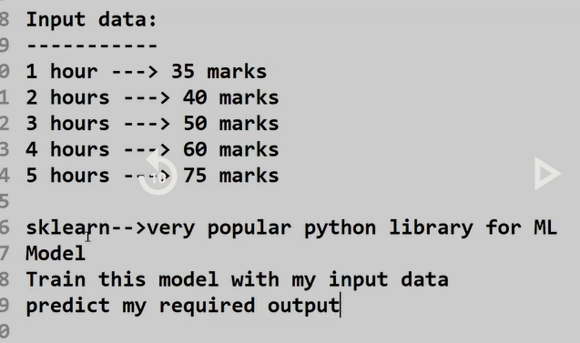
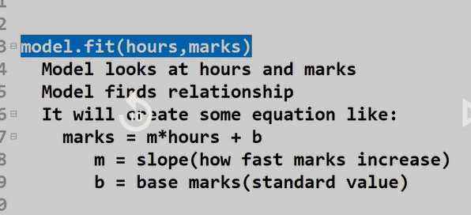
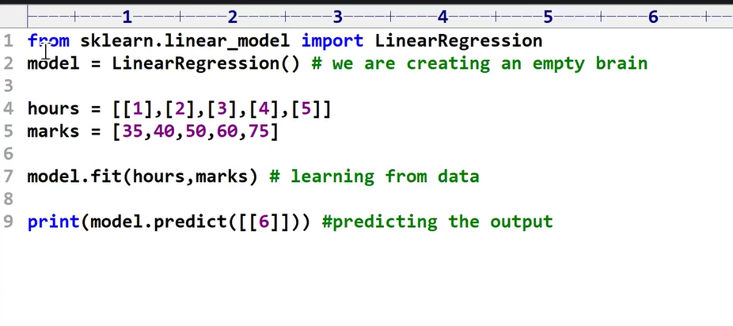

# Linear Regression with sklearn — Study Hours → Marks (Durga Sir class notes)

> Idi **ML lo modati, simple model**. Data ichhi, model ki **pattern (relationship)** nerpinchi,
> kotha input ki **output predict** cheyyadam — ade Machine Learning core idea.
> Transformer lo chusina "training" kuda idhe idea — just chala peddha scale lo.

---

## Architecture Diagram

```text
[Input data: hours → marks]
        ↓
[LinearRegression()]   → khaali brain (empty model)
        ↓
[model.fit(hours, marks)]  → data nundi nerchukuntundi → marks = m*hours + b
        ↓
[model.predict([[6]])]     → kotha input ki output
        ↓
[Predicted marks: 82]
```

### Deep Architecture Notes

**Step 1 — Data:** Manaki telisina examples — enni hours chadivithe enni marks vachayi.

**Step 2 — Model create:** `LinearRegression()` — inka emi nerchukoledu, **empty brain**.

**Step 3 — Train (`fit`):** Model data chusi **hours ki marks ki madhya relationship** kanukkuntundi — oka **straight line equation**.

**Step 4 — Predict:** Aa equation lo kotha hours pedithe marks vastayi.

---

## 1. Input Data (class example)



```text
1 hour  ---> 35 marks
2 hours ---> 40 marks
3 hours ---> 50 marks
4 hours ---> 60 marks
5 hours ---> 75 marks
```

> **sklearn** → very popular Python library for ML.
> **Model** → Train this model with my input data → predict my required output.

| Word | Simple meaning |
|---|---|
| **sklearn (scikit-learn)** | Python lo ML models ready-made ga ichhe library — maths manam rayakkarledu |
| **Model** | Data nundi pattern nerchukune "brain" |
| **Input (X / feature)** | Manam ichhedi — ikkada **hours** |
| **Output (y / label / target)** | Predict cheyyalsindi — ikkada **marks** |
| **Train** | Model ki data chupinchi pattern nerpinchadam |
| **Predict** | Nerchukunna pattern tho kotha input ki answer cheppadam |
| **Linear Regression** | Data ki **best straight line** fit chese model — number (marks) predict cheyyadaniki |

Question: **6 hours chadivithe enni marks vastayi?** — data lo ledu. Model ni nerpinchi predict cheyyali.

---

## 2. `model.fit(hours, marks)` — em jarugutundi?



> Model looks at hours and marks.
> Model finds relationship.
> It will create some equation like:
> **marks = m × hours + b**
> - **m = slope** (how fast marks increase)
> - **b = base marks** (standard value)

| Part | Meaning | Simple ga |
|---|---|---|
| **m (slope)** | Okka extra hour chadivithe **entha marks perugutayi** | Line entha **steep** ga undi |
| **b (intercept / base)** | Hours = 0 aithe vache marks | Line **ekkada start** avutundi |

### Model m, b ni ela kanukkuntundi? (Least Squares)

Model **chala lines try chesinattu** — prathi line ki **error** (actual marks − line cheppina marks) chusi,
**total error (squares) athi takkuva** unna line ni select chestundi. Deenni **least squares** antaru.

Mana data tho calculate cheddam:

```text
hours (x):  1    2    3    4    5     → average x̄ = 3
marks (y):  35   40   50   60   75    → average ȳ = 52

x − x̄:      -2   -1    0    1    2
y − ȳ:     -17  -12   -2    8   23

(x−x̄)(y−ȳ):  34   12    0    8   46   → sum = 100
(x−x̄)²:       4    1    0    1    4   → sum = 10

m = 100 / 10        = 10
b = ȳ − m × x̄ = 52 − 10 × 3 = 22
```

**Model nerchukunna equation:**

```text
marks = 10 × hours + 22
```

- **m = 10** → prathi extra hour ki **~10 marks** perugutayi.
- **b = 22** → 0 hours aithe **~22 marks** (base value).

### Line data ki entha baga fit ayyindi?

| Hours | Actual marks | Line cheppindi (10×h + 22) | Error |
|---|---|---|---|
| 1 | 35 | 32 | +3 |
| 2 | 40 | 42 | −2 |
| 3 | 50 | 52 | −2 |
| 4 | 60 | 62 | −2 |
| 5 | 75 | 72 | +3 |

Errors chinnaga unnayi — line data ki **chala daggaraga** undi (R² ≈ 0.97 — 1.0 ante perfect fit).
Points **exact ga** line meeda levu — real data lo eppudu konchem noise untundi. Model **best possible** straight line istundi.

---

## 3. Full code (class example)



```python
# ---------------- Architecture Diagram ----------------
# [hours, marks data]
#    ↓
# [LinearRegression()]  → empty brain
#    ↓
# [model.fit()]         → m, b nerchukuntundi (marks = m*hours + b)
#    ↓
# [model.predict()]     → 6 hours ki marks
#
# ---------------- Deep Architecture Notes ----------------
# Step 1: sklearn nundi LinearRegression class import chestam
# Step 2: khaali model object create — inka emi nerchukoledu
# Step 3: hours (2D list), marks (1D list) data ready chestam
# Step 4: fit() — data nundi best line (m, b) kanukkuntundi
# Step 5: predict() — kotha hours ki marks guess chestundi

from sklearn.linear_model import LinearRegression   # sklearn nundi Linear Regression model class import

model = LinearRegression()                          # khaali brain create — inka emi nerchukoledu

hours = [[1], [2], [3], [4], [5]]                   # input (X) — prathi row oka example, 2D list kavali
marks = [35, 40, 50, 60, 75]                        # output (y) — prathi example ki marks, 1D list

model.fit(hours, marks)                             # learning from data — best m, b kanukkuntundi

print(model.predict([[6]]))                         # 6 hours ki marks predict — output: [82.]
print(model.coef_)                                  # m (slope) chupistundi — output: [10.]
print(model.intercept_)                             # b (base marks) chupistundi — output: 22.0
```

**Output:**

```text
[82.]
[10.]
22.0
```

(Computer decimal calculations valla `82.00000000000001` / `21.999999999999996` laaga konchem tedaga print avvochu — artham same: 82, 10, 22.)

`predict([[6]])` → `10 × 6 + 22 = 82` → **6 hours chadivithe ~82 marks** ✅
(Class code lo first `print` matrame undi — `coef_`, `intercept_` lines m, b chudadaniki extra ga add chesam.)

### Line by line

| Line | Em chestundi |
|---|---|
| `from sklearn.linear_model import LinearRegression` | sklearn library nundi Linear Regression model ni theeskuntam |
| `model = LinearRegression()` | **Empty brain** — m, b inka teliyavu |
| `hours = [[1],[2],[3],[4],[5]]` | Input data — **double brackets** enduku? kinda chudandi |
| `marks = [35,40,50,60,75]` | Output data — prathi hour ki marks |
| `model.fit(hours, marks)` | **Learning from data** — m = 10, b = 22 kanukkundi |
| `model.predict([[6]])` | **Predicting the output** — 6 hours → 82 marks |

### Doubt: `hours` ki double brackets `[[1],[2],...]` enduku? `marks` ki single?

sklearn lo **input (X) eppudu 2D** (table laaga) undali — **rows = examples, columns = features**.

```text
hours = [[1], [2], [3], [4], [5]]        marks = [35, 40, 50, 60, 75]

        feature: hours                    target
row 1:  [ 1 ]                    →        35
row 2:  [ 2 ]                    →        40
...
```

- Ikkada okka feature (hours) matrame — kabatti prathi row lo okka number `[1]`.
- Rendu features unte (ex: hours + sleep) — `[[1, 8], [2, 7], ...]` — prathi row lo 2 numbers.
- **Output (y)** prathi example ki okka number matrame — kabatti **1D** list chalu.
- Andhuke `predict([[6]])` lo kuda double brackets — **okka row, okka feature**.

---

## 4. Idi Transformer ki ela connect avutundi?

| | Linear Regression (ee example) | Transformer / GPT |
|---|---|---|
| Nerchukune numbers (weights) | **2** (m, b) | **Billions** |
| Input | Hours (okka number) | Tokens (text) |
| Output | Marks (okka number) | Next token probabilities |
| Training | `fit()` — least squares tho direct formula | Gradient descent — weeks/months, GPUs/TPUs |
| Prediction | `predict()` | Next token generate (red loop) |

**Same core idea:** data chupinchu → model numbers (weights) adjust chesukuntundi → kotha input ki predict.
Transformer lo **Linear layer** kuda lopala ide pani — `output = W × input + b` (chala peddha matrix version).

---

## 5. Gurthu Pettukovalsina Points

1. **Linear Regression** = data ki best **straight line** fit chesi, **number** predict cheyyadam.
2. Equation: **marks = m × hours + b** — m = slope (entha fast perugutundi), b = base value.
3. Mana data ki model nerchukundi: **m = 10, b = 22** → 6 hours → **82 marks**.
4. `fit()` = **learning**, `predict()` = **using** — ee rendu steps prathi sklearn model lo same.
5. Input X **2D** (`[[1],[2]]`), output y **1D** (`[35, 40]`).
6. Model **data range bayata** guess chesthe jagratha — 20 hours → 222 marks? (100 max kada!) — straight line ki limit teliyadu. Deenni **extrapolation problem** antaru.

## 6. Summary

Oke line lo: **Linear Regression — data lo hours ki marks ki madhya unna straight-line relationship (m, b) nerchukoni,
kotha hours ki marks predict chestundi.** Mana example lo `marks = 10 × hours + 22`, so 6 hours → **82 marks**.
