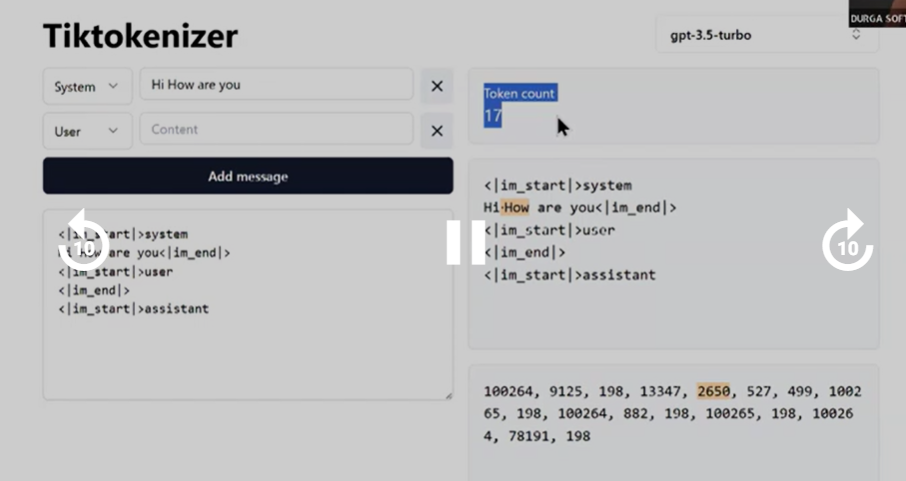
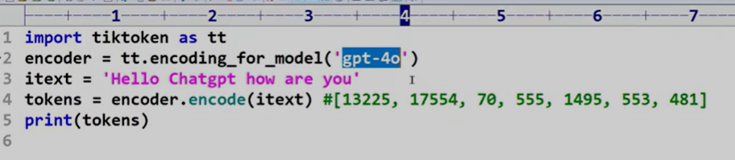

# Transformer — Next Token Prediction (Zero nundi, Durga Sir class notes)

> Idi **beginner file**. Enduku ante — "transformer" ane word vinagane chala mandi ki bhayam.
> Kaani nijam ga adi chese pani **oke okkati**: *next token enti?* ani guess cheyyadam.
> (Word kaadu — **token**. Rendiki difference undi, Section 1.1 lo chuddam.)
> Ee file lo aa oke pani ni, board meeda unna diagram tho, step by step vippudham.

---


Pai image lo Durga Sir board meeda geesindi **idi**:
left side lo **input tokens** peruguthunna list, madhyalo oka box — **transformer**,
right side lo **predict next token**. Prathi line input ki oka output **token** vachindi.
Ee file motham aa oke picture ni explain chestundi.

---

## Architecture Diagram

```text
[User text: "Hi"]
   |
   v
[Tokenizer]            <- text ni chinna mukkalu (tokens) ga cut chestundi
   |
   v
[Embedding layer]      <- prathi token ni numbers list (vector) ga marchutundi
   |
   v
[Positional encoding]  <- ee token entho position lo undo aa info add chestundi
   |
   v
[TRANSFORMER BLOCKS]   <- self-attention + feed-forward, ivi N saarlu repeat
   |
   v
[Output layer + Softmax]  <- vocabulary lo prathi token ki oka probability
   |
   v
["How"]  <- highest probability token select avutundi
   |
   +--> idi malli input chivara ki add avutundi: "Hi How"
         |
         v
   (loop malli modati nunchi, <END> vache varaku)
```

### Deep Architecture Notes

**Step 1 — Tokenizer:** Meeru type chesina text computer ki ardham kaadu. Mundu
daanini **tokens** ga cut cheyyali. Token ante oka word kaavachu, oka word lo
mukka kaavachu.

**Step 2 — Embedding:** Prathi token ki oka **numbers list** assign avutundi.
Enduku ante — model ki maths matrame telusu, letters teliyavu.

**Step 3 — Positional encoding:** "Nenu ninnu pilichanu" and "Ninnu nenu pilichanu" —
same words, kaani meaning different. Andhuke **order** kuda model ki cheppali.

**Step 4 — Transformer blocks:** Idi asalu brain. Ikkada **self-attention** jarugutundi —
prathi word, migatha anni words ni chusi "naaku evaru important?" ani decide chestundi.

**Step 5 — Softmax:** Chivarlo model vocabulary lo unna **prathi okkati** ki oka
probability istundi. Ex: "How" ki 0.62, "are" ki 0.11, "banana" ki 0.0001.

**Step 6 — Loop:** Vachina token ni input chivara ki tagilinchi, **malli Step 1 nundi**
start. Idi **autoregressive** generation. Deeni valle ne ChatGPT lo answer
**token-by-token** type ayinattu kanipistundi (word-by-word kaadu — kinda Section 1.1 chudandi).

---

## 1. Token ante enti? (Modati nunchi)

Model ki "Hi" ane word teliyadu. Daaniki numbers matrame telusu.
Andhuke mundu text ni **tokens** ga break chestaru.

```text
"Hi How can I Help you"
        |
        v  tokenizer
["Hi"] ["How"] ["can"] ["I"] ["Help"] ["you"]
        |
        v  prathi token ki oka ID
[1234]  [567]  [890]  [40]  [4321]   [345]
```

Token eppudu full word kaadu — kondaru saarlu mukkalu avutundi:

| Text | Tokens ela split avutayo |
|---|---|
| `Hi` | `["Hi"]` — oke token |
| `Hyderabad` | `["Hyder", "abad"]` — rendu mukkalu |
| `unbelievable` | `["un", "believ", "able"]` — moodu mukkalu |

**Rough rule:** English lo **1 token ≈ 0.75 word**. Ante 100 words ≈ 130 tokens.
Idi gurthu pettukondi — API bill ee tokens meeda ne calculate avutundi.

### 1.1 Token vs Word — idi chala important

> **Model oka token at a time generate chestundi. Oka word at a time KAADU.**

Chala mandi "LLM word by word rastundi" antaru — **adi thappu**. Nijam ga
generate ayyedi **token**, and oka token ante oka full word kaakapovachu.

```text
Model "unbelievable" ani rayali anukondi:

  Word-by-word aithe:     1 step   -->  "unbelievable"

  Token-by-token reality: step 1   -->  "un"
                          step 2   -->  "believ"
                          step 3   -->  "able"
```

Ante **3 separate runs**, 3 forward passes, 3 softmax picks. Screen meeda meeru
`un` chustaru, tarvata `believ`, tarvata `able` — chala fast ga jarugutundi
kabatti oka word la kanipistundi, antey.

**Enduku ee difference matter avutundi:**

| Point | Explanation |
|---|---|
| **Speed** | "tokens per second" ani cheptaru, words per second kaadu. Telugu / Hindi text lo oke word ki 4-5 tokens padatayi — andhuke avi slow ga generate avutayi |
| **Cost** | Billing tokens meeda jarugutundi. `Hyderabad` oka word, kaani 2 tokens — rendintiki charge avutundi |
| **Spaces** | Space kuda token lo part. `" help"` (mundu space tho) and `"help"` — ivi **rendu veru tokens**, veru IDs |
| **Strawberry problem** | `strawberry` lo enni `r` unnayo LLM thappu cheptundi. Endukante adi letters chudaledu — `["str", "aw", "berry"]` ane 3 chunks matrame chusindi |

Common ga chepthe: **frequent English words** (the, is, help, you) usually oke
token. **Rare words, names, numbers, Telugu/Hindi text, code symbols** — avi
chinna mukkalu ga split avutayi.

```text
"Hi How can I help you"   ->  6 tokens    (prathi word oke token — lucky case)
"Hyderabad lo unnanu"     ->  5-6 tokens  (Hyder|abad|lo|unn|anu)
```

> **Board gurinchi oka note:** Durga Sir board meeda `Hi`, `How`, `can`, `I`,
> `Help`, `you` — ivi anni **oke token** words. Andhuke aa example lo token
> and word same ga kanipistayi. Teaching ki adi manchi choice, kaani nijam lo
> eppudu ala undadu. Gurthu pettukondi: **unit = token, word kaadu.**

### 1.2 Tiktokenizer demo — ChatGPT ki nijamga em velthundi? (Class demo)


Class lo Durga Sir **Tiktokenizer** website (`tiktokenizer.vercel.app`) lo
chupincharu — mana message ChatGPT ki velle mundu **tokens** ga ela marutundo.

#### Mundu konni technical words — simple meanings

| Term | Simple meaning |
|---|---|
| **Tiktokenizer** | Free website — text type chesthe, adi enni tokens, ye token IDs ga marutundo chupistundi |
| **tiktoken** | OpenAI tayaru chesina **tokenizer** library. Tiktokenizer website deenine use chestundi |
| **Tokenizer** | Text ni tokens ga kosi, prathi token ki number (ID) ichhe tool |
| **gpt-4o** | OpenAI model peru. Prathi model ki **sontha tokenizer** untundi — andhuke top-right lo model select chestaru |
| **Token ID** | Prathi token ki vocabulary lo unna fixed number (e.g. `Hi` → `12194`) |
| **Token count** | Motham enni tokens ayyayo — API billing, context window limit ivi ee count meeda depend avutayi |
| **Role** | Message evaru pampincharu ani label — `System`, `User`, `Assistant` |
| **Special tokens** | Normal words kaadu — message **start, end, separator** chupinche hidden marker tokens (`<|im_start|>` laantivi) |

#### Demo lo em type chesaru?

```text
System  →  "Hi How are you"
User    →  (empty — emi type cheyyaledu)
```

Kani **Token count = 15** vachindi! "Hi How are you" lo 4 words e unnayi kada —
migatha 11 tokens ekkada nundi vachayi? 🤔 Ade ee demo lo asalu lesson.

#### Model ki nijamga velle text (chat format)

Manam chat box lo type chese message **direct ga** model ki velladu. Mundu
**special tokens** tho wrap chesi, oka format lo pampistaru:

```text
<|im_start|>system<|im_sep|>Hi How are you<|im_end|>
<|im_start|>user<|im_sep|><|im_end|>
<|im_start|>assistant<|im_sep|>
```

| Special token | Full form | Simple meaning |
|---|---|---|
| `<|im_start|>` | **I**nput **M**essage start | "Kotha message start avutundi" |
| `<|im_sep|>` | **I**nput **M**essage **sep**arator | "Role peru ayipoyindi, ikkada nundi content" |
| `<|im_end|>` | **I**nput **M**essage end | "Ee message ayipoyindi" |

> `im` ante sadharanam ga **"input message"** ani explain chestaru — idi OpenAI
> chat format (ChatML ani antaru — **Chat** **M**arkup **L**anguage).

#### Prathi token — ID tho (15 tokens)

| # | Token | Token ID | Type |
|---|---|---|---|
| 1 | `<|im_start|>` | 200264 | Special — message start |
| 2 | `system` | 17360 | Role name |
| 3 | `<|im_sep|>` | 200266 | Special — separator |
| 4 | `Hi` | 12194 | Content word |
| 5 | ` How` | 3253 | Content word (mundu space tho) |
| 6 | ` are` | 553 | Content word |
| 7 | ` you` | 481 | Content word |
| 8 | `<|im_end|>` | 200265 | Special — message end |
| 9 | `<|im_start|>` | 200264 | Special — message start |
| 10 | `user` | 1428 | Role name |
| 11 | `<|im_sep|>` | 200266 | Special — separator |
| 12 | `<|im_end|>` | 200265 | Special — end (user message empty) |
| 13 | `<|im_start|>` | 200264 | Special — message start |
| 14 | `assistant` | 173781 | Role name |
| 15 | `<|im_sep|>` | 200266 | Special — separator |

**Lekka (count):**

```text
Content words (Hi, How, are, you)   →  4 tokens
Role names (system, user, assistant) →  3 tokens
Special tokens (im_start/sep/end)    →  8 tokens
                                      -----------
Motham                               → 15 tokens ✅
```

#### Ee demo nundi nerchukovalsina points

1. **Same token ki eppudu same ID.** `<|im_start|>` moodu saarlu vachindi — moodu
   saarlu `200264` e. Tokenizer oka fixed dictionary laantidi.
2. **Space kuda token lo bhaagam.** `" How"` (mundu space tho) okka token. Andhuke
   `How` and `" How"` ki IDs veru avvachu.
3. **Special token IDs chala pedda numbers** (200264+). Endukante avi vocabulary
   **chivara** add chesina extra tokens — normal words kaadu.
4. **Hidden tokens kuda count avutayi.** Meeru 4 words type chesina, model ki 15
   tokens velthayi. API lo **billing** and **context window** — rendu ee motham
   count meeda e.
5. **Chivara `assistant<|im_sep|>` enduku?** Idi model ki signal — *"ippudu nee
   turn, assistant ga answer rayi"*. Model ikkada nundi **next token prediction**
   start chestundi (section 2, 4.3 lo chusina loop). Answer ayipogane adi
   `<|im_end|>` token generate chesi aagipotundi.

```text
Model chustundi:  ...<|im_start|>assistant<|im_sep|>
Model predict:    "I'm" → " fine" → "," → " thank" → " you" → <|im_end|>  (STOP)
```

> **Oka line lo:** Mana chat message model ki velle mundu roles + special tokens
> tho wrap avutundi, tarvata prathi piece ki oka number (token ID) vastundi —
> model ki kanipinchedi ee numbers matrame.

### 1.3 Model maarithe token count kuda maarutundi (gpt-4o vs gpt-3.5-turbo)



Same message — `System: "Hi How are you"`, `User: (empty)` — kaani top-right lo
model ni **gpt-4o** nundi **gpt-3.5-turbo** ki marchithe:

```text
gpt-4o         →  Token count = 15
gpt-3.5-turbo  →  Token count = 17   ← same text, different count!
```

**Enduku?** Endukante prathi model ki **sontha tokenizer** untundi — sontha
dictionary (vocabulary), sontha rules.

#### Konni technical words — simple meanings

| Term | Simple meaning |
|---|---|
| **Vocabulary** | Tokenizer ki telisina anni tokens list — prathi token ki oka ID. Oka dictionary laantidi |
| **Vocabulary size** | Aa dictionary lo enni tokens unnayi |
| **cl100k_base** | gpt-3.5-turbo / gpt-4 use chese tokenizer peru — **~1,00,000** tokens vocabulary |
| **o200k_base** | gpt-4o use chese kotha tokenizer — **~2,00,000** tokens vocabulary |
| **`\n` (newline)** | "Next line ki vellu" ane character (Enter key nokkinattu). Idi kuda oka token — ID `198` |

#### gpt-3.5-turbo lo prathi token (17 tokens)

| # | Token | Token ID | Type |
|---|---|---|---|
| 1 | `<|im_start|>` | 100264 | Special — message start |
| 2 | `system` | 9125 | Role name |
| 3 | `\n` | 198 | Newline (separator ga) |
| 4 | `Hi` | 13347 | Content word |
| 5 | ` How` | 2650 | Content word |
| 6 | ` are` | 527 | Content word |
| 7 | ` you` | 499 | Content word |
| 8 | `<|im_end|>` | 100265 | Special — message end |
| 9 | `\n` | 198 | Newline (messages madhya) |
| 10 | `<|im_start|>` | 100264 | Special — message start |
| 11 | `user` | 882 | Role name |
| 12 | `\n` | 198 | Newline (separator ga) |
| 13 | `<|im_end|>` | 100265 | Special — end (user message empty) |
| 14 | `\n` | 198 | Newline (messages madhya) |
| 15 | `<|im_start|>` | 100264 | Special — message start |
| 16 | `assistant` | 78191 | Role name |
| 17 | `\n` | 198 | Newline (separator ga) |

#### gpt-4o vs gpt-3.5-turbo — side by side

| Point | gpt-4o | gpt-3.5-turbo |
|---|---|---|
| Tokenizer | `o200k_base` (~2 lakh vocab) | `cl100k_base` (~1 lakh vocab) |
| Token count | **15** | **17** |
| Role tarvata separator | `<|im_sep|>` (special token) | `\n` newline (ID 198) |
| Messages madhya | Emi ledu | `\n` newline extra |
| `<|im_start|>` ID | 200264 | 100264 |
| `Hi` ID | 12194 | 13347 |
| ` How` ID | 3253 | 2650 |
| `assistant` ID | 173781 | 78191 |

**Extra 2 tokens ekkada nundi?** gpt-3.5-turbo lo messages madhya **2 extra
`\n` newlines** unnayi (`<|im_end|>` tarvata). Separator kuda `\n` e, kaani adi
gpt-4o lo `<|im_sep|>` ki badulu — count same. So 15 + 2 = **17** ✅

#### Ee demo nundi nerchukovalsina points

1. **Token count model ni batti maarutundi.** Same text, different model →
   different count. "Ee text = X tokens" ani fixed ga cheppalemu — **ye model?**
   ani adagali.
2. **Same word ki model batti different ID.** `Hi` gpt-4o lo `12194`,
   gpt-3.5 lo `13347`. Token IDs okka model nundi inko model ki **copy cheyyalemu**.
3. **Pedda vocabulary = sadharanam ga takkuva tokens.** gpt-4o (2 lakh vocab) lo
   ekkuva words / word-pieces **oke token** ga untayi — especially Telugu, Hindi
   laanti English kaani languages lo chala takkuva tokens avutayi.
4. **Takkuva tokens = takkuva cost + ekkuva space.** API billing tokens meeda;
   context window kuda tokens lo. Kotha tokenizer tho same text ki takkuva
   kharchu, context lo ekkuva text pattutundi.

> **Oka line lo:** Prathi model ki sontha tokenizer (dictionary) untundi —
> andhuke same text ki model batti token count, token IDs rendu maarutayi.

### 1.4 tiktoken library — enti, enduku use chestaru?

**tiktoken** = OpenAI tayaru chesina free **Python library**. Text ni tokens ga
kosi, token IDs ga marchutundi — ChatGPT models lopala use chese **same tokenizer** ide.
Mana demo lo chusina **Tiktokenizer website** kuda lopala ee library ne use chestundi
(website = chudadaniki, library = code lo use cheyyadaniki).

**Deeni use enti?**

- **Token count telusukovadam** — API ki pampe mundu, mana text enni tokens o check cheyyochu.
- **Cost estimate** — API billing tokens meeda, so mundhe kharchu lekka veyyochu.
- **Context window limit check** — text model limit dati pothundha leda ani mundhe chudochu.
- **Text ni chunks ga kosadam** — RAG lo pedda documents ni "500 tokens chunks" laaga correct ga kosadaniki.
- **Debugging / learning** — model ki nijamga em velthundo (ye tokens, ye IDs) chudadaniki.

**Chinna example:**

```python
import tiktoken                                       # tiktoken library ni import chestunnam

enc = tiktoken.encoding_for_model("gpt-4o")           # gpt-4o ki sontha tokenizer (o200k_base) teesukuntundi
ids = enc.encode("Hi How are you")                    # text ni token IDs list ga marchutundi
print(ids)                                            # [12194, 3253, 553, 481] — 4 tokens
print(len(ids))                                       # token count — 4
print(enc.decode(ids))                                # IDs ni malli text ga marchutundi — "Hi How are you"
```

> Install cheyyadaniki: `pip install tiktoken`

> **Oka line lo:** tiktoken = OpenAI tokenizer library — token count, cost, context
> limit mundhe telusukovadaniki and text ni correct ga chunks cheyyadaniki use chestaru.

### 1.5 Class example — tiktoken tho text ni tokens ga marchadam (Durga Sir)



```python
import tiktoken as tt                                  # tiktoken library ni import chesi, "tt" ane chinna peru pettam
encoder = tt.encoding_for_model('gpt-4o')              # gpt-4o model use chese tokenizer (encoder) ni teesukuntundi
itext = 'Hello Chatgpt how are you'                    # token ga marchalsina input text
tokens = encoder.encode(itext)                         # text ni token IDs list ga marchutundi
print(tokens)                                          # [13225, 17554, 70, 555, 1495, 553, 481]
```

#### Line by line — simple ga

| Line | Em chestundi |
|---|---|
| `import tiktoken as tt` | tiktoken library load chestundi. `as tt` ante — prathi saari `tiktoken` ani full ga rayakunda `tt` ani shortcut peru |
| `tt.encoding_for_model('gpt-4o')` | "gpt-4o ki ye tokenizer?" ani adigi, daani **encoder** object istundi |
| `itext = '...'` | Manam test cheyyalanukunna text — `itext` = input text |
| `encoder.encode(itext)` | **Encode** = text → numbers (token IDs) ga marchadam |
| `print(tokens)` | Vachina token IDs list ni screen meeda chupistundi |

| Term | Simple meaning |
|---|---|
| **Encoder** | Text ni token IDs ga marche object (tokenizer ki inko peru) |
| **Encode** | Text → token IDs |
| **Decode** | Token IDs → malli text (`encoder.decode(tokens)`) — reverse pani |

#### Output lo prathi ID ki meaning (7 tokens)

| Token ID | Token piece | Note |
|---|---|---|
| 13225 | `Hello` | Common word — oke token |
| 17554 | ` Chat` | Mundu space tho |
| 70 | `g` | Oke letter token! |
| 555 | `pt` | |
| 1495 | ` how` | Small letters `how` |
| 553 | ` are` | 1.2 demo lo kuda ide ID ✅ |
| 481 | ` you` | 1.2 demo lo kuda ide ID ✅ |

**Gamaninchalsina points:**

1. **5 words, kaani 7 tokens.** `Chatgpt` (small letters lo) tokenizer dictionary
   lo oke token ga ledu — andhuke ` Chat` + `g` + `pt` ga **3 pieces** ga kosindi.
   Common words (`Hello`, `are`, `you`) matram oke token.
2. **Capital / small letters ki veru IDs.** ` how` = `1495`, kaani 1.2 demo lo
   ` How` = `3253`. Tokenizer ki `How` and `how` rendu **different tokens**.
3. **Same word, same model → eppudu same ID.** ` are` = `553`, ` you` = `481` —
   1.2 Tiktokenizer demo lo kuda ivve vachayi.
4. **Ikkada special tokens (`<|im_start|>` etc.) levu.** Endukante idi plain
   text encode matrame — chat format wrap cheyyaledu. Andhuke count takkuva.

#### Idi AI model ni ela access chestundi? — **Asalu access cheyyadu!**

Idi chala mandi confuse ayye point. **tiktoken GPT-4o model ni call cheyyadu.**

| Doubt | Nijam |
|---|---|
| GPT-4o model ki request veltunda? | **Ledu.** Model ki asalu connect avvadu |
| API key kavala? | **Akkarledu.** Free, account kuda vaddu |
| Internet kavala? | **Modati saari matrame** — tokenizer dictionary file download cheyyadaniki |
| Cost avutunda? | **Ledu.** Mee computer lone run avutundi |

**Lopala nijamga em jarugutundi:**

```text
[1] encoding_for_model('gpt-4o')
        ↓   library lopala unna oka chinna list chustundi:
        ↓   "gpt-4o"        → "o200k_base"
        ↓   "gpt-3.5-turbo" → "cl100k_base"
[2] "o200k_base" dictionary file mee computer lo unda?
        ├─ Ledu (modati saari) → OpenAI public website nundi download chesi,
        │                         mee computer lo cache (save) chestundi
        └─ Undi (next saari)   → direct ga saved file nundi load — internet akkarledu
        ↓
[3] encode(itext)
        ↓   aa dictionary (token → ID list) chusi, text ni pieces ga kosi
        ↓   prathi piece ki ID isthundi — anta mee computer lone
[4] [13225, 17554, 70, 555, 1495, 553, 481]
```

| Term | Simple meaning |
|---|---|
| **Dictionary file (vocabulary file)** | Token → ID mapping unna file. e.g. `"Hello" → 13225`. `o200k_base` lo ~2 lakh entries |
| **Cache** | Okasari download chesina file ni computer lo save chesi pettukovadam — malli malli download cheyyakunda |
| **Local ga run** | Mee sontha computer lone pani jarugutundi, bayata server ki emi pampadu |

**Simple analogy:** tiktoken ante **dictionary book** laantidi — model kaadu.
Dictionary lo word chusi daani number cheppadaniki, aa book rasina writer
(GPT-4o model) ni call cheyyakkarledu kada. Book (vocabulary file) okasari
techukunte chalu — tarvata offline lo kuda vaadukovachu.

> **Model ni nijamga access cheyyalante** (answer generate cheyyadaniki) —
> veru ga **OpenAI API** use cheyyali (`openai` library + **API key** + internet
> + cost). Appudu kuda OpenAI server lopala ide tokenization jarigi, tarvata
> model ki token IDs veltayi. tiktoken tho manam aa **first step ni matrame**
> mana computer lo mundhe chusukuntunnam.

> **Oka line lo:** tiktoken model ni call cheyyadu — gpt-4o ki ye dictionary
> kavalo telusukuni, aa dictionary file ni (okasari download chesi) mana computer
> lone text ni token IDs ga marchutundi.

### 1.6 Doubt: tiktoken embeddings kuda create chestunda? — **Ledu!**

**Doubt:** "GPT model ki pampe mundu, tiktoken tokens ni **embeddings** ga marchutunda?
Adi library lone jarugutunda, AI access lekunda?"

**Answer:** Sagam correct. tiktoken AI access lekunda local ga run avutundi — **nijame**.
Kaani adi **token IDs** varaku matrame chestundi. **Embeddings create cheyyadu.**

#### Token ID vs Embedding — rendu veru veru

| | **Token ID** | **Embedding** |
|---|---|---|
| Enti? | Oke oka plain number — dictionary lo position | Meaning unna pedda number list (**vector**) |
| Example | `Hello` → `13225` | `Hello` → `[0.21, -0.83, 0.05, ..., 0.47]` (thousands of numbers) |
| Evaru tayaru chestaru? | **tiktoken** (mee computer lo) | **GPT model e** (OpenAI server lo) |
| Model access kavala? | ❌ Akkarledu | ✅ Kavali — adi model lo bhaagam |

| Term | Simple meaning |
|---|---|
| **Vector** | Numbers ni oka order lo pettina list — `[0.21, -0.83, ...]` |
| **Embedding** | Token meaning ni capture chese vector. Similar meaning words ki similar vectors |
| **Embedding layer** | Model lo modati step — token ID ni teesukuni, daani embedding vector ichhe part |
| **Weights / parameters** | Training lo model nerchukunna billions of numbers — model yokka "brain" |

**Simple analogy:**

- **Token ID** = class lo student **roll number**. `13225` ante *evaro* telustundi,
  kaani vaalla gurinchi emi teliyadu.
- **Embedding** = aa student **full profile** — skills, behaviour, evari tho similar ga untaru.

Roll number school register (public dictionary) lo untundi. Full profile matram
teacher (model) daggare untundi.

#### Edi ekkada jarugutundi?

```text
MEE COMPUTER (tiktoken)            OPENAI SERVER (GPT-4o lopala)
─────────────────────────          ─────────────────────────────────────
"Hello Chatgpt..."
      ↓
[Tokenizer]
      ↓
[13225, 17554, 70, ...]  ── ikkade aagipotundi
                                   [Tokenizer MALLI run avutundi]
                                         ↓
                                   [13225, 17554, 70, ...]
                                         ↓
                                   [Embedding layer]  ← ID → vector lookup
                                         ↓
                                   [Transformer blocks: attention...]
                                         ↓
                                   [Next token prediction]
```

#### Embeddings ki model enduku kavali?

**Embedding table** = prathi token ki oka row, prathi row lo thousands of numbers
unna pedda table. Ee numbers training lo **nerchukunnavi** — model **weights** lo bhaagam.

- Ee numbers **secret** — OpenAI GPT-4o weights ni bayataki ivvadu.
- **Dictionary file** (token → ID) matram **public** — andhuke tiktoken download cheyyagaladu.

So tiktoken `"Hello" = 13225` ani cheppagaladu, kaani `13225 = [0.21, -0.83, …]`
ani cheppaledu. Aa rendo part model ki matrame telusu.

#### Rendu mukhyamaina points

**1. API call chesinappudu manam pampedi text, token IDs kaadu.**
Normal ga manam plain text (`"Hello Chatgpt how are you"`) e pampistam. OpenAI server
daanni **malli sontha ga tokenize** chestundi. Manam mundhe tiktoken run chesina —
edi fast avvadu, edi replace avvadu. tiktoken **mana side check kosam matrame** —
token count, cost, context limit, chunking.

**2. Embeddings nijamga kavalante — API call kavali.**
OpenAI ki veru ga **Embeddings API** undi (`text-embedding-3-small` laanti models).
Text pampisthe vector vastundi. **RAG** lo search kosam ide use chestaru —
deeniki **API key kavali, cost avutundi**.
(Note: ee embeddings oka **separate embedding model** nundi vastayi — GPT-4o lopala
unna embedding layer nundi kaadu.)

| Pani | Tool | API access kavala? |
|---|---|---|
| Text → token IDs | `tiktoken` | ❌ Ledu (local) |
| Text → embedding vector (RAG kosam) | OpenAI Embeddings API | ✅ Kavali |
| Text → answer | OpenAI Chat API (GPT-4o) | ✅ Kavali |

> **Oka line lo:** tiktoken token IDs (dictionary numbers) daggare aagipotundi.
> Embeddings (meaning unna vectors) model lopala, daani secret weights tho tayaru
> avutayi — andhuke vaatiki eppudu model / API access kavali.

### 1.7 Encoding → Transformer → Decoding — full process (start to end)

Ippati varaku mukkalu mukkalu ga chusam. Ippudu **motham journey** oke chota —
mana text lopaliki velli, answer text bayataki vache varaku.

#### Mundu technical words — simple meanings

| Term | Simple meaning |
|---|---|
| **Encoding** | **Text → token IDs** ga marchadam (`"Hello"` → `13225`). Tokenizer chestundi |
| **Decoding** | **Token IDs → text** ga malli marchadam (`13225` → `"Hello"`). Encoding ki reverse |
| **Embedding** | Token ID ni meaning unna vector ga marchadam (1.6 lo chusam) |
| **Transformer** | Model yokka brain — attention tho context artham chesukuni, next token predict chestundi |
| **Logits** | Vocabulary lo prathi token ki model ichhe raw score |
| **Softmax** | Logits ni probabilities (motham 1.0) ga marchadam |
| **Autoregressive loop** | Okko token generate chesi, daanni malli input ki add chesi, next token predict cheyyadam — repeat |

#### Full journey — oka chupu lo

```text
"Hello Chatgpt how are you"                         ← mana text
        ↓
┌─────────────────────────────────────┐
│ [1] ENCODING  (Tokenizer)           │  text → token IDs
│     [13225, 17554, 70, 555, ...]    │  (tiktoken idi chestundi)
└─────────────────────────────────────┘
        ↓
┌─────────────────────────────────────┐
│ [2] EMBEDDING LAYER                 │  prathi ID → meaning vector
│     13225 → [0.21, -0.83, ...]      │  (model lopala — secret weights)
│     + position info                 │
└─────────────────────────────────────┘
        ↓
┌─────────────────────────────────────┐
│ [3] TRANSFORMER BLOCKS (× N layers) │
│     ├─ Self-attention               │  words okaridini okaru chusi context share
│     └─ Feed-forward                 │  nerchukunna knowledge apply
└─────────────────────────────────────┘
        ↓
┌─────────────────────────────────────┐
│ [4] OUTPUT LAYER + SOFTMAX          │  prathi token ki probability
│     "I'm" → 0.38, "Hi" → 0.21 ...   │
└─────────────────────────────────────┘
        ↓
┌─────────────────────────────────────┐
│ [5] PICK NEXT TOKEN ID              │  e.g. 15390  ("I'm")
└─────────────────────────────────────┘
        ↓
┌─────────────────────────────────────┐
│ [6] DECODING  (Tokenizer reverse)   │  token ID → text
│     15390 → "I'm"                   │
└─────────────────────────────────────┘
        ↓
   "I'm"  → screen meeda chupistundi
        ↓
[7] LOOP: kotha token ID ni sequence chivara add chesi → malli step [2] nundi
          <|im_end|> vache varaku repeat
```

> **Note:** Step 5 lo ichhina IDs (`15390` laantivi) ardham chesukovadaniki
> ichhina example numbers matrame — real ga vere numbers raavachu.

#### Prathi step — simple ga

**[1] Encoding — text → numbers**
Model ki text ardham kaadu, numbers matrame. Tokenizer text ni pieces (tokens) ga
kosi, prathi piece ki dictionary lo unna ID istundi. **tiktoken chese pani ide.**

**[2] Embedding — numbers → meaning**
`13225` ki sontha ga meaning ledu. Embedding layer daanni oka pedda vector ga marchutundi —
ippudu model ki "Hello ante greeting" laanti meaning dorukutundi. Position info kuda add avutundi.

**[3] Transformer — artham chesukovadam**
Ikkade asalu brain pani. **Self-attention** tho prathi token migatha tokens ni chusi
context artham chesukuntundi (`how are you` ante health adugutunnaru ani). **Feed-forward**
tho training lo nerchukunna knowledge apply avutundi. Ee block chala saarlu repeat avutundi.

**[4] + [5] Next token predict**
Transformer chivari output nundi, vocabulary lo prathi token ki score (logits) →
softmax tho probabilities → oka token ID select avutundi.

**[6] Decoding — numbers → text**
Model ichhedi **token ID matrame** (oka number). Daanni manaki chupinchadaniki,
tokenizer **reverse** lo dictionary chusi ID ni malli text ga marchutundi.

**[7] Loop**
Okka token tho answer ayipodu. Kotha token ni sequence ki add chesi malli
step 2 nundi run chestundi — `<|im_end|>` (stop token) vache varaku.

```text
Round 1:  ...how are you<|im_start|>assistant<|im_sep|>          → "I'm"
Round 2:  ...assistant<|im_sep|>I'm                               → " fine"
Round 3:  ...assistant<|im_sep|>I'm fine                          → ","
Round 4:  ...assistant<|im_sep|>I'm fine,                         → " thanks"
Round 5:  ...assistant<|im_sep|>I'm fine, thanks                  → <|im_end|>  STOP
```

Andhuke ChatGPT answer **word by word** type avuthunnattu kanipistundi — prathi
round lo oka token **decode** ayi screen meeda vastundi.

#### Edi ekkada jarugutundi?

| Step | Ekkada | tiktoken tho mana computer lo cheyyocha? |
|---|---|---|
| [1] Encoding | Tokenizer | ✅ Avunu — `encoder.encode(text)` |
| [2] Embedding | Model lopala | ❌ Ledu — secret weights |
| [3] Transformer | Model lopala | ❌ Ledu |
| [4]–[5] Predict | Model lopala | ❌ Ledu |
| [6] Decoding | Tokenizer | ✅ Avunu — `encoder.decode(ids)` |

Ante tiktoken ki **first step (encoding)** and **last step (decoding)** matrame
telusu. Madhyalo unna **brain (embedding + transformer)** model / API lone untundi.

#### tiktoken tho encode + decode — chinna example

```python
import tiktoken as tt                                  # tiktoken library ni "tt" ane chinna peru tho import
encoder = tt.encoding_for_model('gpt-4o')              # gpt-4o tokenizer (o200k_base) teesukuntundi

itext = 'Hello Chatgpt how are you'                    # input text
tokens = encoder.encode(itext)                         # ENCODING: text → token IDs
print(tokens)                                          # [13225, 17554, 70, 555, 1495, 553, 481]

back_text = encoder.decode(tokens)                     # DECODING: token IDs → malli text
print(back_text)                                       # 'Hello Chatgpt how are you' — same text back ✅

for token_id in tokens:                                # prathi token ID ni okkokati teesukuntundi
    print(token_id, '→', repr(encoder.decode([token_id])))  # aa okka ID ni decode chesi, piece chupistundi
# 13225 → 'Hello'
# 17554 → ' Chat'
# 70    → 'g'
# ...
```

#### ⚠️ Confusion avvakandi — "Encoder / Decoder" ki rendu meanings

AI lo **encoder / decoder** ane words **rendu veru chotla** vastayi:

| Context | Encoder / Decoder meaning |
|---|---|
| **Tokenizer** (ee section) | Encode = text → IDs, Decode = IDs → text. Simple dictionary lookup |
| **Transformer architecture** (4.4 lo chusam) | Encoder = input ni artham chesukune neural network part, Decoder = output rase neural network part |

GPT **decoder-only** transformer (4.4) — kaani daaniki kuda tokenizer **encode** and
**decode** rendu kavali. Peru same, pani purthiga veru!

> **Oka line lo:** Text → **Encode** (IDs) → **Embedding** (vectors) → **Transformer**
> (attention tho artham + next token predict) → **Decode** (malli text) → loop.
> tiktoken first & last steps matrame chestundi; madhyalo brain model lone untundi.

### 1.8 Class example — Encode + Decode rendu kalipi (Durga Sir)


```python
import tiktoken as tt                                  # tiktoken library ni "tt" ane chinna peru tho import chestunnam
encoder = tt.encoding_for_model('gpt-4o')              # gpt-4o model ki sontha tokenizer (o200k_base) teesukuntundi
itext1 = 'Hello Chatgpt how are you'                   # modati input text
itext2 = 'Hello Chatgpt how are you'                   # rendo input text — kavalane same text pettam
tokens1 = encoder.encode(itext1)                       # ENCODE: itext1 ni token IDs ga marchutundi
tokens2 = encoder.encode(itext2)                       # ENCODE: itext2 ni token IDs ga marchutundi
print(tokens1)                                         # [13225, 17554, 70, 555, 1495, 553, 481]
print(tokens2)                                         # [13225, 17554, 70, 555, 1495, 553, 481] — exact same!

text = encoder.decode([13225, 11707, 395, 16054, 13, 1412, 382, 1078, 481])  # DECODE: token IDs ni malli text ga marchutundi
print(text)                                            # Hello thanks for asking. what is about you
```

#### Part 1 — Same text → eppudu same tokens

`itext1`, `itext2` rendu **same text**. Rendintiki **exact same token IDs** vachayi.

| Term | Simple meaning |
|---|---|
| **Deterministic** | Same input isthe, **eppudu same output** — random ga maaradu |

Tokenizer **deterministic** — idi oka fixed dictionary lookup. Enni saarlu run chesina,
ye computer lo run chesina, `'Hello Chatgpt how are you'` ki gpt-4o lo eppudu ide
7 IDs vastayi.

> **Gamaninchandi:** Tokenizer deterministic, kaani **model answer** kaadu!
> Same question rendu saarlu adigithe ChatGPT different answers ivvachu
> (temperature valla — section 7.4). Randomness **model lo** untundi, tokenizer lo kaadu.

#### Part 2 — Decode: token IDs → text

Ikkada Durga Sir konni token IDs ni direct ga ichhi **decode** chesaru. Output:
**"Hello thanks for asking. what is about you"**

| Token ID | Text piece | Note |
|---|---|---|
| 13225 | `Hello` | Encode lo kuda ide ID ✅ — same dictionary |
| 11707 | ` thanks` | Mundu space tho |
| 395 | ` for` | |
| 16054 | ` asking` | |
| 13 | `.` | Full stop kuda oka token! |
| 1412 | ` what` | |
| 382 | ` is` | |
| 1078 | ` about` | |
| 481 | ` you` | Encode lo kuda ide ID ✅ |

**9 token IDs → 9 text pieces → kalipithe oka sentence.**

#### Ee example nundi nerchukovalsina points

1. **Encode, decode rendu reverse pani.** `Hello` ↔ `13225`, ` you` ↔ `481` —
   rendu vaipula same dictionary use avutundi.
2. **Punctuation kuda tokens.** `.` (full stop) ki sontha ID `13` undi. Comma, `?`,
   `!` — anni tokens e, anni count avutayi.
3. **Idi model answer laaga kanipistundi kada?** "Hello thanks for asking. what
   about you" — "how are you" ki reply laaga undi. Nijam lo GPT model **exact ga
   ide chestundi** — answer ni **token IDs** ga generate chestundi, tarvata
   tokenizer **decode** chesi manaki text chupistundi (1.7 lo step [6]).
   Ikkada matram manam IDs ni **chethitho** ichham — model ni call cheyyaledu.
4. **Decode ki kuda AI access akkarledu.** Encode laage, decode kuda dictionary
   lookup matrame — mana computer lone jarugutundi.

```text
Nijamaina ChatGPT lo:
  "Hello Chatgpt how are you"
        ↓ encode (tokenizer)
  [13225, 17554, 70, 555, 1495, 553, 481]
        ↓ GPT-4o model (embedding + transformer)  ← ikkade AI
  [13225, 11707, 395, 16054, 13, 1412, 382, 1078, 481]
        ↓ decode (tokenizer)
  "Hello thanks for asking. what is about you"

Class example lo:  model step skip chesi, answer IDs ni manamey ichhi decode chesam.
```

#### Part 3 — ⚠️ GPT model maarithe tokens kuda maarutayi

"Same text → same tokens" ane rule **same model lo matrame** nijam. Model maarithe
tokenizer maarutundi — appudu **token IDs, token count rendu maarutayi** (1.3 lo
Tiktokenizer demo lo chusam: gpt-4o = 15 tokens, gpt-3.5-turbo = 17 tokens).

```python
import tiktoken as tt                                  # tiktoken library import
itext = 'Hello Chatgpt how are you'                    # rendu models ki same text

enc_4o = tt.encoding_for_model('gpt-4o')               # gpt-4o tokenizer → o200k_base
enc_35 = tt.encoding_for_model('gpt-3.5-turbo')        # gpt-3.5-turbo tokenizer → cl100k_base

print(enc_4o.encode(itext))                            # [13225, 17554, 70, 555, 1495, 553, 481]
print(enc_35.encode(itext))                            # veru IDs vastayi — e.g. " are" = 527, " you" = 499
```

| Token | gpt-4o (`o200k_base`) ID | gpt-3.5-turbo (`cl100k_base`) ID |
|---|---|---|
| ` are` | 553 | 527 |
| ` you` | 481 | 499 |
| `Hi` | 12194 | 13347 |
| ` How` | 3253 | 2650 |

(Ee IDs 1.2, 1.3 Tiktokenizer screenshots nundi teesukunnavi.)

| Model(s) | Tokenizer (encoding) | Vocabulary size |
|---|---|---|
| gpt-4o, gpt-4o-mini | `o200k_base` | ~2,00,000 |
| gpt-4, gpt-3.5-turbo | `cl100k_base` | ~1,00,000 |

**Deeni valla em jarugutundi?**

1. **IDs okka model nundi inko model ki pani cheyyavu.** gpt-4o lo encode chesina
   IDs ni gpt-3.5 tokenizer tho decode chesthe — **thappu / garbage text** vastundi.
   Encode, decode rendu **same model tokenizer** tho e cheyyali.
2. **Token count model batti maarutundi** — cost, context limit lekkalu kuda.
   Andhuke `encoding_for_model('...')` lo **meeru use chese model peru e** ivvali.
3. **Class example lo `decode([...])` IDs gpt-4o vi.** Ave IDs ni vere model
   tokenizer ki isthe, "Hello thanks for asking..." raadu.

> **Oka line lo:** Same text → eppudu same token IDs (deterministic) — **kaani
> same model lo matrame**. Model maarithe tokenizer maarutundi, IDs & count maarutayi.
> Decode token IDs ni malli text ga marchutundi — model ichhe answer IDs ni manaki
> chupinchedi ide step.

---

## 2. Transformer asalu em chestundi? (Oke oka pani)

Chala mandi anukuntaru — "transformer ante question ki answer cheppe machine" ani.
**Kaadu.** Adi chese pani oke okkati:

> **Ippati varaku unna tokens chusi, next token enti ani predict cheyyadam.**

Antey. Chatting, code rayadam, translation, summary — anni **ee oke oka pani**
malli malli chesthe vachina results.

```text
Input ichina tokens  --->  [ TRANSFORMER ]  --->  next token probability list
```

Idi exactly board meeda unna box. Left side arrow = input tokens.
Right side arrow = predict next token.

### 2.1 Class lo ichhina definition (Durga Sir)

> **Transformer: The smart system that guesses next word by finding patterns**

**Simple ga Tenglish lo — prathi word ki meaning:**

| Definition lo word | Simple meaning |
|---|---|
| **Smart system** | Training lo billions of words chadivi nerchukunna computer program (model) |
| **Guesses** | 100% telusukoni cheppadu — **probability** batti "idi ekkuva chance unna word" ani guess chestundi |
| **Next word** | Ippati varaku unna text tarvata raavalsina word (nijaniki **next token**) |
| **Finding patterns** | Training lo chusina text lo **repeat ayye structures** gurthu pettukovadam — ye words ye words tarvata vastayo |

**Pattern ante enti? — Example:**

Training lo GPT ee sentences chala saarlu chusindi anukondi:

```text
"I drink coffee every morning"
"She drinks tea every morning"
"We eat breakfast every morning"
```

Pattern: **"every"** tarvata chala saarlu **"morning"** vachindi.
So ippudu meeru `"I go to gym every ___"` ani isthe:

```text
"every" tarvata em vastundi?  (Training lo chusina pattern batti guess)

  morning  → 0.45   ← pattern ekkuva saarlu chusindi
  day      → 0.30
  evening  → 0.15
  banana   → 0.0001 ← ee pattern eppudu chudaledu
```

GPT ki "gym" ante enti, "morning" ante enti nijamga **telidu** — kaani
**patterns** chala baga gurthu pettukundi. Aa patterns batti next word guess chestundi.

> **Oka line lo:** Transformer = chala text lo patterns nerchukuni, aa patterns
> batti next word guess chese smart system.

### 2.2 ChatGPT language ni ela artham chesukuntundi? (Durga Sir)

> **How ChatGPT understands language?**
> **It uses transformer model to learn patterns from huge data and predict the next best word.**

**Simple ga Tenglish lo — prathi part ki meaning:**

| Definition lo part | Simple meaning |
|---|---|
| **Transformer model** | ChatGPT lopala unna brain / design (paina 2.1 lo chusam — patterns batti next word guess chese system) |
| **Learn patterns** | Ye words ye words tarvata vastayo, ye words kalisi untayo — ivi gurthu pettukovadam |
| **Huge data** | Internet, books, articles, code — **trillions of words** text. Entha ekkuva data chusthe, antha manchi patterns nerchukuntundi |
| **Predict** | Mundhe cheppadam / guess cheyyadam |
| **Next best word** | Ekkuva **probability** unna next word (nijaniki next token) — sense ki baga fit ayye word |

**Moodu steps lo:**

```text
[1] HUGE DATA           → Internet, books, code... trillions of words chaduvutundi
        ↓
[2] LEARN PATTERNS      → Transformer (attention tho) words madhya relations nerchukuntundi
        ↓                  e.g. "every" tarvata "morning", "Paris" ante "France"
[3] PREDICT NEXT WORD   → Kotha question isthe, nerchukunna patterns batti
                           next best word guess chestundi — malli malli (loop)
```

**Mukhyamaina point — "understand" ante manishi laaga kaadu:**

ChatGPT ki manalaaga **feelings, experience** levu. Adi "coffee" taste chesindi
ledu, "morning" chusindi ledu. Kaani huge data lo `coffee`, `morning`, `drink`
ivi kalisi chala saarlu vachayi ani **pattern** telusu.

> Ante ChatGPT "understanding" = **patterns chala baga telusukovadam**.
> Patterns entha baga telisthe, next word antha correct ga guess chestundi —
> andhuke manaki adi language artham chesukuntunnattu kanipistundi.

---

## 3. Board meeda unna example — line by line

Durga Sir board meeda ichina example idi. Prathi row oka **separate run**.
Prathi saari input peruguthundi, output oka kotha **token**.

(Ee example lo prathi word oke token ayindi — andhuke table neat ga undi.
Section 1.1 lo chusinattu, eppudu ala undadu.)

| Run | Input tokens (model ki icchedi) | Predict next token (model ichedi) |
|---|---|---|
| 1 | `Hi` | `How` |
| 2 | `Hi How` | `can` |
| 3 | `Hi How can` | `I` |
| 4 | `Hi How can I` | `Help` |
| 5 | `Hi How can I Help` | `you` |
| 6 | `Hi How can I Help you` | `?` |
| 7 | `Hi How can I Help you ?` | `<END>` |

Chusara? Prathi line lo:
- Input lo **okka token extra** vachindi
- Aa extra token ante — **ventane mundu run lo model ichina output**

Idine **autoregressive loop** antaru. *Auto* ante tanaki tane, *regressive* ante
tanu ichina output ni malli tane input ga theeskovadam.

```text
Run 1:  [Hi] -------------------> How
                                   |
                                   v  (output ni input ki add chey)
Run 2:  [Hi How] ----------------> can
                                   |
                                   v
Run 3:  [Hi How can] ------------> I
                                   |
                                   v
Run 4:  [Hi How can I] ----------> Help
                                   |
                                   v
Run 5:  [Hi How can I Help] -----> you
                                   |
                                   v
Run 6:  [... you] ---------------> ?
                                   |
                                   v
Run 7:  [... you ?] -------------> <END>   <-- ikkada aagipotundi
```

**Chala important:** Board meeda kudi vaipu chivarlo `you`, `To`, `<end>` ani
raasi unnaru chinnaga. Aa `<END>` oka **special token**. Adi vachinappudu loop
aagipotundi. Lekapothe model endless ga rastune untundi.

---

## 4. Transformer box lopala em jarugutundi?

Ippati varaku box ni **black box** la chusam. Ippudu lopaliki veldham.

```text
          INPUT TOKENS: "Hi How can"
                  |
   +--------------v---------------+
   |  1. Embedding                |   token --> numbers vector
   |     Hi   -> [0.2, -1.1, ...] |
   |     How  -> [1.4,  0.3, ...] |
   |     can  -> [-0.7, 0.9, ...] |
   +--------------+---------------+
                  |
   +--------------v---------------+
   |  2. Positional Encoding      |   "ee word 1st/2nd/3rd position lo undi"
   +--------------+---------------+
                  |
   +--------------v---------------+  <--+
   |  3. Self-Attention           |     |
   |     prathi word migatha anni |     |  ivi rendu kalipi
   |     words ni chustundi       |     |  oka "block".
   +--------------+---------------+     |  Idi 12 / 48 / 96
                  |                     |  saarlu repeat
   +--------------v---------------+     |  avutundi (model
   |  4. Feed Forward Network     |     |  size batti)
   |     thinking / processing    |     |
   +--------------+---------------+  ---+
                  |
   +--------------v---------------+
   |  5. Output Layer + Softmax   |   vocabulary lo prathi token ki score
   +--------------+---------------+
                  |
                  v
        "I"  -> 0.71
        "we" -> 0.12
        "you"-> 0.08
        ...  (migatha 50,000 tokens ki chinna chinna values)
                  |
                  v
          SELECT --> "I"
```

### 4.1 Self-attention ante enti? (Idi key concept)

Sentence: **"Bank daggara nenu nadichanu"** vs **"Bank lo money deposit chesanu"**

Rendu sentences lo `Bank` ane same word undi. Kaani meaning veru —
okati **river bank**, inkokati **money bank**.

Model ki idi ela telusu? **Self-attention valla.**

```text
"Bank lo money deposit chesanu"

 Bank ---+--- chustundi ---> "money"    (weight: 0.6)  <-- chala important
         +--- chustundi ---> "deposit"  (weight: 0.3)  <-- important
         +--- chustundi ---> "nenu"     (weight: 0.05) <-- antha kaadu
         +--- chustundi ---> "lo"       (weight: 0.05) <-- antha kaadu
```

Ante prathi word, sentence lo migatha **anni words ni oke saari** chustundi, and
"naa meaning decide cheyyadaniki evaru help chestaru?" ani weights istundi.
"money", "deposit" ekkuva weight techukunnayi kabatti, `Bank` ki **money bank**
ane meaning settle ayindi.

> Transformer ki mundu unna models (RNN, LSTM) words ni **oka dani tarvata okati**
> chusevi — slow, and dooram lo unna words ni marchipoyevi.
> Transformer **anni words ni oke saari parallel ga** chustundi. Andhuke ee
> paper peru — *"Attention Is All You Need"* (2017). Idi motham AI field ni marchindi.

### 4.1.1 Attention — deep ga (Meaning, Query / Key / Value, Formula)

#### Mana daily life lo "attention" ante enti?

Ee sentence chadavandi: **"The cat sat on the mat because it was tired"**

`it` daggara ki vachinappudu, mana brain venakki chusi adugutundi —
*"ee `it` evari gurinchi?"* Mana answer: **cat** (mat kaadu — mat ki tiredness undadu kada 😄).

Manam anni words ki **same importance ivvaledu**. Important words meeda matrame
**focus** pettam. Aa focus chese pani ne **attention** antaru.

#### Class lo ichhina definition (Durga Sir)

> **When GPT reads a sentence, it does not give equal importance to all words.
> It carefully decides which words are important and which words are less
> important, is there any relation between the words etc. This thinking process
> is called attention.**

**Simple ga Tenglish lo:**

GPT oka sentence chadivinappudu, **anni words ki same importance ivvadu**.
Adi jagratta ga moodu vishayalu alochistundi:

1. **Ee words important?** — meaning ki ekkuva help chese words (e.g. `cat`, `tired`)
2. **Ee words antha important kaadu?** — filler words (e.g. `the`, `on`, `was`)
3. **Words madhya relation undha?** — e.g. `it` ane word `cat` ni refer chestundi

Ee **alochinche process** (thinking process) ne **attention** antaru.

```text
Sentence:  "The cat sat on the mat because it was tired"

GPT alochana:
  - Important words      -> cat, tired, it
  - Less important words -> the, on, was, because
  - Relation             -> it  <---->  cat   (it ante cat e!)
```

#### AI lo attention ante?

**Attention** = model sentence lo unna **anni words ni oke saari** chusi, oka word
meaning decide cheyyadaniki **prathi word enta important** ani decide chese method.

`it` ki model ichhe importance scores (veetini **attention weights** antaru):

| Word | Attention weight |
|---|---|
| The | 0.02 |
| **cat** | **0.70** |
| sat | 0.05 |
| on | 0.01 |
| the | 0.02 |
| mat | 0.15 |
| because | 0.03 |
| was | 0.01 |
| tired | 0.01 |

Anni weights kalipithe **1.0 (100%)** avutundi. `cat` ki ekkuva weight vachindi
kabatti, `it` meaning ekkuva bhaagam `cat` nundi build avutundi.

#### Lopala ela pani chestundi? — Query, Key, Value

Prathi word ni model **moodu number lists (vectors)** ga marchutundi:

- **Query (Q)** — *"Nenu emi vethukutunnanu?"* (question adige word, e.g. `it`)
- **Key (K)** — *"Naa daggara emi undi?"* (prathi word pattukune label/board)
- **Value (V)** — *"Idi naa asalu information"* (pass ayye actual content)

**Library example tho ardham chesukondi:**

```text
Query  =  library search box lo type chese topic   ("tired ayina animal?")
Key    =  prathi book spine meeda unna title        ("cat", "mat", "sat"...)
Value  =  book lopala unna actual content
```

Search topic ki title baga match ayithe, aa book content ni ekkuva teesukuntam.
Attention kuda exact ga ide chestundi.

**Steps (oka dani tarvata okati):**

```text
Step 1: COMPARE  -> "it" Query ni, prathi word Key tho compare chey
                    (baga match ayithe high score)
                         |
                         v
Step 2: SOFTMAX  -> scores ni percentages ga marchu (motham = 1.0)
                    (paina table lo unnavi ive)
                         |
                         v
Step 3: MIX      -> anni Values ni weights batti kalupu
                    70% cat info + 15% mat info + ... 
                         |
                         v
Step 4: RESULT   -> "it" ki kotha, context telisina meaning vachindi
                    (it = cat ani model ki ardham ayindi)
```

#### Formula (ekkada chusina idi kanipistundi)

```text
Attention(Q, K, V) = softmax( Q · Kᵀ / √d ) · V
```

| Part | Simple meaning |
|---|---|
| `Q · Kᵀ` | Match scores — Query ni prathi Key tho compare cheyyadam (Step 1) |
| `/ √d` | Scores ni chinnaga cheyyadam, lekapothe numbers chala pedda ayipotayi (`d` = vector size) |
| `softmax` | Scores ni percentages ga marchadam (Step 2) |
| `· V` | Weighted mix — Values ni weights tho kalapadam (Step 3) |

#### Related words — tarachuga vintaru

- **Self-attention** — oke sentence lo prathi word, **adhe sentence** lo unna migatha
  words ni chustundi (paina `Bank` example, `it` example — rendu ide).
- **Multi-head attention** — model **chala attention calculations parallel ga**
  chestundi. Oka "head" grammar chustundi, inkokati `it` evarini refer chestundo
  chustundi, inkokati pakkana unna words chustundi. Chivarlo anni results kaluputundi.
  Oka problem ni chala mandi experts different angles nundi chusinattu.
- **Transformer** — attention meeda build chesina model design. GPT, Claude, BERT —
  ivanni Transformers e.

#### Enduku idi intha pedda deal?

| Attention mundu (RNN / LSTM) | Attention tho (Transformer) |
|---|---|
| Okko word, left to right chadivevi | Anni words oke saari chustundi |
| Pedda sentences lo modati words marchipoyevi | Enta dooram lo unna word aina direct ga chudagaladu |
| Slow — parallel cheyyalemu | Fast — anni words parallel ga process |

> **Oka line lo gurthu pettukondi:**
> Attention = prathi word ki, *"migatha words lo evaru naaku ekkuva important?"*
> ani decide chesi, vaalla nundi ekkuva meaning teesukodam.

### 4.2 Softmax ante enti?

Model direct ga "I" ani cheppadu. Adi **anni words ki scores** istundi, tarvata
aa scores ni **probability** ga marchutundi — motham kalipithe 1.0 avutundi.

```text
Raw scores (logits)        Softmax tarvata (probabilities)
  I    ->  8.2                 I    ->  0.71   (71% chance)
  we   ->  6.4       ===>      we   ->  0.12
  you  ->  6.0                 you  ->  0.08
  dog  -> -2.1                 dog  ->  0.0001
  ...                          ...
                               ------------------
                               motham  =  1.00
```

Chivarlo highest probability unna token select avutundi (temperature setting
batti kondaru saarlu 2nd / 3rd option kuda select kaavachu — daani gurinchi kinda).

### 4.3 GPT internal ga ela pani chestundi? (Full pipeline — lopala nundi)

GPT chese pani **oke okati** — konchem text isthe, **next chinna piece (token)**
predict chestundi. Aa pani ni malli malli repeat chesi full answer rasthundi.

Oke example tho motham follow avudam: prompt **"I love eating"** → GPT predict
chese word **"pizza"**.

#### Full pipeline — oka chupu lo

```text
"I love eating"
      ↓
[1] Tokenizer        → text ni tokens ga kosi, numbers ga marchutundi
      ↓
[2] Embedding        → prathi number ni meaning unna number-list (vector) ga marchutundi
      ↓
[3] Position info    → "ee word ye position lo undi" ane info add chestundi
      ↓
[4] Transformer blocks (× chala layers)
      ├─ Self-attention  → words okaridini okaru chusi context share chesukuntayi
      └─ Feed-forward    → prathi word nerchukunna daani gurinchi "alochistundi"
      ↓
[5] Output layer     → vocabulary lo unna PRATHI token ki oka score
      ↓
[6] Softmax          → scores ni probabilities ga marchutundi
      ↓
[7] Pick a token     → "pizza"
      ↓
[8] Loop             → "I love eating pizza" malli lopaliki → next token...
```

#### Step 1 — Tokenizer: text → numbers

Computer ki **numbers matrame** ardham avutayi. Andhuke text ni **tokens** ga
kostharu (token = oka word leda word lo oka bhaagam).

```text
"I love eating"  →  ["I", " love", " eating"]  →  [40, 1842, 12364]
```

Prathi token ki vocabulary lo oka fixed ID untundi (vocabulary ~50,000 – 2,00,000 tokens).

#### Step 2 — Embedding: number → meaning

`1842` ane number ki sontha ga meaning emi ledu. Andhuke prathi ID ni oka pedda
table lo chusi, **vector** ga marchutaru — ante oka pedda number list (e.g. 4096 numbers).

```text
" love" → [0.21, -0.83, 0.05, ..., 0.47]
```

Similar meaning unna words ki **similar vectors** vastayi:
`love` and `like` daggara daggara untayi; `love` and `table` chala dooram ga untayi.

#### Step 3 — Position info: word ekkada undi?

**"Dog bites man"** vs **"Man bites dog"** — same words, kaani meaning purthiga veru!
Andhuke prathi vector ki **position info** add chestaru —
"idi 1st word", "idi 2nd word"... ila.

#### Step 4 — Transformer blocks: asalu brain

Asalu pani ikkade jarugutundi. Oka block lo **rendu parts** untayi, and ee block ni
**chala saarlu stack** chestaru (GPT-3 lo **96 layers**).

**a) Self-attention** — prathi token, tana **mundu unna** tokens anni chusi, evaru
enta important ani decide chestundi (paina 4.1, 4.1.1 lo chusam).
`eating` ki attention `love`, `I` meeda focus chestundi — so model ki ardham
avutundi: *"evaro edo tinadaniki ishtapadutunnaru → next food word raavali"*.

> GPT lo **masked (causal) attention** untundi — ante token **venakki matrame**
> chudagaladu, future words ni chudaledu. Endukante daani pani ne next word
> guess cheyyadam kada — answer mundhe chusthe cheating avutundi 😄

**b) Feed-forward network** — attention context collect chesina tarvata, prathi
token vector oka chinna neural network lo nundi velthundi. Idi model ki
**knowledge store** laantidi — "pizza oka food", "Paris France lo undi" laanti
facts ikkade weights lo store ayi untayi.

Prathi layer understanding ni konchem konchem improve chestundi:

```text
Early layers  → grammar, word types (noun aa? verb aa?)
Middle layers → meaning, words madhya relations
Later layers  → "next em raavali?"
```

#### Step 5 — Output layer: prathi possible token ki score

**Last token** (`eating`) yokka final vector ni teesukuni, vocabulary lo unna
**prathi token ki oka score** istundi. Ee raw scores ni **logits** antaru.

```text
pizza → 9.1    food → 7.8    rice → 7.5    table → -3.2    ...
```

#### Step 6 — Softmax: scores → probabilities

```text
pizza → 0.42   food → 0.15   rice → 0.11   ...   (motham kalipithe 1.0)
```

(Softmax gurinchi detail ga paina 4.2 lo undi.)

#### Step 7 — Token select cheyyadam

GPT sadharanam ga ekkuva probability unna token select chestundi, kaani
**eppudu top one e kaadu**. **Temperature** setting enta randomness undalo control chestundi:

- **Low temperature** → safe, predictable answers
- **High temperature** → creative, different answers

#### Step 8 — Loop: okko token, okko saari

```text
"I love eating"            → "pizza"
"I love eating pizza"      → " with"
"I love eating pizza with" → " friends"
... <END> token vache varaku, leda max length reach ayye varaku
```

Andhuke ChatGPT answer **word by word** type avuthunnattu kanipistundi —
nijamga ne adi okko token generate chestundi!

#### GPT idanta ela nerchukundi? (Training)

Paina chusindi GPT ni **use** cheyyadam (deenini **inference** antaru).
Daaniki mundu GPT ni **train** cheyyali:

| Stage | Em jarugutundi | Simple ga |
|---|---|---|
| **1. Pre-training** | Internet, books nundi trillions of words chaduvutundi. Prathi saari next token guess chesi, real answer tho check chesi, thappu ayithe weights ni konchem adjust chestundi | "Next word guess cheyyi" game ni billions saarlu aadi language + facts nerchukuntundi |
| **2. Fine-tuning** | Manchi question → answer examples tho train chestaru | Just text continue cheyyadam kaakunda, helpful assistant laaga behave cheyyadam nerchukuntundi |
| **3. RLHF** (Reinforcement Learning from Human Feedback) | Humans answers ni "better / worse" ani rank chestaru, model better type answers ni prefer cheyyadam nerchukuntundi | Helpful ga, polite ga, safe ga undadam nerchukuntundi |

**Weights (parameters)** ante — model lopala unna **billions of numbers**
(embedding table, attention, feed-forward lo). Training lo ee numbers ni matrame
adjust chestaru. GPT-3 lo **175 billion** parameters unnayi!

#### Gurthu pettukovalsina points

- GPT ki chats madhya **memory ledu** — prathi saari motham conversation ni modati nundi malli chaduvutundi.
- Adi facts ni database laaga "telusukodu" — **likely text** ni predict chestundi. Andhuke **hallucinate** chestundi (confident ga thappu cheppadam).
- **Context window** = oke saari enni tokens chadavagalado aa limit.

> **Oka line lo:** GPT text ni numbers ga marchi, chala layers attention dwara
> words context share chesukunela chesi, prathi possible next token ki score ichhi,
> okati select chesi — malli repeat chestundi.

### 4.4 Attention — input tokens ki aa, output tokens ki aa, rendintiki aa?

**Short answer: Rendintiki kavali.** GPT lo attention **prathi token** meeda run
avutundi — meeru type chesina tokens meeda, GPT rase tokens meeda kuda.

#### Mundu konni technical words — simple meanings

| Term | Simple meaning |
|---|---|
| **Token** | Text lo oka chinna piece — oka word leda word lo bhaagam (e.g. `"eating"`) |
| **Sequence** | Tokens anni oka line lo, order lo (e.g. `I → love → eating`) |
| **Input tokens** | Meeru type chesina prompt lo unna tokens |
| **Output tokens** | GPT generate chese (rase) answer tokens |
| **Prompt** | Meeru GPT ki ichhe question / instruction |
| **Generate** | GPT kotha token ni create cheyyadam (predict chesi rayadam) |

#### GPT lo "input" ki "output" ki madhya goda (wall) ledu

GPT ki unnadi **oke oka pedda sequence**. Mundu mee prompt, tarvata GPT rase prathi
word **adhe sequence chivara add** avutundi.

```text
Mee prompt (input)           GPT answer (output)
"I love eating"         →    "pizza"  " with"  " friends"
└──────────────── oke oka sequence ────────────────┘
```

GPT `"pizza"` generate chesina ventane, adi **next step ki input lo bhaagam**
ayipotundi. Ante output tokens ventane input tokens ga maripotayi.

#### Stage 1 — Prompt chadavadam (input tokens) → **Prefill**

**Prefill** = GPT answer rayadaniki mundu, mee motham prompt ni oke saari chadivi
artham chesukune stage. ("Pre" = mundu, "fill" = nimpadam — memory ni mundhe
nimpadam laaga.)

Prompt tokens anni **kalisi, parallel ga** attention lo nundi veltayi.
**Parallel** ante — okati tarvata okati kaakunda, **anni oke saari** process avvadam.
Prathi token tana **venaka** unna tokens ni chustundi:

```text
"I"       → chustundi: (mundu emi ledu)
"love"    → chustundi: I
"eating"  → chustundi: I, love
```

#### Stage 2 — Answer rayadam (output tokens) → **Decoding / Generation**

**Decoding** = okko kotha token ni okko saari generate chese stage.

Prathi kotha token kosam attention **malli** run avutundi. Kotha token **venaka
unna anni** — mee prompt + GPT already rasina words — anni chustundi:

```text
"pizza" tarvata predict chesetappudu → chustundi: I, love, eating, pizza
"with"  tarvata predict chesetappudu → chustundi: I, love, eating, pizza, with
```

Andhuke GPT topic marchipodu — answer lo 50th word rasthunnappudu kuda, mee
original question ni attention dwara chudagaladu.

#### Rule: Causal / Masked attention

| Term | Simple meaning |
|---|---|
| **Causal attention** | "Cause tarvate effect" laaga — token **mundu jarigina (venaka unna)** tokens ni matrame chudagaladu |
| **Masked attention** | Future tokens ni **mask (daachi pettadam)** chestaru — kanipinchakunda cover chestaru. Causal ki inko peru |

```text
Sentence: I   love   eating   pizza
          ✓    ✓      ✓      [mask]   ← "eating" ki "pizza" kanipinchadu
```

> Endukante GPT pani ne next word guess cheyyadam — answer mundhe chusthe
> exam lo answer key chusinattu, cheating avutundi 😄

#### Speed trick: **KV Cache**

Mundu Q, K, V gurthu chesukondi (4.1.1 lo chusam):

| Term | Simple meaning |
|---|---|
| **Query (Q)** | "Nenu emi vethukutunnanu?" — question adige token |
| **Key (K)** | "Naa daggara emi undi?" — prathi token pattukune label |
| **Value (V)** | Token yokka asalu information |
| **Cache** | Malli malli calculate cheyyakunda, result ni **save chesi pettukovadam** (mobile lo app cache laaga) |
| **KV Cache** | Paata tokens yokka **Key, Value** vectors ni save chesi pettukovadam |

Prathi kotha token kosam GPT motham modati nundi recalculate chesthe — chala slow.
Andhuke paata tokens Keys, Values ni **save** chestundi. Kotha token ki matrame
Q, K, V calculate chesi, saved K/V tho attention chestundi.

```text
KV cache lekunda: prathi step lo anni tokens ki attention malli calculate → slow 🐢
KV cache tho:     kotha token ki matrame calculate, paatavi reuse        → fast 🚀
```

#### Original Transformer (2017) — idi konchem veru setup

Original *"Attention Is All You Need"* model **translation** kosam (English → French)
build chesaru. Andulo input, output ki **veru veru parts** unnayi:

| Term | Simple meaning |
|---|---|
| **Encoder** | Input sentence ni **chadivi artham chesukune** part (English sentence chadavadam) |
| **Decoder** | Output ni **okko word rase** part (French words rayadam) |
| **Bidirectional attention** | "Bi" = rendu, "direction" = vaipu — token **mundu, venaka rendu vaipula** words chudagaladu |
| **Self-attention** | Oke sentence lo words, **adhe sentence** lo words ni chudadam |
| **Cross-attention** | Okka sentence lo words, **inko sentence** lo words ni chudadam (output → input) |

Andulo **moodu rakaala attention** undi:

| Part | Attention type | Em chestundi |
|---|---|---|
| **Encoder** (input side) | Self-attention, **bidirectional** | Input words anni migatha input words ni chustayi (rendu vaipula) |
| **Decoder** (output side) | **Masked** self-attention | Output words venaka unna output words ni matrame chustayi |
| **Decoder → Encoder** | **Cross-attention** | Prathi output word input sentence ni chustundi — "ippudu nenu ye English word ni translate chesthunna?" |

```text
English input  →  [ENCODER]  ──cross-attention──→  [DECODER]  →  French output
                  (self-attn,                      (masked self-attn)
                   rendu vaipula)
```

#### Model types — ye model lo ye attention?

| Model type | Simple meaning | Examples | Attention |
|---|---|---|---|
| **Decoder-only** | Rase part matrame undi | **GPT, Claude, Llama** | Oke sequence, prathi token ki masked self-attention |
| **Encoder-only** | Chadive (artham chesukune) part matrame | BERT | Bidirectional self-attention (text artham chesukovadaniki, generate cheyyadaniki kaadu) |
| **Encoder-decoder** | Rendu parts unnayi | Original Transformer, T5 | Encoder self-attn + decoder masked self-attn + cross-attention |

> **Oka line lo:** GPT lo attention input + output rendu tokens meeda run avutundi,
> endukante avi anni oke sequence. Prathi token venaka unna anni tokens ni chustundi,
> and output tokens next step ki input ayipotayi.

---

## 5. Working Flow — complete run, start to end

User "Hi" ani type chesaru anukondi. Em jarugutundo full trace:

```text
[1] User types: "Hi"
         |
[2] Tokenizer: ["Hi"] -> [1234]
         |
[3] Embedding: [1234] -> [0.2, -1.1, 0.8, ... 4096 numbers]
         |
[4] Positional encoding add: "idi position 0 lo undi"
         |
[5] Transformer blocks (96 saarlu loop):
       - self-attention: ee token ki context enti?
       - feed forward: aa context ni process chey
         |
[6] Output layer: 50,000 tokens ki scores
         |
[7] Softmax: scores -> probabilities
         |
[8] Select: "How" (0.45 probability)
         |
[9] Screen meeda "How" print chey  <-- user ki ikkada kanipistundi
         |
[10] "How" ni input chivara add chey -> ["Hi", "How"]
         |
         +-----> malli [3] nundi start

... idi repeat avutundi varaku:
     - <END> token vachina, LEDA
     - max token limit reach ayina
```

**Ee loop valle** ChatGPT lo answer okesaari raakunda, **token by token** type ayinattu
kanipistundi. Adi animation kaadu — nijam ga **aa speed lo ne** generate avutundi.
Gurthunchukondi: prathi loop lo vachedi **oka token**, oka full word kaadu.

---

## 6. Example — chinna code tho chusi ardham chesukondi

Idi nijam ga ela untundo, oka simple Python example:

```python
# ---------------- Architecture Diagram ----------------
# [Prompt text]
#    ↓
# [Tokenizer]  → text ni token IDs ga marchutundi
#    ↓
# [Model forward pass]  → prathi token ki next-token scores
#    ↓
# [Softmax + pick]  → highest probability token select
#    ↓
# [Loop]  → select ayina token ni prompt ki add chesi malli run
#    ↓
# [Final text]
#
# ---------------- Deep Architecture Notes ----------------
# Step 1: Tokenizer text ni numbers ga marchutundi, endukante model ki maths matrame telusu
# Step 2: Model oka forward pass lo "next token enti" ane prediction istundi
# Step 3: Aa prediction ni text ki add chesi, malli model ki pampistham — idi loop
# Step 4: <END> token vachina, leda max length reach ayina — aagipotundi

from transformers import AutoTokenizer, AutoModelForCausalLM   # HuggingFace nundi tokenizer and model load cheyyadaniki
import torch                                                   # tensor maths and softmax kosam

model_name = "gpt2"                                            # chinna open model, laptop lo kuda run avutundi
tokenizer = AutoTokenizer.from_pretrained(model_name)          # text <-> token IDs convert chese tool
model = AutoModelForCausalLM.from_pretrained(model_name)       # asalu transformer — next token predict chestundi

prompt_text = "Hi How can I"                                   # board meeda unna same example
input_ids = tokenizer.encode(prompt_text, return_tensors="pt") # text ni token IDs tensor ga marchutundi

with torch.no_grad():                                          # training kaadu, kevalam prediction — gradients avasaram ledu
    outputs = model(input_ids)                                 # oka forward pass — transformer box lopaliki vellinattu

next_token_logits = outputs.logits[0, -1, :]                   # chivari token ki vachina raw scores (vocabulary motham)
probabilities = torch.softmax(next_token_logits, dim=-1)       # raw scores ni probabilities ga marchutundi, motham = 1.0

top5 = torch.topk(probabilities, 5)                            # top 5 most likely next tokens theeskovatam

for score, token_id in zip(top5.values, top5.indices):         # prathi okkati print chesi chuddam
    word = tokenizer.decode(token_id)                          # token ID ni malli chaduvagalige text ga marchutundi
    print(repr(word), "->", round(score.item(), 4))            # word and daani probability print
```

Output roughly ila untundi:

```text
' help'      -> 0.4821
' assist'    -> 0.1033
' do'        -> 0.0914
' make'      -> 0.0288
' get'       -> 0.0201
```

Chusara? Model `" help"` ki highest probability ichindi — board meeda Durga Sir
raasina `Help` exactly ade. **Model answer ni "telusukoledu" — statistically
guess chesindi.**

---

## 7. Gurthu Pettukovalsina Points (gotchas)

### 7.1 Model ki "memory" ledu

Prathi run lo **motham conversation** malli pampali. Model ki mundu em
matladamo gurtu undadu. ChatGPT lo memory unnattu anipistundi — kaani
background lo prathi saari **full chat history** malli pamputhunnaru.

```text
Meeru:  "Naa peru Sai"
Model:  "Hello Sai!"
Meeru:  "Naa peru enti?"
        |
        v  nijam ga pampedi idi:
   ["Naa peru Sai", "Hello Sai!", "Naa peru enti?"]
   (motham antha malli — lekapothe model ki teliyadu)
```

### 7.2 Context window — limit undi

Model okesaari enni tokens chudagalado aa limit ki **context window** ani peru.
Daanini daatithe, mundu unna matalu **marchipotundi** (truncate avutayi).

| Model | Context window (approx) |
|---|---|
| GPT-2 | 1,024 tokens |
| GPT-4o | 128,000 tokens |
| Claude | 200,000+ tokens |

### 7.3 Hallucination — enduku jarugutundi

Model **facts lookup cheyyadu**. Adi *statistically likely* word ni select
chestundi. Andhuke adi **chala confident ga tappu** cheppagaladu.

```text
Meeru: "2019 lo XYZ case verdict enti?"
Model: "XYZ vs State lo court ila judgment ichindi..."  <-- idi fully kalpitham kaavachu
```

Enduku? Endukante model ki aa case teliyakapoyina, *"aa type question ki
answer ila untundi"* ani adi nerchukundi. Aa shape lo text generate chestundi.

### 7.4 Temperature — same prompt, different answers

Highest probability token **eppudu** select cheyyakunda, kondaru saarlu 2nd/3rd
option select cheyyadaniki **temperature** setting undi.

| Temperature | Em jarugutundi | Eppudu vaadali |
|---|---|---|
| `0` | Eppudu highest probability ne — same prompt ki same answer | Code, facts, extraction |
| `0.7` | Konchem variety — natural ga untundi | Chat, general use |
| `1.5` | Chala random — creative kaani tappulu ekkuva | Story, brainstorming |

### 7.5 Oke pani, kaani anni panulu

Translation, summary, code — ivi anni **separate features kaavu**.
Anni **next token prediction** ne. Meeru prompt ela istharo, aa prakaram
likely continuation marutundi.

```text
"Translate to Telugu: Hello"  --> next likely tokens: "Namaskaram"
"Summarize: <long text>"      --> next likely tokens: short summary
"def add(a, b):"              --> next likely tokens: "    return a + b"
```

---

## 8. Summary

Oke line lo: **Transformer ante — ippati varaku unna tokens chusi, next token
enti ani probability tho guess chese machine.** Antey, inkem ledu.

Gurthu pettukondi:

1. **Text -> tokens -> numbers.** Model ki letters teliyavu, numbers matrame.
   Generate ayyedi kuda **token**, word kaadu — `unbelievable` = 3 separate steps.
2. **Self-attention** valla prathi word, migatha anni words ni oke saari chustundi — andhuke context ardham chesukuntundi.
3. **Softmax** vocabulary motham ki probabilities istundi, highest unna token select avutundi.
4. **Loop:** output ni input ki add chesi malli run — idi **autoregressive** generation. Andhuke ChatGPT **token-by-token** type chestundi (word-by-word **kaadu**).
5. **`<END>` token** vachinappudu aagipotundi.
6. Model ki **memory ledu**, **facts lookup cheyyadu** — andhuke hallucinate chestundi.

Board meeda unna aa chinna picture — left lo peruguthunna input list, madhyalo box,
right lo oka word — **ade motham LLM technology.** Migatha antha ee oke idea
meeda build ayina layers matrame.
