# Transformer — Next Token Prediction (Zero nundi, Durga Sir class notes)

> Idi **beginner file**. Enduku ante — "transformer" ane word vinagane chala mandi ki bhayam.
> Kaani nijam ga adi chese pani **oke okkati**: *next token enti?* ani guess cheyyadam.
> (Word kaadu — **token**. Rendiki difference undi, Section 1.1 lo chuddam.)
> Ee file lo aa oke pani ni, board meeda unna diagram tho, step by step vippudham.

---

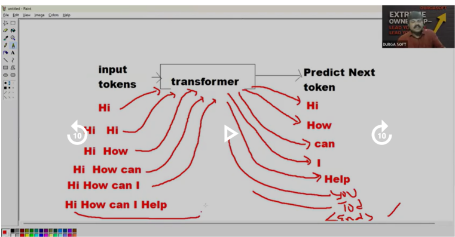

Pai image lo Durga Sir board meeda geesindi **idi**:
left side lo **input tokens** peruguthunna list, madhyalo oka box — **transformer**,
right side lo **predict next token**. Prathi line input ki oka output **token** vachindi.
Ee file motham aa oke picture ni explain chestundi.

---

## Architecture Diagram

```text
[User text: "Hi"]
   |
   v
[Tokenizer]            <- text ni chinna mukkalu (tokens) ga cut chestundi
   |
   v
[Embedding layer]      <- prathi token ni numbers list (vector) ga marchutundi
   |
   v
[Positional encoding]  <- ee token entho position lo undo aa info add chestundi
   |
   v
[TRANSFORMER BLOCKS]   <- self-attention + feed-forward, ivi N saarlu repeat
   |
   v
[Output layer + Softmax]  <- vocabulary lo prathi token ki oka probability
   |
   v
["How"]  <- highest probability token select avutundi
   |
   +--> idi malli input chivara ki add avutundi: "Hi How"
         |
         v
   (loop malli modati nunchi, <END> vache varaku)
```

### Deep Architecture Notes

**Step 1 — Tokenizer:** Meeru type chesina text computer ki ardham kaadu. Mundu
daanini **tokens** ga cut cheyyali. Token ante oka word kaavachu, oka word lo
mukka kaavachu.

**Step 2 — Embedding:** Prathi token ki oka **numbers list** assign avutundi.
Enduku ante — model ki maths matrame telusu, letters teliyavu.

**Step 3 — Positional encoding:** "Nenu ninnu pilichanu" and "Ninnu nenu pilichanu" —
same words, kaani meaning different. Andhuke **order** kuda model ki cheppali.

**Step 4 — Transformer blocks:** Idi asalu brain. Ikkada **self-attention** jarugutundi —
prathi word, migatha anni words ni chusi "naaku evaru important?" ani decide chestundi.

**Step 5 — Softmax:** Chivarlo model vocabulary lo unna **prathi okkati** ki oka
probability istundi. Ex: "How" ki 0.62, "are" ki 0.11, "banana" ki 0.0001.

**Step 6 — Loop:** Vachina token ni input chivara ki tagilinchi, **malli Step 1 nundi**
start. Idi **autoregressive** generation. Deeni valle ne ChatGPT lo answer
**token-by-token** type ayinattu kanipistundi (word-by-word kaadu — kinda Section 1.1 chudandi).

---

## 1. Token ante enti? (Modati nunchi)

Model ki "Hi" ane word teliyadu. Daaniki numbers matrame telusu.
Andhuke mundu text ni **tokens** ga break chestaru.

```text
"Hi How can I Help you"
        |
        v  tokenizer
["Hi"] ["How"] ["can"] ["I"] ["Help"] ["you"]
        |
        v  prathi token ki oka ID
[1234]  [567]  [890]  [40]  [4321]   [345]
```

Token eppudu full word kaadu — kondaru saarlu mukkalu avutundi:

| Text | Tokens ela split avutayo |
|---|---|
| `Hi` | `["Hi"]` — oke token |
| `Hyderabad` | `["Hyder", "abad"]` — rendu mukkalu |
| `unbelievable` | `["un", "believ", "able"]` — moodu mukkalu |

**Rough rule:** English lo **1 token ≈ 0.75 word**. Ante 100 words ≈ 130 tokens.
Idi gurthu pettukondi — API bill ee tokens meeda ne calculate avutundi.

### 1.1 Token vs Word — idi chala important

> **Model oka token at a time generate chestundi. Oka word at a time KAADU.**

Chala mandi "LLM word by word rastundi" antaru — **adi thappu**. Nijam ga
generate ayyedi **token**, and oka token ante oka full word kaakapovachu.

```text
Model "unbelievable" ani rayali anukondi:

  Word-by-word aithe:     1 step   -->  "unbelievable"

  Token-by-token reality: step 1   -->  "un"
                          step 2   -->  "believ"
                          step 3   -->  "able"
```

Ante **3 separate runs**, 3 forward passes, 3 softmax picks. Screen meeda meeru
`un` chustaru, tarvata `believ`, tarvata `able` — chala fast ga jarugutundi
kabatti oka word la kanipistundi, antey.

**Enduku ee difference matter avutundi:**

| Point | Explanation |
|---|---|
| **Speed** | "tokens per second" ani cheptaru, words per second kaadu. Telugu / Hindi text lo oke word ki 4-5 tokens padatayi — andhuke avi slow ga generate avutayi |
| **Cost** | Billing tokens meeda jarugutundi. `Hyderabad` oka word, kaani 2 tokens — rendintiki charge avutundi |
| **Spaces** | Space kuda token lo part. `" help"` (mundu space tho) and `"help"` — ivi **rendu veru tokens**, veru IDs |
| **Strawberry problem** | `strawberry` lo enni `r` unnayo LLM thappu cheptundi. Endukante adi letters chudaledu — `["str", "aw", "berry"]` ane 3 chunks matrame chusindi |

Common ga chepthe: **frequent English words** (the, is, help, you) usually oke
token. **Rare words, names, numbers, Telugu/Hindi text, code symbols** — avi
chinna mukkalu ga split avutayi.

```text
"Hi How can I help you"   ->  6 tokens    (prathi word oke token — lucky case)
"Hyderabad lo unnanu"     ->  5-6 tokens  (Hyder|abad|lo|unn|anu)
```

> **Board gurinchi oka note:** Durga Sir board meeda `Hi`, `How`, `can`, `I`,
> `Help`, `you` — ivi anni **oke token** words. Andhuke aa example lo token
> and word same ga kanipistayi. Teaching ki adi manchi choice, kaani nijam lo
> eppudu ala undadu. Gurthu pettukondi: **unit = token, word kaadu.**

### 1.2 Tiktokenizer demo — ChatGPT ki nijamga em velthundi? (Class demo)

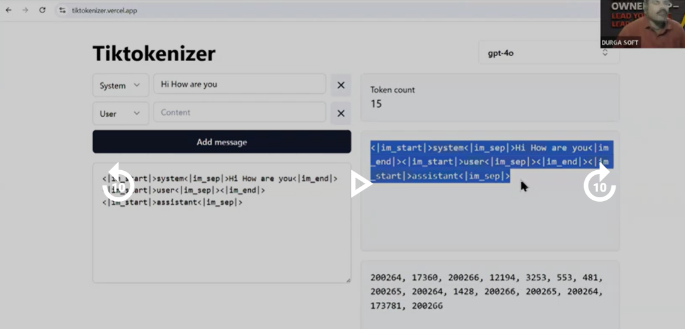

Class lo Durga Sir **Tiktokenizer** website (`tiktokenizer.vercel.app`) lo
chupincharu — mana message ChatGPT ki velle mundu **tokens** ga ela marutundo.

#### Mundu konni technical words — simple meanings

| Term | Simple meaning |
|---|---|
| **Tiktokenizer** | Free website — text type chesthe, adi enni tokens, ye token IDs ga marutundo chupistundi |
| **tiktoken** | OpenAI tayaru chesina **tokenizer** library. Tiktokenizer website deenine use chestundi |
| **Tokenizer** | Text ni tokens ga kosi, prathi token ki number (ID) ichhe tool |
| **gpt-4o** | OpenAI model peru. Prathi model ki **sontha tokenizer** untundi — andhuke top-right lo model select chestaru |
| **Token ID** | Prathi token ki vocabulary lo unna fixed number (e.g. `Hi` → `12194`) |
| **Token count** | Motham enni tokens ayyayo — API billing, context window limit ivi ee count meeda depend avutayi |
| **Role** | Message evaru pampincharu ani label — `System`, `User`, `Assistant` |
| **Special tokens** | Normal words kaadu — message **start, end, separator** chupinche hidden marker tokens (`<|im_start|>` laantivi) |

#### Demo lo em type chesaru?

```text
System  →  "Hi How are you"
User    →  (empty — emi type cheyyaledu)
```

Kani **Token count = 15** vachindi! "Hi How are you" lo 4 words e unnayi kada —
migatha 11 tokens ekkada nundi vachayi? 🤔 Ade ee demo lo asalu lesson.

#### Model ki nijamga velle text (chat format)

Manam chat box lo type chese message **direct ga** model ki velladu. Mundu
**special tokens** tho wrap chesi, oka format lo pampistaru:

```text
<|im_start|>system<|im_sep|>Hi How are you<|im_end|>
<|im_start|>user<|im_sep|><|im_end|>
<|im_start|>assistant<|im_sep|>
```

| Special token | Full form | Simple meaning |
|---|---|---|
| `<|im_start|>` | **I**nput **M**essage start | "Kotha message start avutundi" |
| `<|im_sep|>` | **I**nput **M**essage **sep**arator | "Role peru ayipoyindi, ikkada nundi content" |
| `<|im_end|>` | **I**nput **M**essage end | "Ee message ayipoyindi" |

> `im` ante sadharanam ga **"input message"** ani explain chestaru — idi OpenAI
> chat format (ChatML ani antaru — **Chat** **M**arkup **L**anguage).

#### Prathi token — ID tho (15 tokens)

| # | Token | Token ID | Type |
|---|---|---|---|
| 1 | `<|im_start|>` | 200264 | Special — message start |
| 2 | `system` | 17360 | Role name |
| 3 | `<|im_sep|>` | 200266 | Special — separator |
| 4 | `Hi` | 12194 | Content word |
| 5 | ` How` | 3253 | Content word (mundu space tho) |
| 6 | ` are` | 553 | Content word |
| 7 | ` you` | 481 | Content word |
| 8 | `<|im_end|>` | 200265 | Special — message end |
| 9 | `<|im_start|>` | 200264 | Special — message start |
| 10 | `user` | 1428 | Role name |
| 11 | `<|im_sep|>` | 200266 | Special — separator |
| 12 | `<|im_end|>` | 200265 | Special — end (user message empty) |
| 13 | `<|im_start|>` | 200264 | Special — message start |
| 14 | `assistant` | 173781 | Role name |
| 15 | `<|im_sep|>` | 200266 | Special — separator |

**Lekka (count):**

```text
Content words (Hi, How, are, you)   →  4 tokens
Role names (system, user, assistant) →  3 tokens
Special tokens (im_start/sep/end)    →  8 tokens
                                      -----------
Motham                               → 15 tokens ✅
```

#### Ee demo nundi nerchukovalsina points

1. **Same token ki eppudu same ID.** `<|im_start|>` moodu saarlu vachindi — moodu
   saarlu `200264` e. Tokenizer oka fixed dictionary laantidi.
2. **Space kuda token lo bhaagam.** `" How"` (mundu space tho) okka token. Andhuke
   `How` and `" How"` ki IDs veru avvachu.
3. **Special token IDs chala pedda numbers** (200264+). Endukante avi vocabulary
   **chivara** add chesina extra tokens — normal words kaadu.
4. **Hidden tokens kuda count avutayi.** Meeru 4 words type chesina, model ki 15
   tokens velthayi. API lo **billing** and **context window** — rendu ee motham
   count meeda e.
5. **Chivara `assistant<|im_sep|>` enduku?** Idi model ki signal — *"ippudu nee
   turn, assistant ga answer rayi"*. Model ikkada nundi **next token prediction**
   start chestundi (section 2, 4.3 lo chusina loop). Answer ayipogane adi
   `<|im_end|>` token generate chesi aagipotundi.

```text
Model chustundi:  ...<|im_start|>assistant<|im_sep|>
Model predict:    "I'm" → " fine" → "," → " thank" → " you" → <|im_end|>  (STOP)
```

> **Oka line lo:** Mana chat message model ki velle mundu roles + special tokens
> tho wrap avutundi, tarvata prathi piece ki oka number (token ID) vastundi —
> model ki kanipinchedi ee numbers matrame.

### 1.3 Model maarithe token count kuda maarutundi (gpt-4o vs gpt-3.5-turbo)


Same message — `System: "Hi How are you"`, `User: (empty)` — kaani top-right lo
model ni **gpt-4o** nundi **gpt-3.5-turbo** ki marchithe:

```text
gpt-4o         →  Token count = 15
gpt-3.5-turbo  →  Token count = 17   ← same text, different count!
```

**Enduku?** Endukante prathi model ki **sontha tokenizer** untundi — sontha
dictionary (vocabulary), sontha rules.

#### Konni technical words — simple meanings

| Term | Simple meaning |
|---|---|
| **Vocabulary** | Tokenizer ki telisina anni tokens list — prathi token ki oka ID. Oka dictionary laantidi |
| **Vocabulary size** | Aa dictionary lo enni tokens unnayi |
| **cl100k_base** | gpt-3.5-turbo / gpt-4 use chese tokenizer peru — **~1,00,000** tokens vocabulary |
| **o200k_base** | gpt-4o use chese kotha tokenizer — **~2,00,000** tokens vocabulary |
| **`\n` (newline)** | "Next line ki vellu" ane character (Enter key nokkinattu). Idi kuda oka token — ID `198` |

#### gpt-3.5-turbo lo prathi token (17 tokens)

| # | Token | Token ID | Type |
|---|---|---|---|
| 1 | `<|im_start|>` | 100264 | Special — message start |
| 2 | `system` | 9125 | Role name |
| 3 | `\n` | 198 | Newline (separator ga) |
| 4 | `Hi` | 13347 | Content word |
| 5 | ` How` | 2650 | Content word |
| 6 | ` are` | 527 | Content word |
| 7 | ` you` | 499 | Content word |
| 8 | `<|im_end|>` | 100265 | Special — message end |
| 9 | `\n` | 198 | Newline (messages madhya) |
| 10 | `<|im_start|>` | 100264 | Special — message start |
| 11 | `user` | 882 | Role name |
| 12 | `\n` | 198 | Newline (separator ga) |
| 13 | `<|im_end|>` | 100265 | Special — end (user message empty) |
| 14 | `\n` | 198 | Newline (messages madhya) |
| 15 | `<|im_start|>` | 100264 | Special — message start |
| 16 | `assistant` | 78191 | Role name |
| 17 | `\n` | 198 | Newline (separator ga) |

#### gpt-4o vs gpt-3.5-turbo — side by side

| Point | gpt-4o | gpt-3.5-turbo |
|---|---|---|
| Tokenizer | `o200k_base` (~2 lakh vocab) | `cl100k_base` (~1 lakh vocab) |
| Token count | **15** | **17** |
| Role tarvata separator | `<|im_sep|>` (special token) | `\n` newline (ID 198) |
| Messages madhya | Emi ledu | `\n` newline extra |
| `<|im_start|>` ID | 200264 | 100264 |
| `Hi` ID | 12194 | 13347 |
| ` How` ID | 3253 | 2650 |
| `assistant` ID | 173781 | 78191 |

**Extra 2 tokens ekkada nundi?** gpt-3.5-turbo lo messages madhya **2 extra
`\n` newlines** unnayi (`<|im_end|>` tarvata). Separator kuda `\n` e, kaani adi
gpt-4o lo `<|im_sep|>` ki badulu — count same. So 15 + 2 = **17** ✅

#### Ee demo nundi nerchukovalsina points

1. **Token count model ni batti maarutundi.** Same text, different model →
   different count. "Ee text = X tokens" ani fixed ga cheppalemu — **ye model?**
   ani adagali.
2. **Same word ki model batti different ID.** `Hi` gpt-4o lo `12194`,
   gpt-3.5 lo `13347`. Token IDs okka model nundi inko model ki **copy cheyyalemu**.
3. **Pedda vocabulary = sadharanam ga takkuva tokens.** gpt-4o (2 lakh vocab) lo
   ekkuva words / word-pieces **oke token** ga untayi — especially Telugu, Hindi
   laanti English kaani languages lo chala takkuva tokens avutayi.
4. **Takkuva tokens = takkuva cost + ekkuva space.** API billing tokens meeda;
   context window kuda tokens lo. Kotha tokenizer tho same text ki takkuva
   kharchu, context lo ekkuva text pattutundi.

> **Oka line lo:** Prathi model ki sontha tokenizer (dictionary) untundi —
> andhuke same text ki model batti token count, token IDs rendu maarutayi.

### 1.4 tiktoken library — enti, enduku use chestaru?

**tiktoken** = OpenAI tayaru chesina free **Python library**. Text ni tokens ga
kosi, token IDs ga marchutundi — ChatGPT models lopala use chese **same tokenizer** ide.
Mana demo lo chusina **Tiktokenizer website** kuda lopala ee library ne use chestundi
(website = chudadaniki, library = code lo use cheyyadaniki).

**Deeni use enti?**

- **Token count telusukovadam** — API ki pampe mundu, mana text enni tokens o check cheyyochu.
- **Cost estimate** — API billing tokens meeda, so mundhe kharchu lekka veyyochu.
- **Context window limit check** — text model limit dati pothundha leda ani mundhe chudochu.
- **Text ni chunks ga kosadam** — RAG lo pedda documents ni "500 tokens chunks" laaga correct ga kosadaniki.
- **Debugging / learning** — model ki nijamga em velthundo (ye tokens, ye IDs) chudadaniki.

**Chinna example:**

```python
import tiktoken                                       # tiktoken library ni import chestunnam

enc = tiktoken.encoding_for_model("gpt-4o")           # gpt-4o ki sontha tokenizer (o200k_base) teesukuntundi
ids = enc.encode("Hi How are you")                    # text ni token IDs list ga marchutundi
print(ids)                                            # [12194, 3253, 553, 481] — 4 tokens
print(len(ids))                                       # token count — 4
print(enc.decode(ids))                                # IDs ni malli text ga marchutundi — "Hi How are you"
```

> Install cheyyadaniki: `pip install tiktoken`

> **Oka line lo:** tiktoken = OpenAI tokenizer library — token count, cost, context
> limit mundhe telusukovadaniki and text ni correct ga chunks cheyyadaniki use chestaru.

### 1.5 Class example — tiktoken tho text ni tokens ga marchadam (Durga Sir)


```python
import tiktoken as tt                                  # tiktoken library ni import chesi, "tt" ane chinna peru pettam
encoder = tt.encoding_for_model('gpt-4o')              # gpt-4o model use chese tokenizer (encoder) ni teesukuntundi
itext = 'Hello Chatgpt how are you'                    # token ga marchalsina input text
tokens = encoder.encode(itext)                         # text ni token IDs list ga marchutundi
print(tokens)                                          # [13225, 17554, 70, 555, 1495, 553, 481]
```

#### Line by line — simple ga

| Line | Em chestundi |
|---|---|
| `import tiktoken as tt` | tiktoken library load chestundi. `as tt` ante — prathi saari `tiktoken` ani full ga rayakunda `tt` ani shortcut peru |
| `tt.encoding_for_model('gpt-4o')` | "gpt-4o ki ye tokenizer?" ani adigi, daani **encoder** object istundi |
| `itext = '...'` | Manam test cheyyalanukunna text — `itext` = input text |
| `encoder.encode(itext)` | **Encode** = text → numbers (token IDs) ga marchadam |
| `print(tokens)` | Vachina token IDs list ni screen meeda chupistundi |

| Term | Simple meaning |
|---|---|
| **Encoder** | Text ni token IDs ga marche object (tokenizer ki inko peru) |
| **Encode** | Text → token IDs |
| **Decode** | Token IDs → malli text (`encoder.decode(tokens)`) — reverse pani |

#### Output lo prathi ID ki meaning (7 tokens)

| Token ID | Token piece | Note |
|---|---|---|
| 13225 | `Hello` | Common word — oke token |
| 17554 | ` Chat` | Mundu space tho |
| 70 | `g` | Oke letter token! |
| 555 | `pt` | |
| 1495 | ` how` | Small letters `how` |
| 553 | ` are` | 1.2 demo lo kuda ide ID ✅ |
| 481 | ` you` | 1.2 demo lo kuda ide ID ✅ |

**Gamaninchalsina points:**

1. **5 words, kaani 7 tokens.** `Chatgpt` (small letters lo) tokenizer dictionary
   lo oke token ga ledu — andhuke ` Chat` + `g` + `pt` ga **3 pieces** ga kosindi.
   Common words (`Hello`, `are`, `you`) matram oke token.
2. **Capital / small letters ki veru IDs.** ` how` = `1495`, kaani 1.2 demo lo
   ` How` = `3253`. Tokenizer ki `How` and `how` rendu **different tokens**.
3. **Same word, same model → eppudu same ID.** ` are` = `553`, ` you` = `481` —
   1.2 Tiktokenizer demo lo kuda ivve vachayi.
4. **Ikkada special tokens (`<|im_start|>` etc.) levu.** Endukante idi plain
   text encode matrame — chat format wrap cheyyaledu. Andhuke count takkuva.

#### Idi AI model ni ela access chestundi? — **Asalu access cheyyadu!**

Idi chala mandi confuse ayye point. **tiktoken GPT-4o model ni call cheyyadu.**

| Doubt | Nijam |
|---|---|
| GPT-4o model ki request veltunda? | **Ledu.** Model ki asalu connect avvadu |
| API key kavala? | **Akkarledu.** Free, account kuda vaddu |
| Internet kavala? | **Modati saari matrame** — tokenizer dictionary file download cheyyadaniki |
| Cost avutunda? | **Ledu.** Mee computer lone run avutundi |

**Lopala nijamga em jarugutundi:**

```text
[1] encoding_for_model('gpt-4o')
        ↓   library lopala unna oka chinna list chustundi:
        ↓   "gpt-4o"        → "o200k_base"
        ↓   "gpt-3.5-turbo" → "cl100k_base"
[2] "o200k_base" dictionary file mee computer lo unda?
        ├─ Ledu (modati saari) → OpenAI public website nundi download chesi,
        │                         mee computer lo cache (save) chestundi
        └─ Undi (next saari)   → direct ga saved file nundi load — internet akkarledu
        ↓
[3] encode(itext)
        ↓   aa dictionary (token → ID list) chusi, text ni pieces ga kosi
        ↓   prathi piece ki ID isthundi — anta mee computer lone
[4] [13225, 17554, 70, 555, 1495, 553, 481]
```

| Term | Simple meaning |
|---|---|
| **Dictionary file (vocabulary file)** | Token → ID mapping unna file. e.g. `"Hello" → 13225`. `o200k_base` lo ~2 lakh entries |
| **Cache** | Okasari download chesina file ni computer lo save chesi pettukovadam — malli malli download cheyyakunda |
| **Local ga run** | Mee sontha computer lone pani jarugutundi, bayata server ki emi pampadu |

**Simple analogy:** tiktoken ante **dictionary book** laantidi — model kaadu.
Dictionary lo word chusi daani number cheppadaniki, aa book rasina writer
(GPT-4o model) ni call cheyyakkarledu kada. Book (vocabulary file) okasari
techukunte chalu — tarvata offline lo kuda vaadukovachu.

> **Model ni nijamga access cheyyalante** (answer generate cheyyadaniki) —
> veru ga **OpenAI API** use cheyyali (`openai` library + **API key** + internet
> + cost). Appudu kuda OpenAI server lopala ide tokenization jarigi, tarvata
> model ki token IDs veltayi. tiktoken tho manam aa **first step ni matrame**
> mana computer lo mundhe chusukuntunnam.

> **Oka line lo:** tiktoken model ni call cheyyadu — gpt-4o ki ye dictionary
> kavalo telusukuni, aa dictionary file ni (okasari download chesi) mana computer
> lone text ni token IDs ga marchutundi.

### 1.6 Doubt: tiktoken embeddings kuda create chestunda? — **Ledu!**

**Doubt:** "GPT model ki pampe mundu, tiktoken tokens ni **embeddings** ga marchutunda?
Adi library lone jarugutunda, AI access lekunda?"

**Answer:** Sagam correct. tiktoken AI access lekunda local ga run avutundi — **nijame**.
Kaani adi **token IDs** varaku matrame chestundi. **Embeddings create cheyyadu.**

#### Token ID vs Embedding — rendu veru veru

| | **Token ID** | **Embedding** |
|---|---|---|
| Enti? | Oke oka plain number — dictionary lo position | Meaning unna pedda number list (**vector**) |
| Example | `Hello` → `13225` | `Hello` → `[0.21, -0.83, 0.05, ..., 0.47]` (thousands of numbers) |
| Evaru tayaru chestaru? | **tiktoken** (mee computer lo) | **GPT model e** (OpenAI server lo) |
| Model access kavala? | ❌ Akkarledu | ✅ Kavali — adi model lo bhaagam |

| Term | Simple meaning |
|---|---|
| **Vector** | Numbers ni oka order lo pettina list — `[0.21, -0.83, ...]` |
| **Embedding** | Token meaning ni capture chese vector. Similar meaning words ki similar vectors |
| **Embedding layer** | Model lo modati step — token ID ni teesukuni, daani embedding vector ichhe part |
| **Weights / parameters** | Training lo model nerchukunna billions of numbers — model yokka "brain" |

**Simple analogy:**

- **Token ID** = class lo student **roll number**. `13225` ante *evaro* telustundi,
  kaani vaalla gurinchi emi teliyadu.
- **Embedding** = aa student **full profile** — skills, behaviour, evari tho similar ga untaru.

Roll number school register (public dictionary) lo untundi. Full profile matram
teacher (model) daggare untundi.

#### Edi ekkada jarugutundi?

```text
MEE COMPUTER (tiktoken)            OPENAI SERVER (GPT-4o lopala)
─────────────────────────          ─────────────────────────────────────
"Hello Chatgpt..."
      ↓
[Tokenizer]
      ↓
[13225, 17554, 70, ...]  ── ikkade aagipotundi
                                   [Tokenizer MALLI run avutundi]
                                         ↓
                                   [13225, 17554, 70, ...]
                                         ↓
                                   [Embedding layer]  ← ID → vector lookup
                                         ↓
                                   [Transformer blocks: attention...]
                                         ↓
                                   [Next token prediction]
```

#### Embeddings ki model enduku kavali?

**Embedding table** = prathi token ki oka row, prathi row lo thousands of numbers
unna pedda table. Ee numbers training lo **nerchukunnavi** — model **weights** lo bhaagam.

- Ee numbers **secret** — OpenAI GPT-4o weights ni bayataki ivvadu.
- **Dictionary file** (token → ID) matram **public** — andhuke tiktoken download cheyyagaladu.

So tiktoken `"Hello" = 13225` ani cheppagaladu, kaani `13225 = [0.21, -0.83, …]`
ani cheppaledu. Aa rendo part model ki matrame telusu.

#### Rendu mukhyamaina points

**1. API call chesinappudu manam pampedi text, token IDs kaadu.**
Normal ga manam plain text (`"Hello Chatgpt how are you"`) e pampistam. OpenAI server
daanni **malli sontha ga tokenize** chestundi. Manam mundhe tiktoken run chesina —
edi fast avvadu, edi replace avvadu. tiktoken **mana side check kosam matrame** —
token count, cost, context limit, chunking.

**2. Embeddings nijamga kavalante — API call kavali.**
OpenAI ki veru ga **Embeddings API** undi (`text-embedding-3-small` laanti models).
Text pampisthe vector vastundi. **RAG** lo search kosam ide use chestaru —
deeniki **API key kavali, cost avutundi**.
(Note: ee embeddings oka **separate embedding model** nundi vastayi — GPT-4o lopala
unna embedding layer nundi kaadu.)

| Pani | Tool | API access kavala? |
|---|---|---|
| Text → token IDs | `tiktoken` | ❌ Ledu (local) |
| Text → embedding vector (RAG kosam) | OpenAI Embeddings API | ✅ Kavali |
| Text → answer | OpenAI Chat API (GPT-4o) | ✅ Kavali |

> **Oka line lo:** tiktoken token IDs (dictionary numbers) daggare aagipotundi.
> Embeddings (meaning unna vectors) model lopala, daani secret weights tho tayaru
> avutayi — andhuke vaatiki eppudu model / API access kavali.

### 1.7 Encoding → Transformer → Decoding — full process (start to end)

Ippati varaku mukkalu mukkalu ga chusam. Ippudu **motham journey** oke chota —
mana text lopaliki velli, answer text bayataki vache varaku.

#### Mundu technical words — simple meanings

| Term | Simple meaning |
|---|---|
| **Encoding** | **Text → token IDs** ga marchadam (`"Hello"` → `13225`). Tokenizer chestundi |
| **Decoding** | **Token IDs → text** ga malli marchadam (`13225` → `"Hello"`). Encoding ki reverse |
| **Embedding** | Token ID ni meaning unna vector ga marchadam (1.6 lo chusam) |
| **Transformer** | Model yokka brain — attention tho context artham chesukuni, next token predict chestundi |
| **Logits** | Vocabulary lo prathi token ki model ichhe raw score |
| **Softmax** | Logits ni probabilities (motham 1.0) ga marchadam |
| **Autoregressive loop** | Okko token generate chesi, daanni malli input ki add chesi, next token predict cheyyadam — repeat |

#### Full journey — oka chupu lo

```text
"Hello Chatgpt how are you"                         ← mana text
        ↓
┌─────────────────────────────────────┐
│ [1] ENCODING  (Tokenizer)           │  text → token IDs
│     [13225, 17554, 70, 555, ...]    │  (tiktoken idi chestundi)
└─────────────────────────────────────┘
        ↓
┌─────────────────────────────────────┐
│ [2] EMBEDDING LAYER                 │  prathi ID → meaning vector
│     13225 → [0.21, -0.83, ...]      │  (model lopala — secret weights)
│     + position info                 │
└─────────────────────────────────────┘
        ↓
┌─────────────────────────────────────┐
│ [3] TRANSFORMER BLOCKS (× N layers) │
│     ├─ Self-attention               │  words okaridini okaru chusi context share
│     └─ Feed-forward                 │  nerchukunna knowledge apply
└─────────────────────────────────────┘
        ↓
┌─────────────────────────────────────┐
│ [4] OUTPUT LAYER + SOFTMAX          │  prathi token ki probability
│     "I'm" → 0.38, "Hi" → 0.21 ...   │
└─────────────────────────────────────┘
        ↓
┌─────────────────────────────────────┐
│ [5] PICK NEXT TOKEN ID              │  e.g. 15390  ("I'm")
└─────────────────────────────────────┘
        ↓
┌─────────────────────────────────────┐
│ [6] DECODING  (Tokenizer reverse)   │  token ID → text
│     15390 → "I'm"                   │
└─────────────────────────────────────┘
        ↓
   "I'm"  → screen meeda chupistundi
        ↓
[7] LOOP: kotha token ID ni sequence chivara add chesi → malli step [2] nundi
          <|im_end|> vache varaku repeat
```

> **Note:** Step 5 lo ichhina IDs (`15390` laantivi) ardham chesukovadaniki
> ichhina example numbers matrame — real ga vere numbers raavachu.

#### Prathi step — simple ga

**[1] Encoding — text → numbers**
Model ki text ardham kaadu, numbers matrame. Tokenizer text ni pieces (tokens) ga
kosi, prathi piece ki dictionary lo unna ID istundi. **tiktoken chese pani ide.**

**[2] Embedding — numbers → meaning**
`13225` ki sontha ga meaning ledu. Embedding layer daanni oka pedda vector ga marchutundi —
ippudu model ki "Hello ante greeting" laanti meaning dorukutundi. Position info kuda add avutundi.

**[3] Transformer — artham chesukovadam**
Ikkade asalu brain pani. **Self-attention** tho prathi token migatha tokens ni chusi
context artham chesukuntundi (`how are you` ante health adugutunnaru ani). **Feed-forward**
tho training lo nerchukunna knowledge apply avutundi. Ee block chala saarlu repeat avutundi.

**[4] + [5] Next token predict**
Transformer chivari output nundi, vocabulary lo prathi token ki score (logits) →
softmax tho probabilities → oka token ID select avutundi.

**[6] Decoding — numbers → text**
Model ichhedi **token ID matrame** (oka number). Daanni manaki chupinchadaniki,
tokenizer **reverse** lo dictionary chusi ID ni malli text ga marchutundi.

**[7] Loop**
Okka token tho answer ayipodu. Kotha token ni sequence ki add chesi malli
step 2 nundi run chestundi — `<|im_end|>` (stop token) vache varaku.

```text
Round 1:  ...how are you<|im_start|>assistant<|im_sep|>          → "I'm"
Round 2:  ...assistant<|im_sep|>I'm                               → " fine"
Round 3:  ...assistant<|im_sep|>I'm fine                          → ","
Round 4:  ...assistant<|im_sep|>I'm fine,                         → " thanks"
Round 5:  ...assistant<|im_sep|>I'm fine, thanks                  → <|im_end|>  STOP
```

Andhuke ChatGPT answer **word by word** type avuthunnattu kanipistundi — prathi
round lo oka token **decode** ayi screen meeda vastundi.

#### Edi ekkada jarugutundi?

| Step | Ekkada | tiktoken tho mana computer lo cheyyocha? |
|---|---|---|
| [1] Encoding | Tokenizer | ✅ Avunu — `encoder.encode(text)` |
| [2] Embedding | Model lopala | ❌ Ledu — secret weights |
| [3] Transformer | Model lopala | ❌ Ledu |
| [4]–[5] Predict | Model lopala | ❌ Ledu |
| [6] Decoding | Tokenizer | ✅ Avunu — `encoder.decode(ids)` |

Ante tiktoken ki **first step (encoding)** and **last step (decoding)** matrame
telusu. Madhyalo unna **brain (embedding + transformer)** model / API lone untundi.

#### tiktoken tho encode + decode — chinna example

```python
import tiktoken as tt                                  # tiktoken library ni "tt" ane chinna peru tho import
encoder = tt.encoding_for_model('gpt-4o')              # gpt-4o tokenizer (o200k_base) teesukuntundi

itext = 'Hello Chatgpt how are you'                    # input text
tokens = encoder.encode(itext)                         # ENCODING: text → token IDs
print(tokens)                                          # [13225, 17554, 70, 555, 1495, 553, 481]

back_text = encoder.decode(tokens)                     # DECODING: token IDs → malli text
print(back_text)                                       # 'Hello Chatgpt how are you' — same text back ✅

for token_id in tokens:                                # prathi token ID ni okkokati teesukuntundi
    print(token_id, '→', repr(encoder.decode([token_id])))  # aa okka ID ni decode chesi, piece chupistundi
# 13225 → 'Hello'
# 17554 → ' Chat'
# 70    → 'g'
# ...
```

#### ⚠️ Confusion avvakandi — "Encoder / Decoder" ki rendu meanings

AI lo **encoder / decoder** ane words **rendu veru chotla** vastayi:

| Context | Encoder / Decoder meaning |
|---|---|
| **Tokenizer** (ee section) | Encode = text → IDs, Decode = IDs → text. Simple dictionary lookup |
| **Transformer architecture** (4.4 lo chusam) | Encoder = input ni artham chesukune neural network part, Decoder = output rase neural network part |

GPT **decoder-only** transformer (4.4) — kaani daaniki kuda tokenizer **encode** and
**decode** rendu kavali. Peru same, pani purthiga veru!

> **Oka line lo:** Text → **Encode** (IDs) → **Embedding** (vectors) → **Transformer**
> (attention tho artham + next token predict) → **Decode** (malli text) → loop.
> tiktoken first & last steps matrame chestundi; madhyalo brain model lone untundi.

### 1.8 Class example — Encode + Decode rendu kalipi (Durga Sir)

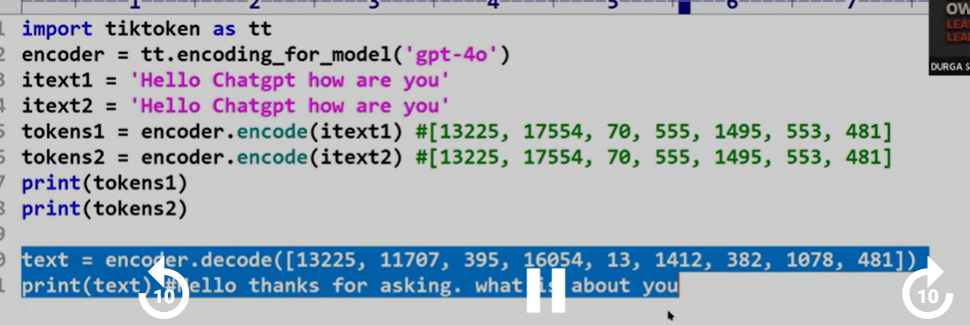

```python
import tiktoken as tt                                  # tiktoken library ni "tt" ane chinna peru tho import chestunnam
encoder = tt.encoding_for_model('gpt-4o')              # gpt-4o model ki sontha tokenizer (o200k_base) teesukuntundi
itext1 = 'Hello Chatgpt how are you'                   # modati input text
itext2 = 'Hello Chatgpt how are you'                   # rendo input text — kavalane same text pettam
tokens1 = encoder.encode(itext1)                       # ENCODE: itext1 ni token IDs ga marchutundi
tokens2 = encoder.encode(itext2)                       # ENCODE: itext2 ni token IDs ga marchutundi
print(tokens1)                                         # [13225, 17554, 70, 555, 1495, 553, 481]
print(tokens2)                                         # [13225, 17554, 70, 555, 1495, 553, 481] — exact same!

text = encoder.decode([13225, 11707, 395, 16054, 13, 1412, 382, 1078, 481])  # DECODE: token IDs ni malli text ga marchutundi
print(text)                                            # Hello thanks for asking. what is about you
```

#### Part 1 — Same text → eppudu same tokens

`itext1`, `itext2` rendu **same text**. Rendintiki **exact same token IDs** vachayi.

| Term | Simple meaning |
|---|---|
| **Deterministic** | Same input isthe, **eppudu same output** — random ga maaradu |

Tokenizer **deterministic** — idi oka fixed dictionary lookup. Enni saarlu run chesina,
ye computer lo run chesina, `'Hello Chatgpt how are you'` ki gpt-4o lo eppudu ide
7 IDs vastayi.

> **Gamaninchandi:** Tokenizer deterministic, kaani **model answer** kaadu!
> Same question rendu saarlu adigithe ChatGPT different answers ivvachu
> (temperature valla — section 7.4). Randomness **model lo** untundi, tokenizer lo kaadu.

#### Part 2 — Decode: token IDs → text

Ikkada Durga Sir konni token IDs ni direct ga ichhi **decode** chesaru. Output:
**"Hello thanks for asking. what is about you"**

| Token ID | Text piece | Note |
|---|---|---|
| 13225 | `Hello` | Encode lo kuda ide ID ✅ — same dictionary |
| 11707 | ` thanks` | Mundu space tho |
| 395 | ` for` | |
| 16054 | ` asking` | |
| 13 | `.` | Full stop kuda oka token! |
| 1412 | ` what` | |
| 382 | ` is` | |
| 1078 | ` about` | |
| 481 | ` you` | Encode lo kuda ide ID ✅ |

**9 token IDs → 9 text pieces → kalipithe oka sentence.**

#### Ee example nundi nerchukovalsina points

1. **Encode, decode rendu reverse pani.** `Hello` ↔ `13225`, ` you` ↔ `481` —
   rendu vaipula same dictionary use avutundi.
2. **Punctuation kuda tokens.** `.` (full stop) ki sontha ID `13` undi. Comma, `?`,
   `!` — anni tokens e, anni count avutayi.
3. **Idi model answer laaga kanipistundi kada?** "Hello thanks for asking. what
   about you" — "how are you" ki reply laaga undi. Nijam lo GPT model **exact ga
   ide chestundi** — answer ni **token IDs** ga generate chestundi, tarvata
   tokenizer **decode** chesi manaki text chupistundi (1.7 lo step [6]).
   Ikkada matram manam IDs ni **chethitho** ichham — model ni call cheyyaledu.
4. **Decode ki kuda AI access akkarledu.** Encode laage, decode kuda dictionary
   lookup matrame — mana computer lone jarugutundi.

```text
Nijamaina ChatGPT lo:
  "Hello Chatgpt how are you"
        ↓ encode (tokenizer)
  [13225, 17554, 70, 555, 1495, 553, 481]
        ↓ GPT-4o model (embedding + transformer)  ← ikkade AI
  [13225, 11707, 395, 16054, 13, 1412, 382, 1078, 481]
        ↓ decode (tokenizer)
  "Hello thanks for asking. what is about you"

Class example lo:  model step skip chesi, answer IDs ni manamey ichhi decode chesam.
```

#### Part 3 — ⚠️ GPT model maarithe tokens kuda maarutayi

"Same text → same tokens" ane rule **same model lo matrame** nijam. Model maarithe
tokenizer maarutundi — appudu **token IDs, token count rendu maarutayi** (1.3 lo
Tiktokenizer demo lo chusam: gpt-4o = 15 tokens, gpt-3.5-turbo = 17 tokens).

```python
import tiktoken as tt                                  # tiktoken library import
itext = 'Hello Chatgpt how are you'                    # rendu models ki same text

enc_4o = tt.encoding_for_model('gpt-4o')               # gpt-4o tokenizer → o200k_base
enc_35 = tt.encoding_for_model('gpt-3.5-turbo')        # gpt-3.5-turbo tokenizer → cl100k_base

print(enc_4o.encode(itext))                            # [13225, 17554, 70, 555, 1495, 553, 481]
print(enc_35.encode(itext))                            # veru IDs vastayi — e.g. " are" = 527, " you" = 499
```

| Token | gpt-4o (`o200k_base`) ID | gpt-3.5-turbo (`cl100k_base`) ID |
|---|---|---|
| ` are` | 553 | 527 |
| ` you` | 481 | 499 |
| `Hi` | 12194 | 13347 |
| ` How` | 3253 | 2650 |

(Ee IDs 1.2, 1.3 Tiktokenizer screenshots nundi teesukunnavi.)

| Model(s) | Tokenizer (encoding) | Vocabulary size |
|---|---|---|
| gpt-4o, gpt-4o-mini | `o200k_base` | ~2,00,000 |
| gpt-4, gpt-3.5-turbo | `cl100k_base` | ~1,00,000 |

**Deeni valla em jarugutundi?**

1. **IDs okka model nundi inko model ki pani cheyyavu.** gpt-4o lo encode chesina
   IDs ni gpt-3.5 tokenizer tho decode chesthe — **thappu / garbage text** vastundi.
   Encode, decode rendu **same model tokenizer** tho e cheyyali.
2. **Token count model batti maarutundi** — cost, context limit lekkalu kuda.
   Andhuke `encoding_for_model('...')` lo **meeru use chese model peru e** ivvali.
3. **Class example lo `decode([...])` IDs gpt-4o vi.** Ave IDs ni vere model
   tokenizer ki isthe, "Hello thanks for asking..." raadu.

> **Oka line lo:** Same text → eppudu same token IDs (deterministic) — **kaani
> same model lo matrame**. Model maarithe tokenizer maarutundi, IDs & count maarutayi.
> Decode token IDs ni malli text ga marchutundi — model ichhe answer IDs ni manaki
> chupinchedi ide step.

### 1.9 Class notes — What is Token? Why Tokenization? Types of Tokens (Durga Sir)

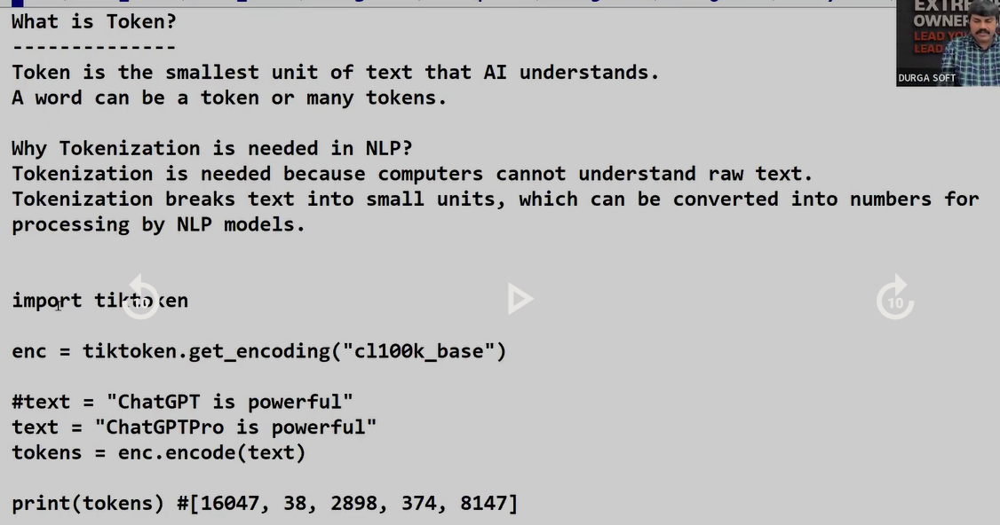

#### What is Token?

> **Token is the smallest unit of text that AI understands.**
> **A word can be a token or many tokens.**

- AI text ni **letters ga kaadu, words ga kaadu** — **tokens** ga chustundi. Adi AI ki **smallest unit**.
- Oka word = **okka token** avvochu (`is`, `powerful`) leda **chala tokens** avvochu (`ChatGPT` = `Chat` + `G` + `PT`).
  Section 1.1 lo `unbelievable` = 3 tokens chusam — same idea.

#### Why Tokenization is needed in NLP?

> Tokenization is needed because **computers cannot understand raw text**.
> Tokenization breaks text into **small units**, which can be **converted into numbers** for processing by NLP models.

```text
Raw text        →   Tokenization      →   Numbers (token IDs)   →   NLP model
"ChatGPT is powerful"   Chat|G|PT| is| powerful    [16047, 38, 2898, 374, 8147]
```

| Word | Simple meaning |
|---|---|
| **NLP** | Natural Language Processing — computers ki manushula bhasha (text) ardham ayyela cheyyadam |
| **Raw text** | Manam type chese normal text — computer ki adi direct ga ardham kaadu |
| **Tokenization** | Text ni **chinna pieces (tokens)** ga break cheyyadam |
| **Token ID** | Prathi token ki vocabulary lo unna **number** |

Computer ki **numbers matrame** telusu — andhuke text → tokens → numbers. Ee numbers ne transformer lopaliki velthayi (Section 1.7).

#### Class code — tiktoken with `cl100k_base`

```python
# ---------------- Architecture Diagram ----------------
# [Text: "ChatGPT is powerful"]
#    ↓
# [cl100k_base tokenizer]  → text ni tokens ga break chestundi
#    ↓
# [Token IDs]  → [16047, 38, 2898, 374, 8147]
#
# ---------------- Deep Architecture Notes ----------------
# Step 1: tiktoken library import
# Step 2: cl100k_base encoding (gpt-4 / gpt-3.5-turbo tokenizer) load
# Step 3: text ni encode() tho token IDs list ga marchadam
# Step 4: IDs print — prathi number oka token

import tiktoken                                    # OpenAI tokenizer library — text ↔ token IDs

enc = tiktoken.get_encoding("cl100k_base")         # cl100k_base tokenizer load — gpt-4 / gpt-3.5-turbo vaadedi (~1 lakh vocab)

#text = "ChatGPT is powerful"                      # modati example — comment chesi pettaru
text = "ChatGPTPro is powerful"                    # rendo example — "Pro" add chesi try chesaru
tokens = enc.encode(text)                          # text → token IDs list

print(tokens)  #[16047, 38, 2898, 374, 8147]       # token IDs print
```

**Class code lo chinna gamanika:** Comment lo unna output `[16047, 38, 2898, 374, 8147]` (5 tokens) —
idi **modati text `"ChatGPT is powerful"`** di:

| Token | ID |
|---|---|
| `Chat` | 16047 |
| `G` | 38 |
| `PT` | 2898 |
| ` is` (space tho) | 374 |
| ` powerful` (space tho) | 8147 |

- `ChatGPT` okka word — kaani **3 tokens** (`Chat`, `G`, `PT`) — *"a word can be many tokens"* ki perfect example.
- ` is`, ` powerful` — prathi word **okka token**, **mundu space tho saha** (Section 1.2 lo chusam).
- `"ChatGPTPro is powerful"` run chesthe — **"Pro"** kosam **extra token(s)** vastayi, kabatti list **5 kanna ekkuva** untundi.
  Kotha word (`ChatGPTPro`) vocabulary lo ledu kabatti, tokenizer daanni **telisina pieces** ga break chestundi. Mee system lo run chesi exact IDs chudandi.

#### Types of tokens

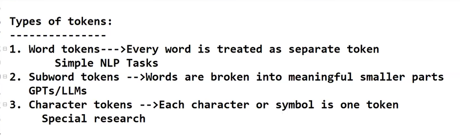

> 1. **Word tokens** → Every word is treated as separate token — *Simple NLP tasks*
> 2. **Subword tokens** → Words are broken into meaningful smaller parts — *GPTs / LLMs*
> 3. **Character tokens** → Each character or symbol is one token — *Special research*

Same sentence ni 3 types lo chuddam — `"ChatGPT is powerful"`:

```text
1. Word tokens:       [ChatGPT] [is] [powerful]                              → 3 tokens
2. Subword tokens:    [Chat] [G] [PT] [ is] [ powerful]                      → 5 tokens  (cl100k_base)
3. Character tokens:  [C][h][a][t][G][P][T][ ][i][s][ ][p][o][w][e][r][f][u][l]  → 19 tokens
```

| Type | Ela break chestundi | Ekkada vaadutaru | Plus ✅ | Minus ❌ |
|---|---|---|---|---|
| **Word tokens** | Prathi **full word** = okka token | Simple NLP tasks (spam filter, basic sentiment) | Simple, ardham easy | Vocabulary **chala peddadi** (anni words + forms: run, runs, running…). Kotha word (`ChatGPTPro`) vasthe → **unknown** ❌ |
| **Subword tokens** | Words ni **meaningful chinna parts** ga (`un` + `believ` + `able`) | **GPT, Claude, Llama — anni LLMs** | Vocabulary medium size (~1–2 lakh), **kotha words kuda handle** (telisina pieces ga break) | Konchem complex, oka word ki chala tokens avvochu |
| **Character tokens** | Prathi **letter / symbol** = okka token | Special research, konni languages / spelling tasks | Vocabulary **chala chinnadi** (~100s), unknown word ane problem ledu | Sequence **chala podavu** → slow, ekkuva compute, meaning nerchukovadam kashtam |

**LLMs enduku subword choose chesayi?** — Rendu extremes madhya **balance**:

```text
Word tokens       ←───────── Subword tokens ─────────→   Character tokens
vocabulary huge             ✅ best balance               vocabulary tiny
sequence short              vocabulary medium             sequence very long
kotha words ❌               kotha words ✅                 kotha words ✅
                            sequence medium
```

- `ChatGPTPro` lantivi kotha words vachina — subword tokenizer `Chat` + `G` + `PT` + `Pro` laaga **telisina pieces** tho handle chestundi. Word tokenizer ki idi **unknown**.
- Character tokens laaga sequence **19 tokens** avvadu — **5–6 tokens** tho ayipotundi → context window (Section 7.2) save, speed ekkuva.
- GPT vaade subword method peru **BPE (Byte Pair Encoding)** — tarachuga kalise letters ni kalipi tokens ga nerchukuntundi.

> **Oka line lo:** Token = AI ki **smallest text unit**. Computer ki raw text ardham kaadu kabatti **tokenization** tho
> text → tokens → numbers. 3 types — **word** (simple), **subword** (LLMs — best balance), **character** (research).
> GPT `"ChatGPT"` ni `Chat` + `G` + `PT` ga chustundi.

---

## 2. Transformer asalu em chestundi? (Oke oka pani)

Chala mandi anukuntaru — "transformer ante question ki answer cheppe machine" ani.
**Kaadu.** Adi chese pani oke okkati:

> **Ippati varaku unna tokens chusi, next token enti ani predict cheyyadam.**

Antey. Chatting, code rayadam, translation, summary — anni **ee oke oka pani**
malli malli chesthe vachina results.

```text
Input ichina tokens  --->  [ TRANSFORMER ]  --->  next token probability list
```

Idi exactly board meeda unna box. Left side arrow = input tokens.
Right side arrow = predict next token.

### 2.1 Class lo ichhina definition (Durga Sir)

> **Transformer: The smart system that guesses next word by finding patterns**

**Simple ga Tenglish lo — prathi word ki meaning:**

| Definition lo word | Simple meaning |
|---|---|
| **Smart system** | Training lo billions of words chadivi nerchukunna computer program (model) |
| **Guesses** | 100% telusukoni cheppadu — **probability** batti "idi ekkuva chance unna word" ani guess chestundi |
| **Next word** | Ippati varaku unna text tarvata raavalsina word (nijaniki **next token**) |
| **Finding patterns** | Training lo chusina text lo **repeat ayye structures** gurthu pettukovadam — ye words ye words tarvata vastayo |

**Pattern ante enti? — Example:**

Training lo GPT ee sentences chala saarlu chusindi anukondi:

```text
"I drink coffee every morning"
"She drinks tea every morning"
"We eat breakfast every morning"
```

Pattern: **"every"** tarvata chala saarlu **"morning"** vachindi.
So ippudu meeru `"I go to gym every ___"` ani isthe:

```text
"every" tarvata em vastundi?  (Training lo chusina pattern batti guess)

  morning  → 0.45   ← pattern ekkuva saarlu chusindi
  day      → 0.30
  evening  → 0.15
  banana   → 0.0001 ← ee pattern eppudu chudaledu
```

GPT ki "gym" ante enti, "morning" ante enti nijamga **telidu** — kaani
**patterns** chala baga gurthu pettukundi. Aa patterns batti next word guess chestundi.

> **Oka line lo:** Transformer = chala text lo patterns nerchukuni, aa patterns
> batti next word guess chese smart system.

### 2.2 ChatGPT language ni ela artham chesukuntundi? (Durga Sir)

> **How ChatGPT understands language?**
> **It uses transformer model to learn patterns from huge data and predict the next best word.**

**Simple ga Tenglish lo — prathi part ki meaning:**

| Definition lo part | Simple meaning |
|---|---|
| **Transformer model** | ChatGPT lopala unna brain / design (paina 2.1 lo chusam — patterns batti next word guess chese system) |
| **Learn patterns** | Ye words ye words tarvata vastayo, ye words kalisi untayo — ivi gurthu pettukovadam |
| **Huge data** | Internet, books, articles, code — **trillions of words** text. Entha ekkuva data chusthe, antha manchi patterns nerchukuntundi |
| **Predict** | Mundhe cheppadam / guess cheyyadam |
| **Next best word** | Ekkuva **probability** unna next word (nijaniki next token) — sense ki baga fit ayye word |

**Moodu steps lo:**

```text
[1] HUGE DATA           → Internet, books, code... trillions of words chaduvutundi
        ↓
[2] LEARN PATTERNS      → Transformer (attention tho) words madhya relations nerchukuntundi
        ↓                  e.g. "every" tarvata "morning", "Paris" ante "France"
[3] PREDICT NEXT WORD   → Kotha question isthe, nerchukunna patterns batti
                           next best word guess chestundi — malli malli (loop)
```

**Mukhyamaina point — "understand" ante manishi laaga kaadu:**

ChatGPT ki manalaaga **feelings, experience** levu. Adi "coffee" taste chesindi
ledu, "morning" chusindi ledu. Kaani huge data lo `coffee`, `morning`, `drink`
ivi kalisi chala saarlu vachayi ani **pattern** telusu.

> Ante ChatGPT "understanding" = **patterns chala baga telusukovadam**.
> Patterns entha baga telisthe, next word antha correct ga guess chestundi —
> andhuke manaki adi language artham chesukuntunnattu kanipistundi.

---

## 3. Board meeda unna example — line by line

Durga Sir board meeda ichina example idi. Prathi row oka **separate run**.
Prathi saari input peruguthundi, output oka kotha **token**.

(Ee example lo prathi word oke token ayindi — andhuke table neat ga undi.
Section 1.1 lo chusinattu, eppudu ala undadu.)

| Run | Input tokens (model ki icchedi) | Predict next token (model ichedi) |
|---|---|---|
| 1 | `Hi` | `How` |
| 2 | `Hi How` | `can` |
| 3 | `Hi How can` | `I` |
| 4 | `Hi How can I` | `Help` |
| 5 | `Hi How can I Help` | `you` |
| 6 | `Hi How can I Help you` | `?` |
| 7 | `Hi How can I Help you ?` | `<END>` |

Chusara? Prathi line lo:
- Input lo **okka token extra** vachindi
- Aa extra token ante — **ventane mundu run lo model ichina output**

Idine **autoregressive loop** antaru. *Auto* ante tanaki tane, *regressive* ante
tanu ichina output ni malli tane input ga theeskovadam.

```text
Run 1:  [Hi] -------------------> How
                                   |
                                   v  (output ni input ki add chey)
Run 2:  [Hi How] ----------------> can
                                   |
                                   v
Run 3:  [Hi How can] ------------> I
                                   |
                                   v
Run 4:  [Hi How can I] ----------> Help
                                   |
                                   v
Run 5:  [Hi How can I Help] -----> you
                                   |
                                   v
Run 6:  [... you] ---------------> ?
                                   |
                                   v
Run 7:  [... you ?] -------------> <END>   <-- ikkada aagipotundi
```

**Chala important:** Board meeda kudi vaipu chivarlo `you`, `To`, `<end>` ani
raasi unnaru chinnaga. Aa `<END>` oka **special token**. Adi vachinappudu loop
aagipotundi. Lekapothe model endless ga rastune untundi.

---

## 4. Transformer box lopala em jarugutundi?

Ippati varaku box ni **black box** la chusam. Ippudu lopaliki veldham.

```text
          INPUT TOKENS: "Hi How can"
                  |
   +--------------v---------------+
   |  1. Embedding                |   token --> numbers vector
   |     Hi   -> [0.2, -1.1, ...] |
   |     How  -> [1.4,  0.3, ...] |
   |     can  -> [-0.7, 0.9, ...] |
   +--------------+---------------+
                  |
   +--------------v---------------+
   |  2. Positional Encoding      |   "ee word 1st/2nd/3rd position lo undi"
   +--------------+---------------+
                  |
   +--------------v---------------+  <--+
   |  3. Self-Attention           |     |
   |     prathi word migatha anni |     |  ivi rendu kalipi
   |     words ni chustundi       |     |  oka "block".
   +--------------+---------------+     |  Idi 12 / 48 / 96
                  |                     |  saarlu repeat
   +--------------v---------------+     |  avutundi (model
   |  4. Feed Forward Network     |     |  size batti)
   |     thinking / processing    |     |
   +--------------+---------------+  ---+
                  |
   +--------------v---------------+
   |  5. Output Layer + Softmax   |   vocabulary lo prathi token ki score
   +--------------+---------------+
                  |
                  v
        "I"  -> 0.71
        "we" -> 0.12
        "you"-> 0.08
        ...  (migatha 50,000 tokens ki chinna chinna values)
                  |
                  v
          SELECT --> "I"
```

### 4.1 Self-attention ante enti? (Idi key concept)

Sentence: **"Bank daggara nenu nadichanu"** vs **"Bank lo money deposit chesanu"**

Rendu sentences lo `Bank` ane same word undi. Kaani meaning veru —
okati **river bank**, inkokati **money bank**.

Model ki idi ela telusu? **Self-attention valla.**

```text
"Bank lo money deposit chesanu"

 Bank ---+--- chustundi ---> "money"    (weight: 0.6)  <-- chala important
         +--- chustundi ---> "deposit"  (weight: 0.3)  <-- important
         +--- chustundi ---> "nenu"     (weight: 0.05) <-- antha kaadu
         +--- chustundi ---> "lo"       (weight: 0.05) <-- antha kaadu
```

Ante prathi word, sentence lo migatha **anni words ni oke saari** chustundi, and
"naa meaning decide cheyyadaniki evaru help chestaru?" ani weights istundi.
"money", "deposit" ekkuva weight techukunnayi kabatti, `Bank` ki **money bank**
ane meaning settle ayindi.

> Transformer ki mundu unna models (RNN, LSTM) words ni **oka dani tarvata okati**
> chusevi — slow, and dooram lo unna words ni marchipoyevi.
> Transformer **anni words ni oke saari parallel ga** chustundi. Andhuke ee
> paper peru — *"Attention Is All You Need"* (2017). Idi motham AI field ni marchindi.

### 4.1.1 Attention — deep ga (Meaning, Query / Key / Value, Formula)

#### Mana daily life lo "attention" ante enti?

Ee sentence chadavandi: **"The cat sat on the mat because it was tired"**

`it` daggara ki vachinappudu, mana brain venakki chusi adugutundi —
*"ee `it` evari gurinchi?"* Mana answer: **cat** (mat kaadu — mat ki tiredness undadu kada 😄).

Manam anni words ki **same importance ivvaledu**. Important words meeda matrame
**focus** pettam. Aa focus chese pani ne **attention** antaru.

#### Class lo ichhina definition (Durga Sir)

> **When GPT reads a sentence, it does not give equal importance to all words.
> It carefully decides which words are important and which words are less
> important, is there any relation between the words etc. This thinking process
> is called attention.**

**Simple ga Tenglish lo:**

GPT oka sentence chadivinappudu, **anni words ki same importance ivvadu**.
Adi jagratta ga moodu vishayalu alochistundi:

1. **Ee words important?** — meaning ki ekkuva help chese words (e.g. `cat`, `tired`)
2. **Ee words antha important kaadu?** — filler words (e.g. `the`, `on`, `was`)
3. **Words madhya relation undha?** — e.g. `it` ane word `cat` ni refer chestundi

Ee **alochinche process** (thinking process) ne **attention** antaru.

```text
Sentence:  "The cat sat on the mat because it was tired"

GPT alochana:
  - Important words      -> cat, tired, it
  - Less important words -> the, on, was, because
  - Relation             -> it  <---->  cat   (it ante cat e!)
```

#### AI lo attention ante?

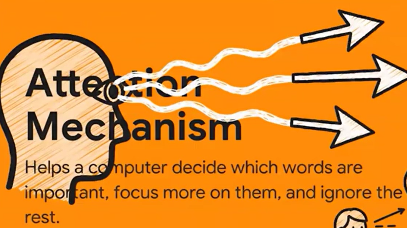

Pai image lo definition:

> **"Helps a computer decide which words are important, focus more on them, and ignore the rest."**

Simple ga Tenglish lo — **attention** anedi computer ki **"ee sentence lo ye words important?"**
ani decide cheyyadaniki help chestundi. Important words meeda **ekkuva focus** pedutundi,
migatha words ni **ignore** chestundi (leda chala takkuva importance istundi).

Picture lo **head nundi vellina arrows** chudandi — manishi kallu konni vishayala meeda
matrame focus chesinattu, model kuda konni words meeda matrame focus chestundi.
Aa "entha focus" ane number ne kinda table lo unna **attention weight**.

| Image lo part | Model lo meaning |
|---|---|
| Head / kallu (eye) | Ippudu process avuthunna word (Query) |
| Arrows | Aa word migatha words ni "chustundi" |
| Peddha focus | Ekkuva attention weight (ex: `it` → `cat` = 0.70) |
| "Ignore the rest" | Chala takkuva weight (ex: `on` = 0.01) — completely zero kaadu, kaani almost ignore |

**Attention** = model sentence lo unna **anni words ni oke saari** chusi, oka word
meaning decide cheyyadaniki **prathi word enta important** ani decide chese method.

`it` ki model ichhe importance scores (veetini **attention weights** antaru):

| Word | Attention weight |
|---|---|
| The | 0.02 |
| **cat** | **0.70** |
| sat | 0.05 |
| on | 0.01 |
| the | 0.02 |
| mat | 0.15 |
| because | 0.03 |
| was | 0.01 |
| tired | 0.01 |

Anni weights kalipithe **1.0 (100%)** avutundi. `cat` ki ekkuva weight vachindi
kabatti, `it` meaning ekkuva bhaagam `cat` nundi build avutundi.

#### Inko example — Sita, she, Ravi, book

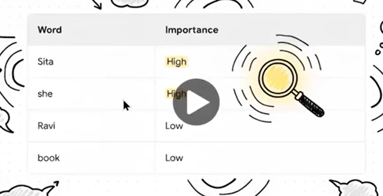

Ee sentence anukondi (slide lo full sentence kanipinchaledu — ardham kosam oka example):

```text
"Sita gave Ravi a book because she was going to Hyderabad."
```

Model **`she`** ane word ni process chesthunnappudu adugutundi —
*"ee `she` evaru? naaku ye words important?"*

| Word | Importance | Enduku? |
|---|---|---|
| **Sita** | **High** | `she` ante **Sita** ne — female name, `she` ki direct ga connect avutundi |
| **she** | **High** | Ippudu process avuthunna word e idi — tanani tanu kuda chustundi (self-attention) |
| Ravi | Low | Male name — `she` ki match avvadu |
| book | Low | Oka vasthuvu (object) — `she` evaro cheppadu |

Image lo **magnifying glass (bhootaddam)** chudandi — model `Sita`, `she` meeda
**zoom** chesi focus chestundi, `Ravi`, `book` ni dadapu ignore chestundi.

> **Gurthu pettukondi:** "High / Low" ani slide lo simple ga chupincharu. Nijam ga model
> **numbers** istundi (ex: Sita = 0.65, she = 0.25, Ravi = 0.06, book = 0.04) — anni kalipithe **1.0**.
> Paina `it → cat` example lo chusindi kuda exactly idhe idea.

#### Attention 4 steps lo — Read → Check → Focus → Answer


```text
[1. Read]  →  [2. Check]  →  [3. Focus]  →  [4. Answer]
 full          prathi word     important      focus chesina
 sentence      entha           words ki       words tho
 chadavali     important?      ekkuva focus   answer ivvali
```

| Step | Slide lo | Tenglish lo meaning | Sita example lo | Model lopala (technical) |
|---|---|---|---|---|
| **1. Read** | Read the full sentence | Mundu **motham sentence** chadavali — okko word vidiga kaadu | "Sita gave Ravi a book because she…" anni words chadivindi | Anni tokens → embeddings (numbers) |
| **2. Check** | Check how important each word is | Prathi word ki **"idi entha important?"** ani score ivvali | `she` ki: Sita = High, Ravi = Low, book = Low | **Query × Key** → scores |
| **3. Focus** | Give more focus to important words | High score unna words ki **ekkuva weight**, migathavi dadapu ignore | Sita meeda ekkuva focus | **Softmax** → attention weights (motham = 1.0) |
| **4. Answer** | Use focused words to give an answer | Focus chesina words info ni kalipi **final meaning / answer** | `she` = **Sita** ani ardham | Weights × **Value** → kotha meaning vector → next token |

> **Oka line lo:** Attention = *chaduvu → evaru important o check chey → vaalla meeda focus pettu → daani base chesukoni answer ivvu.*
> Manam exam lo question chadivi, **keywords** underline chesi, vaati base meeda answer rasinattu — model kuda alaage.
> Step 2, 3, 4 lo unna **Query / Key / Value** ni kinda section lo deep ga chuddam.

#### Lopala ela pani chestundi? — Query, Key, Value

Prathi word ni model **moodu number lists (vectors)** ga marchutundi:

- **Query (Q)** — *"Nenu emi vethukutunnanu?"* (question adige word, e.g. `it`)
- **Key (K)** — *"Naa daggara emi undi?"* (prathi word pattukune label/board)
- **Value (V)** — *"Idi naa asalu information"* (pass ayye actual content)

**Library example tho ardham chesukondi:**

```text
Query  =  library search box lo type chese topic   ("tired ayina animal?")
Key    =  prathi book spine meeda unna title        ("cat", "mat", "sat"...)
Value  =  book lopala unna actual content
```

Search topic ki title baga match ayithe, aa book content ni ekkuva teesukuntam.
Attention kuda exact ga ide chestundi.

**Steps (oka dani tarvata okati):**

```text
Step 1: COMPARE  -> "it" Query ni, prathi word Key tho compare chey
                    (baga match ayithe high score)
                         |
                         v
Step 2: SOFTMAX  -> scores ni percentages ga marchu (motham = 1.0)
                    (paina table lo unnavi ive)
                         |
                         v
Step 3: MIX      -> anni Values ni weights batti kalupu
                    70% cat info + 15% mat info + ... 
                         |
                         v
Step 4: RESULT   -> "it" ki kotha, context telisina meaning vachindi
                    (it = cat ani model ki ardham ayindi)
```

#### Formula (ekkada chusina idi kanipistundi)

```text
Attention(Q, K, V) = softmax( Q · Kᵀ / √d ) · V
```

| Part | Simple meaning |
|---|---|
| `Q · Kᵀ` | Match scores — Query ni prathi Key tho compare cheyyadam (Step 1) |
| `/ √d` | Scores ni chinnaga cheyyadam, lekapothe numbers chala pedda ayipotayi (`d` = vector size) |
| `softmax` | Scores ni percentages ga marchadam (Step 2) |
| `· V` | Weighted mix — Values ni weights tho kalapadam (Step 3) |

#### Related words — tarachuga vintaru

- **Self-attention** — oke sentence lo prathi word, **adhe sentence** lo unna migatha
  words ni chustundi (paina `Bank` example, `it` example — rendu ide).
- **Multi-head attention** — model **chala attention calculations parallel ga**
  chestundi. Oka "head" grammar chustundi, inkokati `it` evarini refer chestundo
  chustundi, inkokati pakkana unna words chustundi. Chivarlo anni results kaluputundi.
  Oka problem ni chala mandi experts different angles nundi chusinattu.
- **Transformer** — attention meeda build chesina model design. GPT, Claude, BERT —
  ivanni Transformers e.

#### Enduku idi intha pedda deal?

| Attention mundu (RNN / LSTM) | Attention tho (Transformer) |
|---|---|
| Okko word, left to right chadivevi | Anni words oke saari chustundi |
| Pedda sentences lo modati words marchipoyevi | Enta dooram lo unna word aina direct ga chudagaladu |
| Slow — parallel cheyyalemu | Fast — anni words parallel ga process |

> **Oka line lo gurthu pettukondi:**
> Attention = prathi word ki, *"migatha words lo evaru naaku ekkuva important?"*
> ani decide chesi, vaalla nundi ekkuva meaning teesukodam.

### 4.2 Softmax ante enti?

Model direct ga "I" ani cheppadu. Adi **anni words ki scores** istundi, tarvata
aa scores ni **probability** ga marchutundi — motham kalipithe 1.0 avutundi.

```text
Raw scores (logits)        Softmax tarvata (probabilities)
  I    ->  8.2                 I    ->  0.71   (71% chance)
  we   ->  6.4       ===>      we   ->  0.12
  you  ->  6.0                 you  ->  0.08
  dog  -> -2.1                 dog  ->  0.0001
  ...                          ...
                               ------------------
                               motham  =  1.00
```

Chivarlo highest probability unna token select avutundi (temperature setting
batti kondaru saarlu 2nd / 3rd option kuda select kaavachu — daani gurinchi kinda).

### 4.3 GPT internal ga ela pani chestundi? (Full pipeline — lopala nundi)

GPT chese pani **oke okati** — konchem text isthe, **next chinna piece (token)**
predict chestundi. Aa pani ni malli malli repeat chesi full answer rasthundi.

Oke example tho motham follow avudam: prompt **"I love eating"** → GPT predict
chese word **"pizza"**.

#### Full pipeline — oka chupu lo

```text
"I love eating"
      ↓
[1] Tokenizer        → text ni tokens ga kosi, numbers ga marchutundi
      ↓
[2] Embedding        → prathi number ni meaning unna number-list (vector) ga marchutundi
      ↓
[3] Position info    → "ee word ye position lo undi" ane info add chestundi
      ↓
[4] Transformer blocks (× chala layers)
      ├─ Self-attention  → words okaridini okaru chusi context share chesukuntayi
      └─ Feed-forward    → prathi word nerchukunna daani gurinchi "alochistundi"
      ↓
[5] Output layer     → vocabulary lo unna PRATHI token ki oka score
      ↓
[6] Softmax          → scores ni probabilities ga marchutundi
      ↓
[7] Pick a token     → "pizza"
      ↓
[8] Loop             → "I love eating pizza" malli lopaliki → next token...
```

#### Step 1 — Tokenizer: text → numbers

Computer ki **numbers matrame** ardham avutayi. Andhuke text ni **tokens** ga
kostharu (token = oka word leda word lo oka bhaagam).

```text
"I love eating"  →  ["I", " love", " eating"]  →  [40, 1842, 12364]
```

Prathi token ki vocabulary lo oka fixed ID untundi (vocabulary ~50,000 – 2,00,000 tokens).

#### Step 2 — Embedding: number → meaning

`1842` ane number ki sontha ga meaning emi ledu. Andhuke prathi ID ni oka pedda
table lo chusi, **vector** ga marchutaru — ante oka pedda number list (e.g. 4096 numbers).

```text
" love" → [0.21, -0.83, 0.05, ..., 0.47]
```

Similar meaning unna words ki **similar vectors** vastayi:
`love` and `like` daggara daggara untayi; `love` and `table` chala dooram ga untayi.

#### Step 3 — Position info: word ekkada undi?

**"Dog bites man"** vs **"Man bites dog"** — same words, kaani meaning purthiga veru!
Andhuke prathi vector ki **position info** add chestaru —
"idi 1st word", "idi 2nd word"... ila.

#### Step 4 — Transformer blocks: asalu brain

Asalu pani ikkade jarugutundi. Oka block lo **rendu parts** untayi, and ee block ni
**chala saarlu stack** chestaru (GPT-3 lo **96 layers**).

**a) Self-attention** — prathi token, tana **mundu unna** tokens anni chusi, evaru
enta important ani decide chestundi (paina 4.1, 4.1.1 lo chusam).
`eating` ki attention `love`, `I` meeda focus chestundi — so model ki ardham
avutundi: *"evaro edo tinadaniki ishtapadutunnaru → next food word raavali"*.

> GPT lo **masked (causal) attention** untundi — ante token **venakki matrame**
> chudagaladu, future words ni chudaledu. Endukante daani pani ne next word
> guess cheyyadam kada — answer mundhe chusthe cheating avutundi 😄

**b) Feed-forward network** — attention context collect chesina tarvata, prathi
token vector oka chinna neural network lo nundi velthundi. Idi model ki
**knowledge store** laantidi — "pizza oka food", "Paris France lo undi" laanti
facts ikkade weights lo store ayi untayi.

Prathi layer understanding ni konchem konchem improve chestundi:

```text
Early layers  → grammar, word types (noun aa? verb aa?)
Middle layers → meaning, words madhya relations
Later layers  → "next em raavali?"
```

#### Step 5 — Output layer: prathi possible token ki score

**Last token** (`eating`) yokka final vector ni teesukuni, vocabulary lo unna
**prathi token ki oka score** istundi. Ee raw scores ni **logits** antaru.

```text
pizza → 9.1    food → 7.8    rice → 7.5    table → -3.2    ...
```

#### Step 6 — Softmax: scores → probabilities

```text
pizza → 0.42   food → 0.15   rice → 0.11   ...   (motham kalipithe 1.0)
```

(Softmax gurinchi detail ga paina 4.2 lo undi.)

#### Step 7 — Token select cheyyadam

GPT sadharanam ga ekkuva probability unna token select chestundi, kaani
**eppudu top one e kaadu**. **Temperature** setting enta randomness undalo control chestundi:

- **Low temperature** → safe, predictable answers
- **High temperature** → creative, different answers

#### Step 8 — Loop: okko token, okko saari

```text
"I love eating"            → "pizza"
"I love eating pizza"      → " with"
"I love eating pizza with" → " friends"
... <END> token vache varaku, leda max length reach ayye varaku
```

Andhuke ChatGPT answer **word by word** type avuthunnattu kanipistundi —
nijamga ne adi okko token generate chestundi!

#### GPT idanta ela nerchukundi? (Training)

Paina chusindi GPT ni **use** cheyyadam (deenini **inference** antaru).
Daaniki mundu GPT ni **train** cheyyali:

| Stage | Em jarugutundi | Simple ga |
|---|---|---|
| **1. Pre-training** | Internet, books nundi trillions of words chaduvutundi. Prathi saari next token guess chesi, real answer tho check chesi, thappu ayithe weights ni konchem adjust chestundi | "Next word guess cheyyi" game ni billions saarlu aadi language + facts nerchukuntundi |
| **2. Fine-tuning** | Manchi question → answer examples tho train chestaru | Just text continue cheyyadam kaakunda, helpful assistant laaga behave cheyyadam nerchukuntundi |
| **3. RLHF** (Reinforcement Learning from Human Feedback) | Humans answers ni "better / worse" ani rank chestaru, model better type answers ni prefer cheyyadam nerchukuntundi | Helpful ga, polite ga, safe ga undadam nerchukuntundi |

**Weights (parameters)** ante — model lopala unna **billions of numbers**
(embedding table, attention, feed-forward lo). Training lo ee numbers ni matrame
adjust chestaru. GPT-3 lo **175 billion** parameters unnayi!

#### Gurthu pettukovalsina points

- GPT ki chats madhya **memory ledu** — prathi saari motham conversation ni modati nundi malli chaduvutundi.
- Adi facts ni database laaga "telusukodu" — **likely text** ni predict chestundi. Andhuke **hallucinate** chestundi (confident ga thappu cheppadam).
- **Context window** = oke saari enni tokens chadavagalado aa limit.

> **Oka line lo:** GPT text ni numbers ga marchi, chala layers attention dwara
> words context share chesukunela chesi, prathi possible next token ki score ichhi,
> okati select chesi — malli repeat chestundi.

### 4.4 Attention — input tokens ki aa, output tokens ki aa, rendintiki aa?

**Short answer: Rendintiki kavali.** GPT lo attention **prathi token** meeda run
avutundi — meeru type chesina tokens meeda, GPT rase tokens meeda kuda.

#### Mundu konni technical words — simple meanings

| Term | Simple meaning |
|---|---|
| **Token** | Text lo oka chinna piece — oka word leda word lo bhaagam (e.g. `"eating"`) |
| **Sequence** | Tokens anni oka line lo, order lo (e.g. `I → love → eating`) |
| **Input tokens** | Meeru type chesina prompt lo unna tokens |
| **Output tokens** | GPT generate chese (rase) answer tokens |
| **Prompt** | Meeru GPT ki ichhe question / instruction |
| **Generate** | GPT kotha token ni create cheyyadam (predict chesi rayadam) |

#### GPT lo "input" ki "output" ki madhya goda (wall) ledu

GPT ki unnadi **oke oka pedda sequence**. Mundu mee prompt, tarvata GPT rase prathi
word **adhe sequence chivara add** avutundi.

```text
Mee prompt (input)           GPT answer (output)
"I love eating"         →    "pizza"  " with"  " friends"
└──────────────── oke oka sequence ────────────────┘
```

GPT `"pizza"` generate chesina ventane, adi **next step ki input lo bhaagam**
ayipotundi. Ante output tokens ventane input tokens ga maripotayi.

#### Stage 1 — Prompt chadavadam (input tokens) → **Prefill**

**Prefill** = GPT answer rayadaniki mundu, mee motham prompt ni oke saari chadivi
artham chesukune stage. ("Pre" = mundu, "fill" = nimpadam — memory ni mundhe
nimpadam laaga.)

Prompt tokens anni **kalisi, parallel ga** attention lo nundi veltayi.
**Parallel** ante — okati tarvata okati kaakunda, **anni oke saari** process avvadam.
Prathi token tana **venaka** unna tokens ni chustundi:

```text
"I"       → chustundi: (mundu emi ledu)
"love"    → chustundi: I
"eating"  → chustundi: I, love
```

#### Stage 2 — Answer rayadam (output tokens) → **Decoding / Generation**

**Decoding** = okko kotha token ni okko saari generate chese stage.

Prathi kotha token kosam attention **malli** run avutundi. Kotha token **venaka
unna anni** — mee prompt + GPT already rasina words — anni chustundi:

```text
"pizza" tarvata predict chesetappudu → chustundi: I, love, eating, pizza
"with"  tarvata predict chesetappudu → chustundi: I, love, eating, pizza, with
```

Andhuke GPT topic marchipodu — answer lo 50th word rasthunnappudu kuda, mee
original question ni attention dwara chudagaladu.

#### Rule: Causal / Masked attention

| Term | Simple meaning |
|---|---|
| **Causal attention** | "Cause tarvate effect" laaga — token **mundu jarigina (venaka unna)** tokens ni matrame chudagaladu |
| **Masked attention** | Future tokens ni **mask (daachi pettadam)** chestaru — kanipinchakunda cover chestaru. Causal ki inko peru |

```text
Sentence: I   love   eating   pizza
          ✓    ✓      ✓      [mask]   ← "eating" ki "pizza" kanipinchadu
```

> Endukante GPT pani ne next word guess cheyyadam — answer mundhe chusthe
> exam lo answer key chusinattu, cheating avutundi 😄

#### Speed trick: **KV Cache**

Mundu Q, K, V gurthu chesukondi (4.1.1 lo chusam):

| Term | Simple meaning |
|---|---|
| **Query (Q)** | "Nenu emi vethukutunnanu?" — question adige token |
| **Key (K)** | "Naa daggara emi undi?" — prathi token pattukune label |
| **Value (V)** | Token yokka asalu information |
| **Cache** | Malli malli calculate cheyyakunda, result ni **save chesi pettukovadam** (mobile lo app cache laaga) |
| **KV Cache** | Paata tokens yokka **Key, Value** vectors ni save chesi pettukovadam |

Prathi kotha token kosam GPT motham modati nundi recalculate chesthe — chala slow.
Andhuke paata tokens Keys, Values ni **save** chestundi. Kotha token ki matrame
Q, K, V calculate chesi, saved K/V tho attention chestundi.

```text
KV cache lekunda: prathi step lo anni tokens ki attention malli calculate → slow 🐢
KV cache tho:     kotha token ki matrame calculate, paatavi reuse        → fast 🚀
```

#### Original Transformer (2017) — idi konchem veru setup

Original *"Attention Is All You Need"* model **translation** kosam (English → French)
build chesaru. Andulo input, output ki **veru veru parts** unnayi:

| Term | Simple meaning |
|---|---|
| **Encoder** | Input sentence ni **chadivi artham chesukune** part (English sentence chadavadam) |
| **Decoder** | Output ni **okko word rase** part (French words rayadam) |
| **Bidirectional attention** | "Bi" = rendu, "direction" = vaipu — token **mundu, venaka rendu vaipula** words chudagaladu |
| **Self-attention** | Oke sentence lo words, **adhe sentence** lo words ni chudadam |
| **Cross-attention** | Okka sentence lo words, **inko sentence** lo words ni chudadam (output → input) |

Andulo **moodu rakaala attention** undi:

| Part | Attention type | Em chestundi |
|---|---|---|
| **Encoder** (input side) | Self-attention, **bidirectional** | Input words anni migatha input words ni chustayi (rendu vaipula) |
| **Decoder** (output side) | **Masked** self-attention | Output words venaka unna output words ni matrame chustayi |
| **Decoder → Encoder** | **Cross-attention** | Prathi output word input sentence ni chustundi — "ippudu nenu ye English word ni translate chesthunna?" |

```text
English input  →  [ENCODER]  ──cross-attention──→  [DECODER]  →  French output
                  (self-attn,                      (masked self-attn)
                   rendu vaipula)
```

#### Model types — ye model lo ye attention?

| Model type | Simple meaning | Examples | Attention |
|---|---|---|---|
| **Decoder-only** | Rase part matrame undi | **GPT, Claude, Llama** | Oke sequence, prathi token ki masked self-attention |
| **Encoder-only** | Chadive (artham chesukune) part matrame | BERT | Bidirectional self-attention (text artham chesukovadaniki, generate cheyyadaniki kaadu) |
| **Encoder-decoder** | Rendu parts unnayi | Original Transformer, T5 | Encoder self-attn + decoder masked self-attn + cross-attention |

> **Oka line lo:** GPT lo attention input + output rendu tokens meeda run avutundi,
> endukante avi anni oke sequence. Prathi token venaka unna anni tokens ni chustundi,
> and output tokens next step ki input ayipotayi.

---

### 4.5 Ee maths antha ekkada run avutundi? — GPU & TPU

Paina chusina prathi step — embedding, attention (Q·Kᵀ), softmax, output layer —
anni chivariki **numbers ni multiply chesi add cheyyadame** (matrix multiplication).
Oka chinna prompt ki kuda **billions of multiplications** jarugutayi.
Ee pani ni fast ga chese hardware ye **GPU** and **TPU**.

#### Mundu konni technical words — simple meanings

| Word | Simple meaning |
|---|---|
| **CPU** | Computer lo main processor. Konni (8–64) **powerful cores** — okko pani ni chala smart ga chestundi |
| **GPU** | Graphics Processing Unit. **Velalla (thousands) chinna cores** — simple pani ni oke saari kotlu saarlu chestundi |
| **TPU** | Tensor Processing Unit. **Google** AI kosame design chesina chip — matrix maths matrame chestundi |
| **Core** | Chip lopala oka chinna "worker" — oka calculation chese unit |
| **Parallel processing** | Chala panulu **oke time lo** cheyyadam (okati tarvata okati kaadu) |
| **Matrix multiplication** | Rendu numbers tables ni multiply cheyyadam — neural network lo ekkuva pani idhe |
| **Tensor** | Numbers unna multi-dimensional box (list → table → cube …) |
| **VRAM / HBM** | GPU/TPU meeda unde **fast memory** — model weights ikkade load avutayi |
| **CUDA** | NVIDIA GPU ni program cheyyadaniki software platform. PyTorch lopala idhe use avutundi |
| **Training** | Model ni nerpinchadam — weeks/months, velalla chips |
| **Inference** | Nerchukunna model tho answer generate cheyyadam (mana ChatGPT use) |

#### Enduku CPU saripodu? — Simple example

Oka exam lo **10 lakh simple addition questions** unnayi anukondi.

```text
CPU  = 8 mandi maths professors    → prathi okkaru chala fast, kaani 8 mandi matrame
GPU  = 10,000 mandi school pillalu → prathi okkaru slow, kaani 10,000 mandi oke saari
TPU  = addition kosame tayaru chesina factory assembly line → inka fast, kaani addition matrame
```

Questions anni **simple and independent** (okati inkokati meeda depend avvadu) —
andhuke **10,000 pillalu professors kanna chala mundu** pani complete chestaru.
Neural network maths kuda exactly ilaage untundi: **simple multiply-add, kotlu saarlu, parallel ga.**

#### Transformer lo GPU/TPU ekkada use avutundi?

```text
[Text → Tokens]  → CPU (tokenizer — chinna pani, CPU chalu)
    ↓
[Embedding lookup]           ┐
[Q, K, V = X × W]            │
[Attention = softmax(QKᵀ)V]  │  ← ivi anni GPU / TPU meeda
[Feed-forward layers]        │     (heavy matrix multiplication)
[Output layer + softmax]     ┘
    ↓
[Token select + decode] → malli CPU (chinna pani)
```

- **Attention:** prathi token, migatha anni tokens tho score calculate chestundi — 1,000 tokens unte ~10 lakh scores. Ivi anni **independent** — GPU oke saari chestundi.
- **Prefill (Section 4.4):** prompt lo anni tokens oke saari process avutayi → GPU cores anni busy — **compute** important.
- **Decoding:** okko token generate avutundi, prathi saari motham model weights memory nundi chadavali → **memory speed (bandwidth)** important. Andhuke **KV cache** GPU memory lo pettukuntaru.

#### Training lo vs Inference lo

| | **Training** | **Inference** |
|---|---|---|
| Em jarugutundi | Forward pass + backward pass (weights update) | Forward pass matrame |
| Entha hardware | Velalla GPUs/TPUs, weeks–months | Konni GPUs, milliseconds–seconds per answer |
| Ekkuva kavalsindi | Raw compute + chips madhya fast network | Memory + low latency |

#### GPU vs TPU — side by side

| | **GPU** (NVIDIA A100, H100 …) | **TPU** (Google TPU v4, v5 …) |
|---|---|---|
| Evaru tayaru chestaru | NVIDIA (AMD kuda) | Google matrame |
| Modata enduku | Games graphics kosam — tarvata AI ki baga suit ayyindi | Modati nunchi **AI kosame** |
| Lopala design | Velalla general cores + **Tensor Cores** (matrix kosam special units) | **Systolic array** — numbers oka grid lo pass avutu multiply-add avutayi |
| Flexibility | Chala ekkuva — AI, gaming, science, video edit anni | Takkuva — matrix/tensor maths ki matrame best |
| Ela vadataru | Konachu (buy) leda AWS / Azure / GCP lo rent | **Google Cloud** lo rent (Colab lo free ga try cheyyochu) |
| Software | **PyTorch + CUDA** (most popular) | **JAX / TensorFlow** + XLA compiler (PyTorch/XLA kuda undi) |
| Ekkada vadataru | Industry lo ekkuva mandi (Meta Llama, chala startups) | Google (Gemini, PaLM) |

> **Simple ga:** GPU = Swiss army knife (anni pani chestundi, AI lo kuda chala baga).
> TPU = AI kosame tayaru chesina special tool (matrix maths lo chala efficient, kaani Google Cloud lo matrame).

#### Memory enduku antha important?

Model weights motham GPU memory lo undali. Chinna calculation:

```text
70 Billion parameters × 2 bytes (fp16 lo okko number) = 140 GB
Okka H100 GPU memory                                   = 80 GB
→ Okka GPU lo pattadu! Kanisam 2 GPUs kavali (+ KV cache ki inka space)
```

Andhuke pedda models ni **chala GPUs/TPUs meeda split** chestaru (model parallelism).
Training ki aite **velalla chips** weeks/months continuous ga run avutayi — andhuke AI training ki crores kharchu avutundi.

#### Code lo GPU ela use chestaru? (PyTorch)

Section 6 lo unna code ni GPU meeda run cheyyali ante — **model ni, data ni GPU ki pampali**, antey.

```python
# ---------------- Architecture Diagram ----------------
# [Check GPU available aa?]
#    ↓
# [Model weights → GPU memory]
#    ↓
# [Input token IDs → GPU memory]
#    ↓
# [Forward pass GPU meeda]  → matrix maths anni GPU cores lo parallel ga
#    ↓
# [Result → CPU ki tirigi]  → text ga decode cheyyadaniki
#
# ---------------- Deep Architecture Notes ----------------
# Step 1: torch.cuda.is_available() tho NVIDIA GPU undo ledo check chestam
# Step 2: model.to(device) — weights anni GPU VRAM loki copy avutayi
# Step 3: inputs kuda same device ki pampali — leda error vastundi (CPU tensor + GPU tensor kalavavu)
# Step 4: forward pass GPU meeda jarugutundi — CPU kanna chala fast
# Step 5: .cpu() tho result ni malli CPU ki teesukoni decode chestam

import torch                                                    # PyTorch library — tensors, GPU support
from transformers import AutoModelForCausalLM                   # pre-trained GPT-style model load cheyyadaniki
from transformers import AutoTokenizer                          # text ↔ token IDs marchadaniki

device = "cuda" if torch.cuda.is_available() else "cpu"         # GPU unte "cuda", lekapothe CPU ki fallback
print("Running on:", device)                                    # ekkada run avutundo chupistundi

tokenizer = AutoTokenizer.from_pretrained("gpt2")               # gpt2 tokenizer load — idi CPU meede pani chestundi
model = AutoModelForCausalLM.from_pretrained("gpt2")            # model weights mundu CPU RAM loki load avutayi
model = model.to(device)                                        # weights anni GPU memory (VRAM) loki copy

inputs = tokenizer("Hi How can I", return_tensors="pt")         # text → token IDs tensor (CPU lo undi)
inputs = inputs.to(device)                                      # token IDs ni kuda GPU ki — model unna chote data undali

with torch.no_grad():                                           # training kaadu — gradients avasaram ledu, memory save
    outputs = model(**inputs)                                   # forward pass — heavy matrix maths anni GPU lo

next_token_id = outputs.logits[0, -1, :].argmax().cpu()         # highest score token ni teesi CPU ki tirigi teesukuntam
print(tokenizer.decode(next_token_id))                          # token ID → text ga print
```

> **TPU meeda aite:** Google Colab lo *Runtime → Change runtime type → TPU* select chesi,
> sadharanam ga **JAX** leda **TensorFlow** tho rastaru. Idea same — model, data ni accelerator meedaki pampi
> akkada matrix maths run cheyyadam.

#### Gurthu pettukovalsina points

1. Transformer lo pani antha **matrix multiplication** — simple maths, kaani kotlu saarlu.
2. **CPU** = konni smart cores, **GPU** = velalla simple cores → parallel maths lo GPU chala fast.
3. **TPU** = Google AI kosame chesina chip — matrix maths lo inka efficient, kaani Google Cloud lo matrame.
4. **Memory (VRAM)** kuda compute antha important — model weights + KV cache anni GPU lo pattali.
5. Code lo: `model.to("cuda")` + `inputs.to("cuda")` — rendu oke device lo undali.
6. Tokenizer (tiktoken) **CPU** meede run avutundi — heavy pani antha model lopala, GPU meeda.

---

### 4.6 Core Concepts of Transformers — Full Architecture Diagram

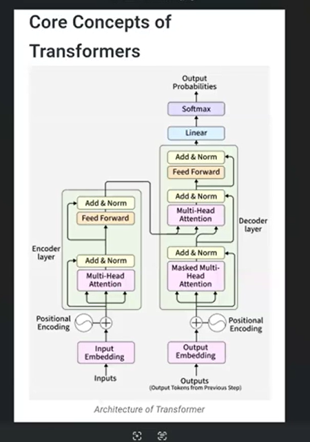

Idi **2017 lo "Attention Is All You Need"** paper lo vachina **original Transformer** diagram.
Ee okka picture nundi ne GPT, BERT, Claude, Gemini — anni puttayi.
Diagram ni **kinda nundi paiki** chadavali (data kinda nundi paiki flow avutundi).

Rendu peddha parts unnayi:

| Part | Side | Pani |
|---|---|---|
| **Encoder layer** | Left (edama) box | Input sentence ni **chadivi ardham chesukuntundi** |
| **Decoder layer** | Right (kudi) box | Ardham chesukunna daani base meeda **output ni okko token rastundi** |

Example kosam **translation** anukondi:

```text
Input  (Encoder ki):  "I love India"
Output (Decoder nundi): "Nenu India ni premistanu"   ← okko token, okko saari
```

#### Mundu konni technical words — simple meanings

| Word | Simple meaning |
|---|---|
| **Embedding** | Token ID ni **meaning unna numbers list (vector)** ga marchadam |
| **Positional Encoding** | Prathi word **ye position lo undo** cheppe numbers — embedding ki add chestaru (⊕ symbol) |
| **Multi-Head Attention** | Attention ni **okkasari kaadu, chala "heads" tho parallel ga** cheyyadam — prathi head veru angle lo chustundi |
| **Masked Attention** | **Future words ni chudakunda** block chesina attention (Section 4.4 lo chusam) |
| **Add & Norm** | **Add** = input ni output ki malli kalapadam (residual / shortcut), **Norm** = numbers ni balanced range lo pettadam (layer normalization) |
| **Feed Forward** | Prathi word ni **vidiga** process chese chinna neural network — attention tarvata "alochinchadam" |
| **Linear** | Final vector ni **vocabulary size** scores (logits) ga marche layer |
| **Softmax** | Scores ni **probabilities** ga marchutundi (motham = 1.0) |

#### Left side — Encoder (input ni ardham chesukovadam)

```text
Inputs ("I love India")
   ↓
[Input Embedding]        → prathi token ki oka vector
   ↓
 ⊕ Positional Encoding   → "ee word ye position lo undi" info add
   ↓
┌──────── Encoder layer (Nx times repeat) ────────┐
│ [Multi-Head Attention]  → prathi word, migatha   │
│                           anni words ni chustundi │
│ [Add & Norm]                                      │
│ [Feed Forward]          → prathi word ni deep ga  │
│                           process                 │
│ [Add & Norm]                                      │
└───────────────────────────────────────────────────┘
   ↓
Encoder output  → Decoder ki velthundi (madhyalo unna arrow)
```

1. **Input Embedding:** "I", "love", "India" → prathi token oka numbers vector ga marutundi.
2. **Positional Encoding (⊕):** Transformer anni words ni **oke saari** chustundi — kabatti order teliyadu. Andhuke position info ni embedding ki **add** chestaru. Leda "I love India" and "India love I" rendu same ga kanipistayi.
3. **Multi-Head Attention:** Prathi word, migatha anni words ni chusi context theeskuntundi. Diagram lo **3 arrows** lopaliki velthunnayi — avi **Query, Key, Value** (Section 4.1.1). "Multi-head" ante — oka head grammar chustundi, inkoti meaning chustundi, inkoti relations chustundi… ila chala heads parallel ga.
4. **Add & Norm:** Attention output + original input kalipi (**residual connection** — info poakunda shortcut), tarvata normalize. Deep network lo training stable ga undadaniki idi chala important.
5. **Feed Forward:** Prathi word vector ni vidiga oka chinna neural network lo pampi inka refine chestaru.
6. **Add & Norm** malli.
7. Ee motham block ni **Nx saarlu** (original paper lo 6 saarlu) okadaani meeda okati pedataru.

#### Positional Encoding — deep ga (Durga Sir class)

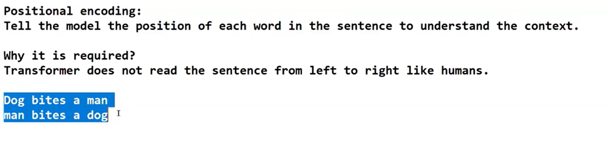

**Class lo ichhina definition:**

> **Positional encoding:** Tell the model the position of each word in the sentence to understand the context.

Simple ga — sentence lo **prathi word ye position lo undo** model ki cheppadam.
Appude model ki **context (meaning)** correct ga ardham avutundi.

**Enduku kavali? (Why it is required?)**

> **Transformer does not read the sentence from left to right like humans.**

Manam sentence ni **edama nundi kudi ki** (left → right) okko word chaduvutam —
kabatti order mana ki automatic ga telusu. Kaani Transformer **anni words ni oke saari**
(parallel ga) chustundi. Andhuke daaniki **"ye word mundu, ye word tarvata"** ani teliyadu.

**Class example:**

```text
Sentence 1:  "Dog bites a man"   → kukka manishi ni kaarichindi  (normal news 🐕)
Sentence 2:  "man bites a dog"   → manishi kukka ni kaarichadu   (shocking news 😲)
```

- Rendu sentences lo **exactly same words** unnayi: `Dog`, `bites`, `a`, `man`.
- Kaani **order maarindi** → **meaning motham maaripoyindi** (evaru kaarcharu? evariki kaatu padindi?).
- Positional encoding **lekapothe**, Transformer ki ee rendu sentences **okkate** ga kanipistayi —
  endukante daaniki words ni oka **bag (sanchi)** laaga chustundi, order lekunda.

```text
Positional encoding LEKUNDA:
  "Dog bites a man"  →  { Dog, bites, a, man }   ┐
  "man bites a dog"  →  { man, bites, a, Dog }   ┘  → model ki rendu SAME ❌

Positional encoding THO:
  "Dog bites a man"  →  Dog@1, bites@2, a@3, man@4   ┐
  "man bites a dog"  →  man@1, bites@2, a@3, dog@4   ┘  → rendu DIFFERENT ✅
```

**Ela pani chestundi?**

Prathi position ki (1, 2, 3, …) oka **position vector** untundi. Daanni word embedding ki **add** chestaru —
diagram lo unna **⊕** symbol ide.

```text
Final input vector  =  Word embedding ("Dog" meaning)  +  Position vector (position 1)

"Dog" @ position 1  →  [0.21, 0.80, …] + [0.00, 1.00, …]  =  [0.21, 1.80, …]
"Dog" @ position 4  →  [0.21, 0.80, …] + [-0.76, -0.65, …] = [-0.55, 0.15, …]
                                         ↑ veru position → veru final vector
```

Ante **same word "Dog"**, position maarithe model ki **veru numbers** ga velthundi —
andhuke "Dog" subject aa (kaarichindi) leda object aa (kaatu padindi) ani model ardham chesukuntundi.
(Paina numbers ardham kosam matrame — nijam values model calculate chestundi.)

**Position vectors ekkada nundi vastayi?**

| Type | Ela | Ekkada use |
|---|---|---|
| **Sinusoidal** | `sin` / `cos` waves tho fixed formula — training avasaram ledu | Original Transformer (2017) — ee diagram |
| **Learned** | Prathi position ki vector ni model training lo **nerchukuntundi** | GPT-2, BERT |
| **RoPE (Rotary)** | Query, Key vectors ni position batti **rotate** chestaru | Llama, chala modern LLMs |

> **Oka line lo:** Transformer anni words ni oke saari chustundi kabatti order teliyadu —
> **positional encoding** prathi word ki *"nuvvu ee position lo unnav"* ani oka stamp vestundi.
> Lekapothe "Dog bites a man" and "man bites a dog" model ki okkate!

#### Multi-Head Attention — deep ga (Durga Sir class)

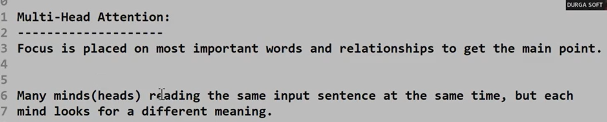

**Class lo ichhina definition:**

> **Multi-Head Attention:** Focus is placed on most important words and relationships to get the main point.
>
> **Many minds (heads) reading the same input sentence at the same time, but each mind looks for a different meaning.**

Simple ga — **oke sentence ni chala mandi (heads) oke saari chaduvutaru**, kaani
**prathi okkaru veru vishayam** kosam chustaru. Chivarlo andari observations kalipithe
sentence ki **full meaning** vastundi.

Real life example: oka cricket match ni
- **commentator** score chustadu,
- **coach** players technique chustadu,
- **umpire** rules chustadu,
- **fan** entertainment chustadu.

Andaru **same match** chustunnaru — kaani prathi okkari focus veru. Andari view kaliste match ki **complete picture**.

##### Class example — "Durga drinks cold mansion house at night"

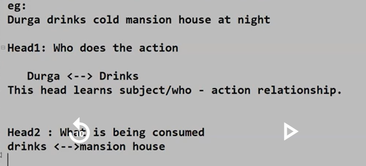

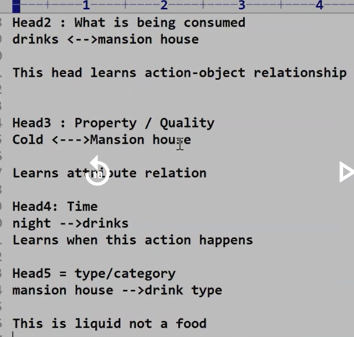

```text
Sentence:  "Durga drinks cold mansion house at night"
```

Ikkada **"Mansion House"** anedi oka **drink brand** (liquid) — ade model ardham chesukovali.

| Head | Em chustundi? | Connect chese words | Nerchukune relation |
|---|---|---|---|
| **Head 1** | Who does the action (evaru chestunnaru?) | `Durga` ⟷ `drinks` | **Subject – action** relationship |
| **Head 2** | What is being consumed (em taagutunnaru?) | `drinks` ⟷ `mansion house` | **Action – object** relationship |
| **Head 3** | Property / Quality (ela undi?) | `cold` ⟷ `mansion house` | **Attribute** relation (cold ane quality) |
| **Head 4** | Time (eppudu?) | `night` → `drinks` | Action **eppudu** jarugutundo |
| **Head 5** | Type / Category (idi enti?) | `mansion house` → drink type | Idi **liquid, food kaadu** |

```text
                "Durga drinks cold mansion house at night"
                                  │
        ┌──────────┬──────────────┼──────────────┬──────────┐
        ↓          ↓              ↓              ↓          ↓
     Head 1     Head 2         Head 3         Head 4     Head 5
     WHO?       WHAT?          QUALITY?       WHEN?      TYPE?
   Durga ⟷    drinks ⟷       cold ⟷        night →    mansion house
   drinks     mansion house  mansion house  drinks     → liquid
        │          │              │              │          │
        └──────────┴──────────────┼──────────────┴──────────┘
                                  ↓
                        [Concat — anni kalipi]
                                  ↓
     Full meaning: "Durga (evaru) raatri (eppudu) challani (ela)
                    Mansion House ane drink (em, ye type) taagutadu"
```

Okka head matrame unte — adi **okka relation** matrame baga pattukuntundi (ex: who-action).
**Chala heads** unte — who, what, quality, time, type **anni oke saari** pattukuntundi. Ade multi-head power.

##### Entha heads vadali? — Edi decide chestundi?

Idi chala common doubt. Important point:

> **Heads count input sentence batti maaradu.** Adi model **design chesetappude (training mundu)**
> engineers fix chese oka setting — deenni **hyperparameter** antaru.

- "Durga drinks cold mansion house at night" ki 5 heads, peddha paragraph ki 50 heads — **ala kaadu**.
- Model ki **8 heads** ani fix chesthe — 2-word input ki aina, 2000-word input ki aina **eppudu 8 heads ne**.
- Class example lo **5 heads** chupincharu — **ardham kosam**. Nijam models lo heads count fixed, and **prathi layer ki separate set** of heads untayi.

**Ye basis meeda decide chestaru?**

| Basis | Explanation |
|---|---|
| **Model size (d_model)** | Prathi token vector size ni (`d_model`) heads madhya **samaanam ga divide** chestaru. Kabatti `d_model` ni heads tho divide cheyyagalagali. Formula: **head size = d_model ÷ heads** |
| **Head size ~64–128** | Practical ga prathi head ki ~64 leda 128 numbers ichhe la heads count select chestaru — chala chinna head ayithe em nerchukoledu |
| **Hardware (GPU/TPU)** | Heads anni **parallel** ga run avutayi — GPU ki suit ayye numbers (8, 12, 16, 32, 64, 96…) select chestaru |
| **Experiments** | Engineers different values try chesi, ye value ki best accuracy / speed vastundo choose chestaru |

**Real models lo numbers:**

| Model | d_model (vector size) | Heads per layer | Head size (d_model ÷ heads) | Layers |
|---|---|---|---|---|
| Original Transformer (2017) | 512 | **8** | 64 | 6 |
| GPT-2 small | 768 | **12** | 64 | 12 |
| BERT-base | 768 | **12** | 64 | 12 |
| GPT-3 (175B) | 12,288 | **96** | 128 | 96 |
| Llama 2 7B | 4,096 | **32** | 128 | 32 |

Ante GPT-3 lo **96 layers × 96 heads = 9,216 heads** motham!

##### Prathi head ki "who" / "what" / "time" pani evaru istaru?

> **Evaru ivvaru!** Engineers *"Head 1 = who, Head 2 = what"* ani program cheyyaru.

- Training start lo anni heads **random numbers** tho start avutayi.
- Training lo (billions of sentences chadivi) prathi head **tanantata tane** oka useful pattern nerchukuntundi.
- Research lo chusinappudu — konni heads grammar (subject–verb), konni pronouns (`she` → `Sita`), konni next word, konni punctuation ni chustunnattu kanipistayi.
- Durga Sir example lo **who / what / quality / time / type** labels — idea ardham avvadaniki **simple ga ichhina names**. Nijam heads chese pani anni saarlu intha clean ga undakapovachu.

##### Lopala ela pani chestundi? (step by step)

Original Transformer numbers tho (d_model = 512, heads = 8):

```text
Input: prathi token ki 512 numbers vector
   │
   ├─→ Head 1: own W_Q1, W_K1, W_V1 → Q1, K1, V1 (64 numbers each) → attention → output 64
   ├─→ Head 2: own W_Q2, W_K2, W_V2 → Q2, K2, V2 (64 numbers each) → attention → output 64
   ├─→ ...
   └─→ Head 8: own W_Q8, W_K8, W_V8 → Q8, K8, V8 (64 numbers each) → attention → output 64
                                    │
                         [Concat: 8 × 64 = 512]
                                    ↓
                         [× W_O (output weight)]  → anni heads info ni mix chestundi
                                    ↓
                     Final: prathi token ki kotha 512 vector (context tho)
```

1. **Split:** Prathi head ki **own** Query, Key, Value weights (`W_Q`, `W_K`, `W_V`) untayi — andhuke prathi head veru angle lo chustundi.
2. **Attention (prathi head lo vidiga):** Section 4.1.1 lo chusina formula ne — `softmax(Q·Kᵀ / √d) · V`. Head 1 lo `Durga`→`drinks` ki high score, Head 3 lo `cold`→`mansion house` ki high score… ila.
3. **Parallel:** 8 heads **oke saari** run avutayi (GPU meeda — Section 4.5) — okati tarvata okati kaadu.
4. **Concat:** 8 heads outputs (8 × 64) ni pakka pakkana pedithe malli 512 vastundi.
5. **W_O (output projection):** Anni heads nundi vachina info ni **mix** chesi oka final vector chestundi.
6. Tarvata **Add & Norm → Feed Forward** (diagram lo next blocks).

> **Important:** 8 heads × 64 = 512 — ante heads ekkuva chesina **compute peragadu**, same 512 ni
> chinna pieces ga divide chestunnam. Andhuke multi-head "free lo" ekkuva perspectives istundi.

> **Oka line lo:** Multi-head attention = **oke sentence ni chala "minds" oke saari chadivi, prathi okkaru
> veru relation (who / what / when / quality) pattukuntaru, chivarlo anni kalipi full meaning.**
> Heads count = model design lo fix chese **hyperparameter** (input batti maaradu), prathi head em nerchukovalo
> **training lo tane nerchukuntundi.**

#### Add & Norm — deep ga (Encoder lo)

Diagram lo encoder box chudandi — **Add & Norm** rendu saarlu vastundi:

```text
        ┌───────────────────────────────┐
        │        [Add & Norm]  ←──────┐ │   ← 2nd Add & Norm
        │             ↑               │ │
        │       [Feed Forward]        │ │
        │             ↑               │ │
        │             ├───────────────┘ │   (shortcut / residual arrow)
        │        [Add & Norm]  ←──────┐ │   ← 1st Add & Norm
        │             ↑               │ │
        │  [Multi-Head Attention]     │ │
        │             ↑               │ │
        │             ├───────────────┘ │   (shortcut / residual arrow)
        └─────────────↑─────────────────┘
               Input (embedding ⊕ position)
```

Diagram lo **pakkana nundi Add & Norm ki velle arrow** chudandi — adi block ni **skip chesi**
direct ga velthundi. Ade **"Add"** part. Peru lo rendu panulu unnayi: **Add** + **Norm**.

##### Mundu konni technical words — simple meanings

| Word | Simple meaning |
|---|---|
| **Sub-layer** | Encoder lopala unna oka block — Multi-Head Attention leda Feed Forward |
| **Residual connection / Skip connection** | Block ki velle input ni, block output ki **direct ga kalapadam** (shortcut) |
| **Layer Normalization (LayerNorm)** | Prathi token vector lo numbers ni **balanced range** ki theesukuravadam (average ≈ 0, spread ≈ 1) |
| **Mean** | Average |
| **Variance / Std deviation** | Numbers average nundi **entha dooram** spread ayyayo |
| **Gradient** | Training lo "ee weight ni entha maarchali" ane signal |
| **Vanishing gradient** | Chala layers unte ee signal venakki velthu velthu **chala chinnaga ayipoyi** modati layers em nerchukolevu |

##### Part 1 — "Add" (Residual Connection)

**Formula:**

```text
Add output  =  x  +  Sublayer(x)

x            = block ki vachina input (original word vector)
Sublayer(x)  = Multi-Head Attention (leda Feed Forward) ichina output
```

Ante — attention em nerchukundo **adi matrame pampadam kaadu**, **original input ni kuda kalipi** pamputham.

**Real life example — Notes edit cheyyadam:**

```text
❌ Add LEKUNDA:  Teacher mee notes motham theesesi, kotha notes rasi istaru
                 → mee original points anni poyayi, teacher miss chesinavi kuda poyayi

✅ Add THO:      Mee notes alaage untayi + teacher corrections / extra points add chestaru
                 → original info safe, kotha info extra ga vachindi
```

Attention block **"track changes"** laaga pani chestundi — motham rewrite cheyyadu,
**em maarchalo (change) matrame** nerchukuntundi. Migathadi original input nundi vastundi.

**Enduku kavali? — 3 reasons:**

| Reason | Explanation |
|---|---|
| **1. Original info poadu** | Attention context add chestundi, kaani word yokka original meaning (`Dog` ante kukka) + position info poakunda input lo ne untundi |
| **2. Deep network train avutundi** | Encoder lo 6 layers, GPT-3 lo 96 layers. Shortcut lekapothe training signal (gradient) venakki velthu chinnaga ayipotundi (**vanishing gradient**). Shortcut ade signal ki **highway** laaga — direct ga modati layers varaku velthundi |
| **3. Nerchukovadam easy** | Block "full answer" nerchukovakkarledu, **"input ki em add cheyyali"** (chinna correction) matrame nerchukunte chalu. Em add cheyyakkarledu ante — output ≈ 0, input alaage pass avutundi |

##### Part 2 — "Norm" (Layer Normalization)

Add chesina tarvata numbers **chala peddaga leda chala chinnaga** ayye chance undi —
prathi layer lo add chestu pothe numbers inka perigipotayi. Andhuke **normalize** chestaru.

**Real life example — Volume control:**

Konni songs chala loud, konni chala silent ga record ayyayi anukondi. Player **volume ni balance** chesthe
anni songs oke level lo vinipistayi — kaani **song (tune) maaradu**. LayerNorm kuda anthe —
numbers **scale** maarchutundi, kaani vaati madhya **pattern (meaning)** alaage untundi.

**Ela chestundi? (prathi token vector ki vidiga)**

```text
Step 1: Vector lo numbers average (mean) kanukko
Step 2: Prathi number nundi mean theesey          → center 0 ki vastundi
Step 3: Spread (std deviation) tho divide chey     → spread 1 ki vastundi
Step 4: × γ (gamma) + β (beta)                     → model nerchukune 2 settings —
                                                      avasaram aithe scale/shift adjust cheyyadaniki
```

##### Chinna number example (Add + Norm rendu kalipi)

Oka word vector (4 numbers anukondi — nijam ga 512):

```text
x (input)               = [ 1.0,  2.0,  3.0,  2.0 ]
Attention output        = [ 0.5, -1.0,  2.0,  0.5 ]

─── ADD ───
x + Attention           = [ 1.5,  1.0,  5.0,  2.5 ]

─── NORM ───
Mean                    = (1.5 + 1.0 + 5.0 + 2.5) / 4 = 2.5
Mean theesesthe         = [ -1.0, -1.5,  2.5,  0.0 ]
Variance                = (1 + 2.25 + 6.25 + 0) / 4 = 2.375
Std deviation           = √2.375 ≈ 1.54
Divide by 1.54          = [ -0.65, -0.97,  1.62,  0.00 ]   ← final (γ=1, β=0 anukunte)
```

Final numbers **0 chuttu, chinna range lo** unnayi — kaani **3rd number peddadi, 2nd chinnadi** ane
pattern alaage undi. Next block (Feed Forward) ki ivi **stable, clean** numbers ga velthayi.

##### Real sentence example — "bank" ane word (Add & Norm step by step)

Paina numbers ki meaning ledu. Ippudu **meaning unna** example chuddam.
Ardham kosam word vector lo 4 numbers ki **4 meanings** isthunnam (nijam model lo ila clean labels undavu, 512 numbers untayi):

```text
Vector position:   [ money,  water/nature,  place,  action ]
```

**Sentence 1:** `"I sat on the river bank"` → ikkada **bank = nadi oddu (river side)**

**Step 0 — Input `x` (embedding ⊕ position):**
`bank` ane word ki rendu meanings unnayi (money bank, river bank) — kabatti embedding lo rendu konchem konchem untayi.

```text
x ("bank")              = [ 0.8,  0.6,  0.9,  0.1 ]
                            money  water  place  action
                            (ambiguous — money aa? river aa? model ki inka teliyadu)
```

**Step 1 — Multi-Head Attention:**
`bank` word `river`, `sat` words ni chusi context theeskuntundi:
*"river undi kabatti water/nature penchu, money taggiinchu."*

```text
Attention output        = [ -0.6,  1.2,  0.3,  0.0 ]
                            money↓ water↑ place↑
```

**Step 2 — ADD (residual):**

```text
x + Attention           = [ 0.8-0.6,  0.6+1.2,  0.9+0.3,  0.1+0.0 ]
                        = [ 0.2,      1.8,      1.2,      0.1     ]
```

- Original `bank` info (**place = 0.9**) poledu — alaage undi, inka perigindi.
- Attention ichina **correction** (money taggu, water perugu) add ayyindi.

**Add LEKAPOTHE em avutundi?** Attention output `[-0.6, 1.2, 0.3, 0.0]` matrame next ki velthundi —
"place" info dadapu poyindi (0.3 matrame), and **money negative** — idi asalu `bank` ane word ani
gurthu pette info chala poyindi. Andhuke **original x ni kalapali**.

**Step 3 — NORM (LayerNorm):**

```text
Mean                    = (0.2 + 1.8 + 1.2 + 0.1) / 4 = 0.825
Mean theesesthe         = [ -0.625,  0.975,  0.375, -0.725 ]
Variance                = (0.39 + 0.95 + 0.14 + 0.53) / 4 ≈ 0.50
Std deviation           = √0.50 ≈ 0.71
Divide by 0.71          = [ -0.88,   1.38,   0.53,  -1.02 ]
                            money    WATER   place   action
                            (low)    (HIGH)  (med)   (low)
```

**Result:** Highest = **water/nature**, next = **place** → model ki ardham ayyindi:
**"ee bank = nadi pakkana unna place"** ✅. Numbers kuda **0 chuttu, chinna range** lo unnayi.

---

**Sentence 2:** `"I deposited money in the bank"` → ikkada **bank = money bank**

Same word `bank`, same input `x` — kaani ippudu attention `deposited`, `money` ni chustundi:

```text
x ("bank")              = [ 0.8,  0.6,  0.9,  0.1 ]      ← same as before
Attention output        = [ 0.9, -0.5,  0.2,  0.0 ]      ← money↑ water↓ (context veru!)

─── ADD ───
x + Attention           = [ 1.7,  0.1,  1.1,  0.1 ]

─── NORM ───
Mean = 0.75,  Std ≈ 0.68
Final                   = [ 1.39, -0.95,  0.51, -0.95 ]
                            MONEY  water   place  action
                            (HIGH) (low)   (med)  (low)
```

**Result:** Highest = **money** → **"ee bank = money bank"** ✅

| | Sentence 1 (river bank) | Sentence 2 (money bank) |
|---|---|---|
| Input `x` | `[0.8, 0.6, 0.9, 0.1]` | `[0.8, 0.6, 0.9, 0.1]` (same!) |
| Attention ichina correction | water ↑, money ↓ | money ↑, water ↓ |
| After **Add** | `[0.2, 1.8, 1.2, 0.1]` | `[1.7, 0.1, 1.1, 0.1]` |
| After **Norm** | `[-0.88, 1.38, 0.53, -1.02]` | `[1.39, -0.95, 0.51, -0.95]` |
| Model ki ardham | Nadi oddu 🌊 | Money bank 🏦 |

> **Ee example lo gamaninchandi:** **Add** valla `bank` ane word identity (place) **poledu**, attention context **add** ayyindi.
> **Norm** valla numbers balanced range lo ki vachayi — kaani **ye meaning high, ye meaning low** ane pattern maaraledu.

##### Norm LEKAPOTHE em avutundi? — 6 layers example

Prathi encoder layer lo Add chestu pothe — numbers **perigipothuntayi**:

```text
Norm LEKUNDA (prathi layer lo x + konchem add):
  Layer 1:  [ 0.2,  1.8, ...]
  Layer 2:  [ 0.5,  3.9, ...]
  Layer 3:  [ 1.1,  8.2, ...]
  Layer 6:  [ 9.0, 70.5, ...]   ← numbers explode 💥 → softmax lo okka word ki 100%, migathavi 0
                                   → training unstable, model em nerchukoledu

Norm THO:
  Prathi layer tarvata → [ -0.9, 1.4, ...] range lo ne untayi ✅ → stable training
```

Ante — **Add** valla info safe, **Norm** valla numbers control lo. Rendu kalisthene deep encoder (6, 12, 96 layers) pani chestundi.

##### Encoder lo full flow — Add & Norm ekkada?

```text
x0 = Embedding ⊕ Position
x1 = LayerNorm( x0 + MultiHeadAttention(x0) )     ← 1st Add & Norm
x2 = LayerNorm( x1 + FeedForward(x1) )            ← 2nd Add & Norm
x2 → next encoder layer ki (Nx times repeat)
```

| Add & Norm | Mundu em vachindi | Em chestundi |
|---|---|---|
| **1st** | Multi-Head Attention | Context (attention) + original word info kalipi, balance chestundi |
| **2nd** | Feed Forward | Refine chesina info + attention tarvata info kalipi, balance chestundi |

##### Konni extra points

- **LayerNorm vs BatchNorm:** BatchNorm (images lo/CNN lo common) — batch lo unna **anni examples** kalipi normalize chestundi. LayerNorm — **prathi token ni vidiga** normalize chestundi. Sentences length maarutu untayi kabatti Transformers ki **LayerNorm** better.
- **Post-Norm vs Pre-Norm:** Original diagram lo Norm **tarvata** (`LayerNorm(x + Sublayer(x))`) — idi **Post-Norm**. GPT-2, GPT-3, Llama lantivi Norm ni **mundu** pedataru (`x + Sublayer(LayerNorm(x))`) — **Pre-Norm**. Chala layers unna models lo Pre-Norm training inka stable. (Llama **RMSNorm** ane simpler version vaadutundi.)
- **Decoder lo kuda** same Add & Norm — kaani 3 saarlu (masked attention, cross-attention, feed forward tarvata).

> **Oka line lo:** **Add** = *"original input ni marchipoku"* — block output ki input ni kalipi pamputhundi (shortcut, deep
> training ki highway). **Norm** = *"numbers ni balance lo pettu"* — prathi token vector ni mean 0, spread 1 ki
> theesukosthundi (volume control). Rendu kalisi encoder ni **stable ga, deep ga** train avvadaniki help chestayi.

#### Feed Forward — deep ga (Durga Sir class)

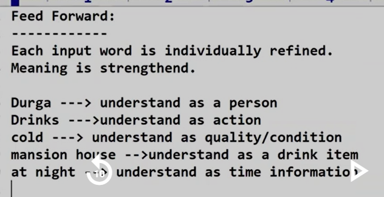

**Class lo ichhina definition:**

> **Feed Forward:** Each input word is individually refined. Meaning is strengthened.

Simple ga — attention tarvata, **prathi word ni vidiga (okko word, okko saari)** theesukoni,
daani meaning ni **inka clear ga, strong ga** chestundi. Ikkada words okadaanitho okati **matladukovu** —
prathi word tana daggara unna info ni (attention lo collect chesina context tho saha) **polish** chesukuntundi.

##### Class example — "Durga drinks cold mansion house at night"

| Word | Feed Forward tarvata model ki ardham ayyedi |
|---|---|
| **Durga** | Understand as a **person** (manishi) |
| **drinks** | Understand as an **action** (pani) |
| **cold** | Understand as a **quality / condition** (ela undi) |
| **mansion house** | Understand as a **drink item** (taage vasthuvu) |
| **at night** | Understand as **time information** (eppudu) |

Multi-head attention lo chusam — Head 1 `Durga ⟷ drinks` connect chesindi, Head 5 `mansion house → drink type` connect chesindi…
Aa **connections nundi vachina info** prathi word lo kalisindi. Ippudu Feed Forward prathi word ni vidiga chusi
*"ok, nuvvu person vi"*, *"nuvvu drink item vi"* ani **final ga confirm / strong** chestundi.

##### Attention vs Feed Forward — class note

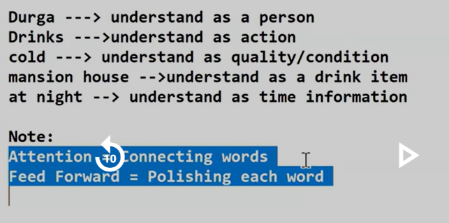

> **Note:**
> **Attention = Connecting words**
> **Feed Forward = Polishing each word**

| | **Attention** | **Feed Forward** |
|---|---|---|
| Pani | Words ni **connect** chestundi | Prathi word ni **polish** chestundi |
| Words madhya matladatayaa? | **Avunu** — prathi word migatha anni words ni chustundi | **Ledu** — prathi word **vidiga**, ontariga process |
| Question | *"Naaku evaru important? evari nundi info theesukovali?"* | *"Naa daggara unna info tho nenu asalu enti?"* |
| Durga example | `Durga` ⟷ `drinks` (who does action) | `Durga` → **person** |
| Real life | **Group discussion** — andari tho matladi points collect cheyyadam | **Self study** — collect chesina points ni intiki vellaka ontariga revise chesi clear ga ardham chesukovadam |

**Inko real life example — Cooking 🍛:**

```text
Attention     = Market ki velli anni ingredients collect cheyyadam
                (onion, tomato, masala — veru veru shops nundi)
Feed Forward  = Intlo prathi ingredient ni vidiga prepare cheyyadam
                (onion cut, tomato puree, masala roast)
```

Ingredients collect cheyyakapothe (attention lekapothe) em cheyyalem. Prepare cheyyakapothe (feed forward lekapothe) vanta raadu.
**Rendu kavali.**

##### Lopala ela pani chestundi? — Expand → Filter → Shrink

Feed Forward ante oka **chinna neural network** (2 layers). Prathi word vector ki **same network** apply chestaru.

```text
Word vector (512 numbers)
      ↓
[Layer 1: Expand]   512 → 2048 numbers   (4 times peddadi — ekkuva "features" check cheyyadaniki space)
      ↓
[ReLU: Filter]      negative numbers → 0  (useful features matrame unchu, migathavi off)
      ↓
[Layer 2: Shrink]   2048 → 512 numbers   (malli original size ki)
      ↓
Polished word vector (512 numbers)  → Add & Norm ki
```

**Formula (original paper):**

```text
FFN(x) = W2 · ReLU( W1 · x + b1 ) + b2

W1  = 512 × 2048 weights   (expand)
W2  = 2048 × 512 weights   (shrink)
ReLU(z) = max(0, z)        (negative aithe 0, positive aithe alaage)
```

**Enduku expand chestaru?** 512 numbers lo chala features kalisi untayi. 2048 ki expand chesthe —
model ki *"idi person aa?"*, *"idi liquid aa?"*, *"idi time word aa?"*… ila **velalla chinna chinna checks** cheyyadaniki space dorukutundi.
Prathi hidden number ni oka **"feature detector" / switch** laaga anukondi.

##### Chinna number example — "mansion house" polish avvadam

Ardham kosam — 4 numbers → 6 hidden "checks" → 4 numbers (nijam ga 512 → 2048 → 512).

```text
Input (attention + Add & Norm tarvata "mansion house" vector):
  x = [ 0.4, 1.1, -0.3, 0.7 ]

Layer 1 — Expand (6 feature checks):
  hidden = [ 1.5,      -0.8,     2.1,       -1.2,       0.3,      -0.5    ]
             is_liquid  is_person is_drink   is_time     is_place  is_food

ReLU — Filter (negative → 0):
  hidden = [ 1.5,       0,        2.1,        0,         0.3,       0      ]
             ✅ liquid   ❌        ✅ drink    ❌          ~          ❌ food kaadu

Layer 2 — Shrink (malli 4 numbers):
  output = [ 0.2, 1.9, -0.1, 1.4 ]   ← "drink item" meaning strong ayyindi
```

- **is_person, is_time, is_food** → negative → ReLU **off** chesindi (`mansion house` person kaadu, time kaadu, **food kaadu**).
- **is_liquid, is_drink** → positive → **on** — ivi output ni build chestayi.
- Ade class lo cheppindi: *"mansion house → understand as a drink item"*, *"This is liquid not a food"*.

(Numbers ardham kosam matrame — nijam model lo feature names ila clean ga undavu, training lo tane nerchukuntundi.)

##### Important points

1. **Position-wise:** Prathi word ki **same W1, W2** — kaani prathi word **vidiga** process avutundi. Andhuke anni words ni GPU meeda **parallel** ga cheyyochu.
2. **Prathi layer ki separate FFN:** Encoder layer 1 FFN weights, layer 2 FFN weights veru veru.
3. **Model lo ekkuva parameters ikkade:** Transformer lo dadapu **2/3 parameters** Feed Forward layers lo ne untayi. Research prakaram model nerchukunna **facts / knowledge** (ex: "Mansion House oka drink brand") chala varaku ikkade store avutayi — oka **memory** laaga.
4. **Activation function maarindi:** Original lo **ReLU**, GPT-2/GPT-3 lo **GELU**, Llama lo **SwiGLU** — anni "filter" pani ne, smooth versions.
5. **Tarvata Add & Norm:** `x2 = LayerNorm( x1 + FFN(x1) )` — polish chesina info + original info kalipi balance.

##### Encoder layer motham — oka chupu lo

```text
Input word vectors (embedding ⊕ position)
      ↓
[Multi-Head Attention]  → words CONNECT avutayi (Durga ⟷ drinks, cold ⟷ mansion house …)
      ↓
[Add & Norm]            → original info safe + balance
      ↓
[Feed Forward]          → prathi word POLISH (Durga = person, mansion house = drink …)
      ↓
[Add & Norm]            → original info safe + balance
      ↓
Next encoder layer (Nx) → prathi layer lo inka deep understanding
```

> **Oka line lo:** **Attention = connecting words** (group discussion), **Feed Forward = polishing each word** (self study).
> Attention lo collect chesina context ni, Feed Forward prathi word lo **expand → filter → shrink** chesi meaning ni strong chestundi.

#### Right side — Decoder (output ni okko token rayadam)

```text
Outputs (ippati varaku rasina tokens: "Nenu India")
   ↓
[Output Embedding] ⊕ Positional Encoding
   ↓
┌──────── Decoder layer (Nx times repeat) ─────────────┐
│ [Masked Multi-Head Attention] → rasina tokens matrame │
│                                  chudali, future kaadu │
│ [Add & Norm]                                           │
│ [Multi-Head Attention]  ← Encoder output ikkada vastundi│
│                           (Cross-attention)            │
│ [Add & Norm]                                           │
│ [Feed Forward]                                         │
│ [Add & Norm]                                           │
└────────────────────────────────────────────────────────┘
   ↓
[Linear]   → vocabulary lo prathi token ki score
   ↓
[Softmax]  → probabilities
   ↓
Output Probabilities → "ni" (next token)
```

1. **Outputs (Output tokens from previous step):** Diagram kinda raasindi chudandi — decoder ki input **adi intaku mundu generate chesina tokens**. Idi mana **autoregressive loop** (Section 3) ne!
2. **Output Embedding + Positional Encoding:** Encoder lo laage.
3. **Masked Multi-Head Attention:** Rasina tokens okadaanini okati chustayi, kaani **future tokens ni chudakudadu** (mask). Endukante generate chesetappudu future inka puttaledu kada.
4. **Multi-Head Attention (Cross-attention):** Diagram lo **encoder nundi decoder ki vachina arrow** ikkade kalustundi. Ikkada **Query** decoder nundi, **Key & Value** encoder output nundi vastayi. Ante decoder adugutundi — *"ippudu translate cheyyadaniki input sentence lo ye word chudali?"*
5. **Feed Forward + Add & Norm:** Encoder lo laage.
6. **Linear:** Final vector ni vocabulary lo unna **prathi token ki oka score** ga marchutundi.
7. **Softmax:** Scores → probabilities. Highest probability token = next token. Daanni malli **Outputs** ki add chesi loop repeat.

#### Doubt: "Encoder anni input tokens oke saari chustundi, Decoder okko token matrame chustundi" — idi nijamaa?

**Answer: Sagam nijam, sagam tappu.**

| Statement | Nijamaa? | Correct ga |
|---|---|---|
| Encoder anni input tokens ni **oke saari** chustundi | ✅ **Nijam** | Anni input words parallel ga process avutayi. Prathi word **mundu unna words ni, venaka unna words ni** rendu chustundi (**bidirectional**) |
| Decoder **okko token matrame** chustundi | ❌ **Tappu** | Decoder **okko token generate** chestundi (okko saari okati **rastundi**) — kaani **chusedi** okka token kaadu. Ippati varaku rasina **anni tokens** + encoder nundi **motham input** chustundi |

Confusion ekkada nundi vastundi ante — **"okko token rayadam"** ni **"okko token chudadam"** ani anukovadam.

##### Encoder — anni oke saari, rendu vaipula

Translation example: `"I love India"` → `"Nenu India ni premistanu"`

```text
Encoder input:   I   love   India
                 ↕    ↕      ↕
            anni words okadaanini okati chustayi (left + right rendu)

"love" chustundi →  I ✅ (venaka)   India ✅ (mundu)
```

Encoder ki full input **mundhe** dorikindi — kabatti future words chudadam lo problem ledu.
Andhuke encoder lo **mask ledu**.

##### Decoder — okko token rastundi, kaani anni previous tokens chustundi

Decoder `"Nenu India ni premistanu"` ni okko step lo rastundi:

```text
Step 1:  chusedi: [START]                          + encoder input motham  → rasedi: "Nenu"
Step 2:  chusedi: [START] Nenu                     + encoder input motham  → rasedi: "India"
Step 3:  chusedi: [START] Nenu India               + encoder input motham  → rasedi: "ni"
Step 4:  chusedi: [START] Nenu India ni            + encoder input motham  → rasedi: "premistanu"
Step 5:  chusedi: [START] Nenu India ni premistanu + encoder input motham  → rasedi: [END]
```

Step 4 lo decoder **okka token** (`ni`) ni matrame chudaledu — `[START] Nenu India ni` **anni** chusindi,
plus cross-attention dwara `I love India` **motham** chusindi.

Decoder lo rendu attentions:

| Attention | Decoder em chustundi? |
|---|---|
| **Masked self-attention** | Ippati varaku **rasina anni** output tokens (future matrame block) |
| **Cross-attention** | Encoder output — **input sentence motham** |

##### Mask enduku? — "future chudakudadu" ane rule

Decoder **chudalenidi** — **inka raayani future tokens** matrame.
Generate chesetappudu future tokens **inka puttaledu** kabatti, training lo kuda chudanivvaru (cheating avvakunda).

```text
Masked attention — prathi token ye tokens ni chudagaladu (✅ chudochu, ❌ block):

              [START]  Nenu  India   ni   premistanu
[START]         ✅      ❌     ❌     ❌      ❌
Nenu            ✅      ✅     ❌     ❌      ❌
India           ✅      ✅     ✅     ❌      ❌
ni              ✅      ✅     ✅     ✅      ❌
premistanu      ✅      ✅     ✅     ✅      ✅
```

Prathi row lo — **tanu + tana venaka unnavi** anni ✅. Okka token matrame kaadu.

##### Training lo vs Generation (inference) lo — inko twist

| | **Training** | **Generation (inference)** |
|---|---|---|
| Decoder ki em telusu? | Correct answer motham mundhe telusu (`Nenu India ni premistanu`) | Answer teliyadu — okko token rastu velthundi |
| Ela process | **Anni output tokens oke saari, parallel ga** — mask tho future block (paina table) | **Okko step lo okka kotha token** |
| Speed | Fast (GPU parallel) | Slow (sequential — okati tarvata okati) |

Ante **training lo decoder kuda anni tokens ni oke saari** process chestundi — mask matrame future ni daachestundi.
Idi **teacher forcing** antaru.

Generation lo **KV cache** (Section 4.4) vaadithe — prathi step lo **kotha token ni matrame calculate** chestaru,
kaani adi **cache lo unna previous tokens anni** chustundi. Kabatti akkada kuda "okka token matrame chudadam" kaadu.

##### Correct statement

> **Encoder:** Input motham **oke saari** chustundi — prathi word **rendu vaipula** (venaka + mundu) chudagaladu. Mask ledu.
>
> **Decoder:** Output ni **okko token, okko saari rastundi** — kaani prathi step lo ippati varaku rasina **anni tokens** ni
> (masked self-attention) + **input motham** ni (cross-attention) chustundi. **Future tokens** ni matrame chudadu.
>
> GPT (decoder-only) lo kuda same — prompt + rasina tokens **anni** chustundi, inka raayanivi matrame kaadu.

#### Decoder — deep ga (Durga Sir class — red loop)

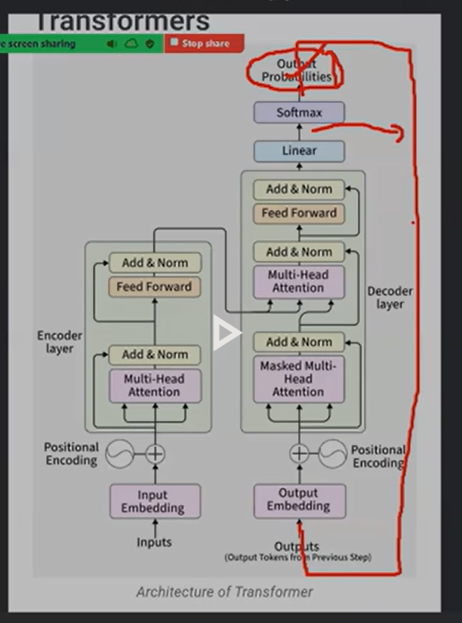

Class lo Durga Sir **red pen** tho geesindi chudandi:

```text
Output Probabilities (paina, red circle)
        │
        └──── red line ────┐  (right side nundi kindaki)
                           ↓
Outputs (Output Tokens from Previous Step) (kinda)
```

Ante — decoder **paina** ichina answer (next token) ni, **malli kinda** decoder input ki pamputharu.
Ade **loop**. Decoder **oka saari run ayithe okka token** vastundi. Full sentence kavali ante **malli malli run** avvali.
Idi mana **autoregressive generation** (Section 3, board example) — exactly ade picture!

##### Most important point — Encoder oka saari, Decoder chala saarlu

```text
"I love India"  →  [ENCODER]  → oka saari matrame run  → encoder output (memory) ready
                                                              │
                                                              ↓ (prathi step lo vadukuntundi)
[START]                       → [DECODER] → "Nenu"        ┐
[START] Nenu                  → [DECODER] → "India"       │
[START] Nenu India            → [DECODER] → "ni"          │  red loop — prathi saari
[START] Nenu India ni         → [DECODER] → "premistanu"  │  kotha token add chesi malli run
[START] Nenu India ni premistanu → [DECODER] → [END]  ✋  ┘  [END] vasthe aagipotundi
```

| | Encoder | Decoder |
|---|---|---|
| Entha saarlu run? | **Oka saari** | **Prathi output token ki oka saari** (5 tokens → 5 saarlu) |
| Input | Source sentence (`I love India`) | Ippati varaku rasina tokens (`[START] Nenu India …`) |
| Output | Prathi input word ki meaning vector (memory) | **Next token** okkate |

##### Class notes — Decoder steps 1 to 4 (Durga Sir)

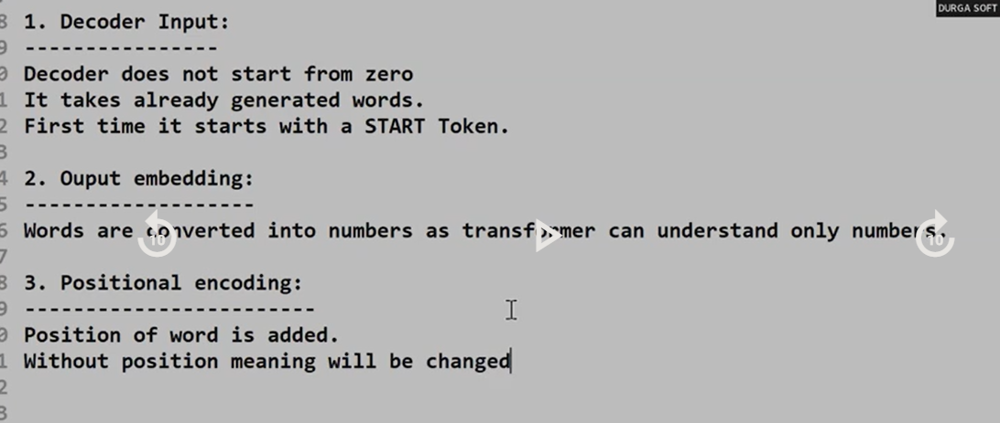

**1. Decoder Input**

> Decoder does not start from zero.
> It takes already generated words.
> First time it starts with a **START** token.

Decoder prathi saari **kotha ga, khaali ga** start avvadu — ippati varaku **already generate chesina words** ni input ga theeskuntundi (red loop).
Modati saari inka emi generate avvaledu kabatti — special **`[START]`** token tho start chestundi.

```text
1st time:  [START]                  → "Nenu"
2nd time:  [START] Nenu             → "India"
3rd time:  [START] Nenu India       → "ni"
```

**2. Output Embedding**

> Words are converted into numbers as transformer can understand only numbers.

Encoder lo *Input Embedding* laage — decoder lo **output words** (`[START]`, `Nenu`, `India` …) ni **numbers (vectors)** ga marchadam.
Transformer ki letters teliyavu, **numbers matrame** ardham avutayi (Section 1 lo chusam).

**3. Positional Encoding**

> Position of word is added.
> Without position meaning will be changed.

Prathi output word ki **position** add chestaru. Lekapothe `Nenu India ni premistanu` and `India Nenu ni premistanu` model ki okkate ga kanipistayi —
**meaning maaripotundi** ("Dog bites a man" vs "man bites a dog" laage — Positional Encoding section chudandi).

**4. Masked Multi-Head Self-Attention**

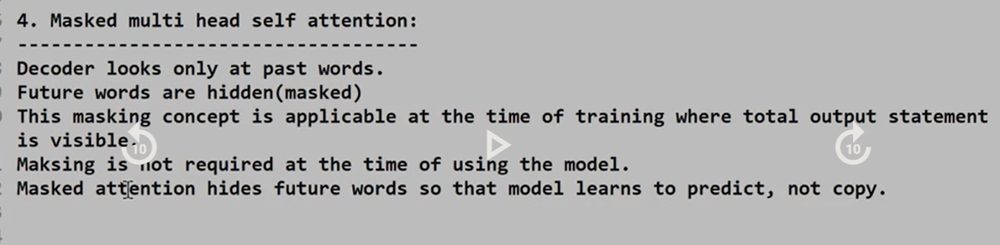

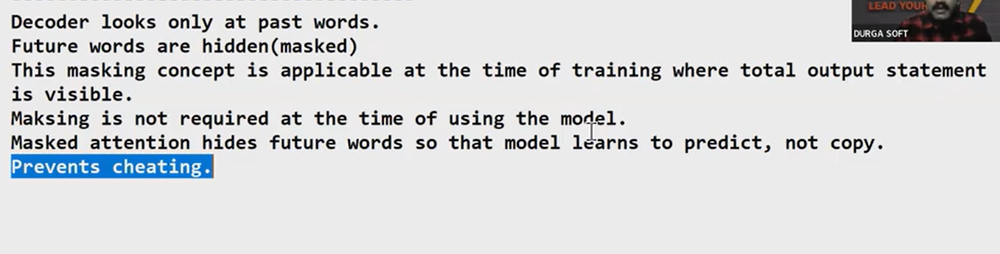

> Decoder looks only at past words.
> Future words are hidden (masked).
> This masking concept is applicable at the time of **training** where total output statement is visible.
> Masking is not required at the time of using the model.
> Masked attention hides future words so that model learns to **predict, not copy**.
> **Prevents cheating.**

Simple ga:
- Decoder **venaka words (past)** matrame chustundi, **future words** daachestaru (mask).
- Training lo **motham answer sentence** model ki kanipistundi — mask lekapothe next word ni **copy** chesestundi, em nerchukodu.
- Mask valla model **guess (predict)** cheyyadam nerchukuntundi — **cheating aagipotundi**.

**Exam example 📝:** Student ki question paper tho paatu **answer key kuda** isthe — answers copy chesestadu, em nerchukodu.
Answer key ni **cover (mask)** chesi, okko answer rasina tarvata ne next line chupisthe — appude nijam ga nerchukuntadu.
Training lo mask chese pani ade.

##### ⭐ Core Truth (First understand this)

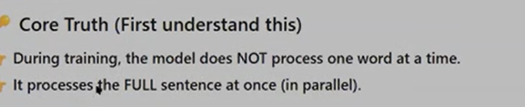

> **During training, the model does NOT process one word at a time.**
> **It processes the FULL sentence at once (in parallel).**

Chala mandi anukuntaru — training lo kuda decoder okko word rasi, malli run chesi, malli okko word…
**Ala kaadu!** Training lo correct answer motham mundhe telusu kabatti, **full sentence ni oke saari** decoder lopaliki pampistaru.

**Mari full sentence oke saari isthe cheating avvada?** — Ikkade **mask** vastundi.
Mask valla prathi position **tana venaka words matrame** chustundi. Ante oke forward pass lo,
prathi position **vidiga oka chinna exam** rastunnattu:

```text
Decoder ki oke saari:   [START]   Nenu   India   ni
                           ↓        ↓       ↓      ↓
Prathi position chusedi: [START]  [START]  [START]  [START]
                                   Nenu     Nenu     Nenu
                                            India    India
                                                     ni
                           ↓        ↓       ↓      ↓
Predict cheyyalsindi:    "Nenu"  "India"   "ni"  "premistanu"
                           ✅       ✅       ✅      ✅
              ── 4 predictions, OKE forward pass lo ──
```

| | Mask LEKUNDA (okko word, okko saari) | Mask THO (full sentence, parallel) |
|---|---|---|
| Runs | 4 words ki **4 separate runs** | **1 run** lo 4 predictions |
| Cheating | — | ❌ Ledu — prathi position ki future hidden |
| Speed | Slow | **Chala fast** — GPU parallel power (Section 4.5) |

> **Key connection:** **Mask** valle **parallel training** possible. Mask cheating aaputhundi,
> parallel processing training ni fast chestundi — rendu kalisi pani chestayi.
> Billions of sentences meeda train cheyyagaligedi ee trick valle. Idi **teacher forcing** antaru.

**Usage (generation) lo matram** — answer teliyadu kabatti **okko token, okko saari** (red loop). Ade difference:

```text
TRAINING:  full sentence → 1 forward pass → anni positions predict (parallel, mask tho)
USAGE:     [START] → run → "Nenu" → run → "India" → run → ... (sequential, red loop)
```

##### Doubt: "Training lo manam questions emi adagam kada — mari masking ekkada vastundi?"

Correct — training lo **evaru question type cheyyaru**. Kaani **question data lopale daagi undi**:
**prathi word daggara model ni silent ga adugutaru — *"next em vastundi?"*** Aa question **fair** ga undadaniki ne mask.

**Training ela jarugutundi? (GPT style)**

Training data nundi oka sentence: `"The cat sat on the mat"`

Ade sentence **input** kuda, **answer key** kuda — answer ante same sentence **okka word left ki jarupithe** vachedi:

```text
Position:        1      2      3      4      5
Input:          The    cat    sat    on     the
Answer (label): cat    sat    on     the    mat
```

5 positions **oke saari (parallel)** lopaliki velthayi — prathi position ki oka **hidden question**:

| Position | Chusedi | Hidden question | Correct answer |
|---|---|---|---|
| 1 | The | next em vastundi? | cat |
| 2 | The cat | next em vastundi? | sat |
| 3 | The cat sat | next em vastundi? | on |
| 4 | The cat sat on | next em vastundi? | the |
| 5 | The cat sat on the | next em vastundi? | mat |

Prathi position lo model guess ni **correct answer tho compare** chestaru → difference = **loss** →
loss taggela weights update chestaru. Evaru question adagaledu — **text ne questions + answers rendu istundi**.
Deenni **self-supervised learning** antaru (manishi labels rayakkarledu).

**Mask ekkada vastundi?**

Full sentence **oke saari** model lopala undi. Mask lekapothe — position 1 (`The`) attention tho position 2 ni chusi
**"cat"** ni chudagaladu — adi exactly daaniki guess cheyyalsina **answer**!

```text
Mask LEKUNDA:  position 1 → kudi vaipu chusi "cat" kanipinchindi → copy → perfect score, em nerchukoledu ❌
Mask THO:      position 1 → "The" matrame kanipistundi → nijam ga "cat" guess cheyyali ✅
```

Inka — usage lo future words **asalu undavu**, kabatti mask lekunda train chesina model akkada **completely fail** avutundi
(training lo copy chesi alavaatu paddadi, usage lo copy cheyyadaniki emi undadu).
Ade slide lo cheppindi — *"predict, not copy"*, *"Prevents cheating"*.

**Translation (encoder-decoder) example lo kuda same idea:**

```text
"Question"  = source sentence  (I love India)              → Encoder ki
"Answer"    = target sentence  (Nenu India ni premistanu)   → Decoder ki oke saari, mask tho
Prathi decoder position hidden question = "next Telugu word enti?"
```

> **Oka line lo:** Training lo type chesina question undadu — **prathi word position oka hidden "next word guess chey" question**,
> training text ne **answer key**, and **mask aa answer key ni prathi position nundi daachestundi**.

##### Doubt: "Decoder ki default ga `[START]` okka token matrame input — input sentence lekunda?"

**Answer: Sagam nijam.** Decoder **tana side** lo modati input `[START]` okkate — kaani **input sentence lekunda run avvadu**.
Model type batti maarutundi:

**1. Encoder-decoder (translation — ee diagram)**

```text
Encoder input:  "I love India"   ← input sentence IKKADA velthundi
Decoder input:  [START]          ← decoder tana side lo idi okkate
```

- Decoder **tana input side** lo `[START]` tho start avutundi — endukante inka emi rayaledu.
- Kaani **cross-attention** dwara, decoder prathi step lo (**modati step lo kuda**) encoder output (`I love India`) motham chustundi.
- Ante modati step nijam ga: **`[START]` + cross-attention tho full input sentence** → `"Nenu"`.
- `[START]` okkate ante — *"rayadam start chey"* ani matrame. **Em rayali?** ane answer encoder output nundi vastundi.

```text
Step 1:   Decoder side: [START]        +  Cross-attention: "I love India" (motham)  → "Nenu"
Step 2:   Decoder side: [START] Nenu   +  Cross-attention: "I love India" (motham)  → "India"
```

**2. Decoder-only (GPT, Claude, Llama)**

- Encoder ledu, separate input sentence ledu — **mee prompt ne decoder input**.
- Prompt chivari nundi generation continue avutundi — separate `[START]` kosam wait cheyyadu.
- 2 practical details:
  - Chala models sequence **modatlo** oka special **begin token** pedatayi (ex: Llama lo `<|begin_of_text|>`).
  - Chat models lo **chat format special tokens** *"ikkada nundi assistant answer start"* ani signal istayi.
    Section 1.2 lo tiktokenizer demo lo chusam — **`<|im_start|>assistant`** ade "answer rayadam start chey" signal (START laage pani).

```text
GPT input:  <|im_start|>user Hi How can I Help you <|im_end|> <|im_start|>assistant
                                                                          ↑
                                                answer ikkada nundi start (START laage)
```

**3. Training lo (encoder-decoder)**

Decoder input = `[START]` + target sentence **shifted right**, oke saari, mask tho (Core Truth box chudandi):

```text
Decoder input:  [START]  Nenu   India  ni
Labels:          Nenu    India  ni     premistanu
```

| Model / Phase | Decoder modati input | Input sentence ela chustundi? |
|---|---|---|
| **Encoder-decoder — usage** | `[START]` okkate | **Cross-attention** tho encoder output |
| **Encoder-decoder — training** | `[START]` + shifted target (motham, mask tho) | **Cross-attention** tho encoder output |
| **Decoder-only (GPT) — usage** | Begin token + **prompt** (+ `<|im_start|>assistant`) | Prompt ne input — **same sequence lo** |

> **Oka line lo:** `[START]` = decoder **tana side** lo modati token matrame. Translation lo input sentence
> **cross-attention** tho vastundi. GPT lo **prompt + chat format assistant token** ne `[START]` pani chestayi.

##### Doubt: "Training lo output isthamu, testing lo mask chestam, usage lo masking undadu" — correct aa?

**Answer: Konchem tappu.** Masking **testing lo kaadu — training lo** jarugutundi.

| Phase | Full output (answer) isthara? | Masking undaa? | Enduku |
|---|---|---|---|
| **Training** | ✅ Avunu — correct answer motham isthamu (`Nenu India ni premistanu`) | ✅ **Avunu — masking ikkade** | Answer motham kanipistundi kabatti, mask lekapothe next word copy chesestundi. Mask future ni daachi **predict** cheyyistundi — *"Prevents cheating"* |
| **Testing / Usage** (inference) | ❌ Ivvamu — model tane rastundi | ❌ Avasaram ledu (slide cheppina meaning lo) | Okko token generate avutundi — future words **inka puttaledu**, daachalsindi emi ledu |

**Rendu corrections:**
1. **Training = output isthamu + mask chestam** — rendu kalisi vastayi. Output kanipistundi **kabatte** mask kavali.
2. **Testing and usage = same** — rendu lo model tane generate chestundi, answer ivvamu, daachalsindi emi ledu.

```text
TRAINING:   Input:  I love India
            Answer: Nenu India ni premistanu  ← motham kanipistundi
            Mask:   "India" position lo unnappudu → "ni", "premistanu" ❌ hidden
            → model "ni" ni guess cheyyali, copy cheyyalekapotundi ✅

USAGE:      Input:  I love India
            Answer: ???  ← model ki teliyadu
            [START] → Nenu → India → ...   (okko token rastundi)
            → future words asalu levu, daachalsina avasaram ledu
```

**Slide ki minchina 2 chinna nuances:**

- **"Testing" ki ML lo rendu meanings:**
  - Correct answer ichhi **loss / accuracy check** chesthe (evaluation) — training laage pani chestundi, **mask use avutundi**.
  - Model ni **free ga generate** cheyyanisthe — usage laage, daachalsina future words undavu.
- **"Usage lo masking ledu" — idi simplification:** GPT lo mee **prompt** (ex: 50 tokens) ni **oke saari** process chestundi (**prefill** — Section 4.4).
  Appudu code lo **causal mask on lo ne untundi**. Tarvata **KV cache** tho okko kotha token generate chesetappudu future tokens levu kabatti, mask ki **pani undadu**.
  Concept ga slide correct — code lo matram mask switch off cheyyaru.

> **Oka line lo:** Mask = **training rule** — answer kanipisthunnappudu model cheating cheyyakunda (copy cheyyakunda) aapadaniki.
> Usage lo future inka raayaledu kabatti daachalsindi emi ledu.

##### Class notes — Decoder steps 5 to 9 (Durga Sir)

Steps 1–4 (Decoder Input, Output Embedding, Positional Encoding, Masked Attention) paina chusam. Ippudu migatha steps.

**5. Add & Norm (After Masked Multi-Head Attention)**

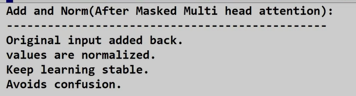

> Original input added back.
> Values are normalized.
> Keep learning stable.
> Avoids confusion.

| Slide line | Tenglish meaning |
|---|---|
| Original input added back | Masked attention output ki **original input ni malli kaluputharu** (residual — "Add") — rasina words original info poadu |
| Values are normalized | Numbers ni **balanced range** ki theesukostharu ("Norm" — volume control laaga) |
| Keep learning stable | Numbers explode avvakunda → training **stable** |
| Avoids confusion | Info kalavakunda, numbers gandaragolam avvakunda — next block ki **clean** input |

Encoder lo chusina **Add & Norm ne** — detailed explanation + "bank" example kosam **"Add & Norm — deep ga"** section chudandi.
Decoder lo idi **3 saarlu** vastundi — masked attention tarvata, cross-attention tarvata, feed forward tarvata.

**6. Multi-Head Attention (Encoder-Decoder Attention / Cross-Attention)**

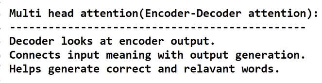

> Decoder looks at encoder output.
> Connects input meaning with output generation.
> Helps generate correct and relevant words.

| Slide line | Tenglish meaning |
|---|---|
| Decoder looks at encoder output | Decoder **input sentence ni** (encoder ardham chesukunnadi) chustundi — Query decoder nundi, Key & Value encoder nundi |
| Connects input meaning with output generation | **"Input lo em undi"** ni **"nenu em rastunna"** tho connect chestundi — iddari madhya **bridge** |
| Helps generate correct and relevant words | Input ki **sambandham unna, correct** words rayadaniki help — lekapothe decoder tanaki nachindi rasestundi |

```text
Decoder ippudu: [START] Nenu India  → next?
Cross-attention: "I love India" lo ye word chudali?  → India (0.65), love (0.25)
→ "ni" (correct + relevant) ✅      cross-attention lekapothe → "cricket"?? (random) ❌
```

**7. Feed Forward Network**

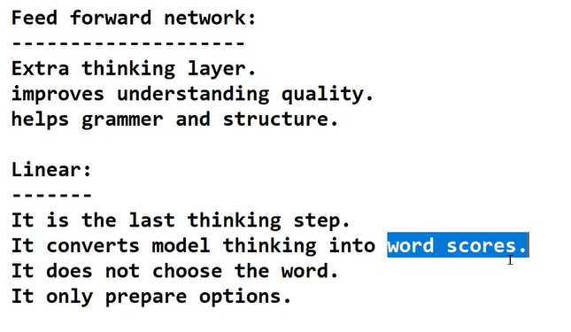

> Extra thinking layer.
> Improves understanding quality.
> Helps grammar and structure.

- **Extra thinking layer** — attention collect chesina info meeda prathi word **vidiga inka alochistundi** (encoder lo *"polishing each word"* laage).
- **Improves understanding quality** — meaning inka clear, strong.
- **Helps grammar and structure** — decoder rase part kabatti, ikkada **grammar correct ga** (ex: Telugu lo object tarvata `ni`, chivarlo verb `premistanu`) undela help chestundi.

**8. Linear**

> It is the last thinking step.
> It converts model thinking into **word scores**.
> It does not choose the word.
> It only prepares options.

| Slide line | Tenglish meaning |
|---|---|
| Last thinking step | Decoder layers anni ayyaka **chivari** calculation |
| Converts model thinking into word scores | Model final vector (512 numbers) → vocabulary lo **prathi word ki oka score** (logit) |
| Does not choose the word | Linear **select cheyyadu** — scores matrame istundi |
| Only prepares options | *"Ivi options, ivi vaati scores"* ani **list ready** chestundi |

```text
Model thinking (512 numbers) → [Linear] → ni: 6.1,  ki: 3.9,  lo: 3.2,  premistanu: 2.5,  ... (vela words)
                                           ↑ options + scores matrame — inka choose cheyyaledu
```

**9. Softmax Layer**

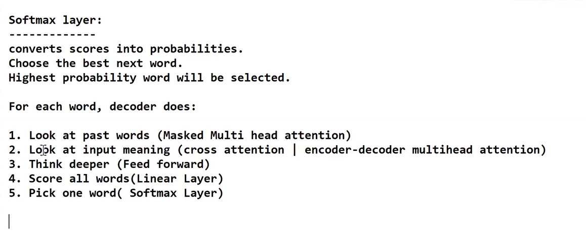

> Converts scores into probabilities.
> Choose the best next word.
> Highest probability word will be selected.

```text
Scores:         ni: 6.1    ki: 3.9    lo: 3.2    premistanu: 2.5   ...
   ↓ Softmax
Probabilities:  ni: 0.82   ki: 0.09   lo: 0.05   premistanu: 0.02  ...  (motham = 1.0)
   ↓ Highest select
Next word:      "ni" ✅
```

> **Chinna note:** Technical ga **Softmax probabilities matrame istundi** — select chese pani (highest pick = *greedy*)
> daani tarvata jarugutundi. ChatGPT lantivi eppudu highest ne theesukovu — **temperature** tho konchem random ga kuda select chestayi
> (Section 7.4). Class lo simple ga "Softmax choose chestundi" ani cheppindi — idea correct.

##### Summary — For each word, decoder does (class note)

> 1. Look at past words (**Masked Multi-Head Attention**)
> 2. Look at input meaning (**Cross-Attention** | Encoder-Decoder Multi-Head Attention)
> 3. Think deeper (**Feed Forward**)
> 4. Score all words (**Linear Layer**)
> 5. Pick one word (**Softmax Layer**)

| # | Step | Block | Question | Translation example (`[START] Nenu India` → ?) |
|---|---|---|---|---|
| 1 | Look at past words | Masked Multi-Head Attention | *"Nenu ippati varaku em rasanu?"* | `Nenu`, `India` chusindi |
| 2 | Look at input meaning | Cross-Attention | *"Input lo em undi? ippudu edi chudali?"* | `I love India` lo `India`, `love` |
| 3 | Think deeper | Feed Forward | *"Naa info tho grammar, meaning enti?"* | Object tarvata case marker kavali |
| 4 | Score all words | Linear | *"Prathi word ki entha score?"* | `ni`: 6.1, `ki`: 3.9 … |
| 5 | Pick one word | Softmax (+ select) | *"Edi best?"* | **`ni`** (0.82) → red loop 🔴 |

(Prathi step tarvata **Add & Norm** untundi — steps 1, 2, 3 tarvata. Steps 1–3 **Nx layers** repeat avutayi, 4–5 chivarlo **oka saari**.)

> **Oka line lo:** Decoder prathi word ki — **venaka chudu → input chudu → alochinchu → anni words ki score ivvu → okati pick chey**,
> tarvata aa word tho **red loop** lo malli.

##### Class example — "What is todays weather?" → "Rain is heavy" (Durga Sir)

```text
Encoder input understanding:  What is todays weather?
Decoder output:               Rain is heavy
```

Encoder question ni ardham chesukundi. Ippudu decoder **modati word `Rain`** ela rastundo step by step chuddam.

**Step 0 — START token**

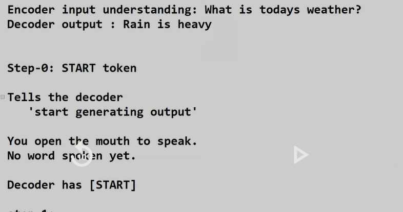

> Tells the decoder **'start generating output'**.
> You open the mouth to speak. No word spoken yet.
> Decoder has **[START]**.

Manam matladadaniki **noru terichinattu** — inka okka word kuda cheppaledu. `[START]` ante decoder ki *"ippudu answer cheppadam start chey"* ani signal.

**Step 1 — Masked Multi-Head Attention**

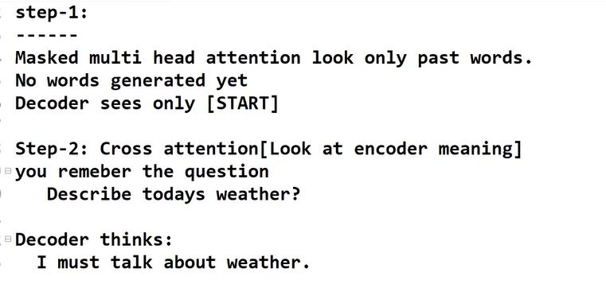

> Masked multi head attention look only past words.
> No words generated yet.
> Decoder sees only **[START]**.

Inka emi rayaledu kabatti venaka chudadaniki `[START]` okkate undi. Ee step lo kotha info peddaga raadu — kaani block run avutundi (next steps lo `Rain`, `is` add ayyaka ikkada nijam ga pani untundi).

**Step 2 — Cross-Attention (Look at encoder meaning)**

> You remember the question — *Describe todays weather?*
> Decoder thinks: **I must talk about weather.**

Manam answer cheppe mundu **question ni gurthu chesukuntam** — decoder kuda encoder output ni chustundi.
`[START]` position (Query) → encoder words (Key, Value) lo **`weather`** ki highest attention:

| Encoder word | Attention weight (ardham kosam) |
|---|---|
| What | 0.05 |
| is | 0.03 |
| todays | 0.22 |
| **weather** | **0.70** |

Result: decoder vector lo ippudu **"topic = weather, today"** ane meaning vachindi.

**Step 3 — Feed Forward Network (Extra thinking)**

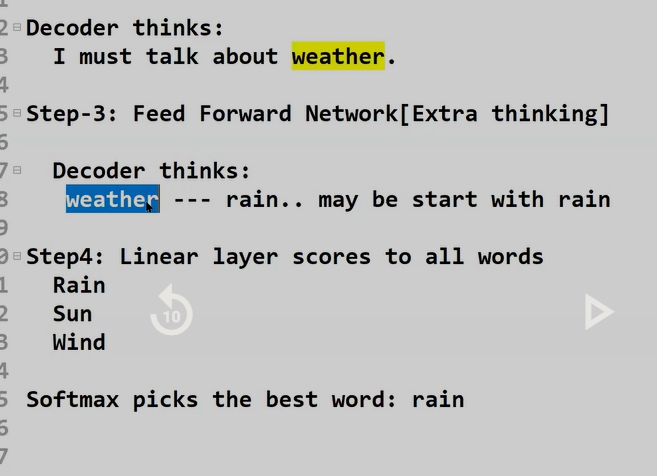

> Decoder thinks: **weather → rain… may be start with rain**

**Step 4 — Linear layer scores to all words**

> Rain, Sun, Wind …

**Softmax picks the best word: `Rain`** ✅

```text
[START] → Masked Attn → Cross-Attn ("weather") → FFN ("weather → rain/sun/wind…") → Linear (scores) → Softmax → "Rain"
```

##### Step 3 lo "Rain" ani ela decide chestundi?

Idi chala important doubt. Mundu **oka nijam**:

> ⚠️ **Model ki ivvala nijam ga varsham padutundo ledo teliyadu!** Daniki window ledu, weather report ledu, internet ledu.
> `Rain` ani cheppedi **training lo nerchukunna patterns** batti — **fact kaadu, probability guess**.

Mari ela? — 3 parts lo chuddam.

**Part 1 — Feed Forward lo "memory" (training lo nerchukunnadi)**

Feed Forward section lo chusam — model **knowledge chala varaku FFN weights lo** store avutundi.
Training lo model laksha laksha sentences chadivindi:

```text
"Today's weather: heavy rain expected..."
"What's the weather? It's sunny and hot."
"The weather is windy today..."
"Weather update: rain in Hyderabad..."
```

Ee data nundi FFN lo konni neurons **"weather topic vasthe → rain, sun, wind, cloudy, hot words ready cheyyi"** ane connection nerchukunnayi.
Ade slide lo — *"weather → rain… may be start with rain"*.

**Part 2 — FFN lopala ela jarugutundi? (Expand → Filter → Shrink)**

Step 2 tarvata vector lo "weather question" meaning undi. FFN lo (ardham kosam 6 feature checks):

```text
Input vector: "topic = weather, today" (cross-attention nundi)

Expand → feature detectors:
  [ weather_topic: 2.4,  rain_words: 1.8,  sun_words: 1.1,  wind_words: 0.6,  food: -1.5,  person: -0.9 ]

ReLU (negative → 0):
  [ weather_topic: 2.4,  rain_words: 1.8,  sun_words: 1.1,  wind_words: 0.6,  food: 0,     person: 0    ]
                                                                               ❌ off       ❌ off

Shrink → output vector:  "weather answer words" vaipu, ANDULO "rain" vaipu konchem ekkuva push ✅
```

- `food`, `person` lantivi **off** — weather question ki sambandham ledu.
- `rain`, `sun`, `wind` anni **on** — kaani `rain` neuron **ekkuva strong** ga fire ayyindi.

**Enduku `rain` ekkuva strong?** — training data lo *"what is today's weather?"* lantivi questions tarvata
**"rain"** words ekkuva saarlu vachi unte, aa connection weights lo **strong** ga nerchukuntundi.
(Durga Sir example lo — ee question ki answer `Rain is heavy` ane pair tho train chesinattu anukovachu. Andhuke `Rain`.)

**Part 3 — Linear + Softmax lo final decision**

Step 3 lo FFN **decide cheyyadu** — vector ni "rain" vaipu **tilt (vanchu)** chestundi matrame.
Final decision Linear + Softmax lo:

```text
Linear: final vector ni vocabulary lo prathi word vector tho compare (dot product) → score
        vector "rain" vaipu ekkuva tilt ayyindi → Rain ki highest score

          Score    Probability (Softmax)
Rain       5.2   →   0.61   ← highest ✅
Sun        4.3   →   0.25
Wind       3.4   →   0.10
Cloudy     2.1   →   0.03
Banana    -3.0   →   0.00
```

Andhuke **"Rain"** select ayyindi. (Numbers ardham kosam matrame.)

> **Gamaninchandi:** Sun ki kuda 0.25 undi — **temperature** ekkuva unte (Section 7.4) kondari saarlu `Sun` kuda ravochu.
> Ade model ki fact teliyadu ani proof — adi **probabilities** tho guess chestundi.

**Nijam ga anni layers kalisi decide chestayi:** Slide lo simple ga *"Step 3 lo FFN alochinchindi"* ani cheppindi. Nijam ga
6 (leda 96) decoder layers lo prathi layer lo attention + FFN konchem konchem ee "rain" direction ni build chestayi. FFN ki
**knowledge / association** pani ekkuva — andhuke slide lo daaniki credit.

**Nijam weather kavali ante?**

Model ki live info ledu kabatti — real apps (ChatGPT weather, Google assistant) **tool / API** call chesi (weather API) live data theeskuni
prompt lo pedatayi, tarvata model answer rastundi. Idi **RAG / tool calling** idea (RAG folder lo chusam). Lekapothe model rase answer
**hallucination** (Section 7.3) avvochu — confident ga, kaani tappu.

> **Oka line lo:** Step 3 lo FFN **"weather → rain/sun/wind"** ane training lo nerchukunna association ni fire chesi vector ni
> **rain vaipu vanchutundi**. Linear + Softmax lo `Rain` ki highest probability vachi select avutundi.
> **Model ki nijam weather teliyadu** — idi patterns tho chese **probability guess**.

##### Second round — "is" ela generate avutundi? (Durga Sir)

`Rain` generate ayyindi → **red loop** → decoder input ippudu `[START] Rain`. Malli anni blocks run avutayi.

**Step 5 — Masked Multi-Head Attention (Second round)**

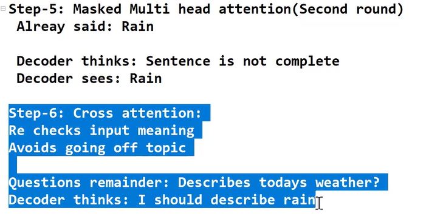

> Already said: **Rain**
> Decoder thinks: **Sentence is not complete**
> Decoder sees: **Rain**

- Ippudu venaka chudadaniki nijam ga oka word undi — `Rain` (plus `[START]`).
- `Rain` okkate — *"sentence inka complete kaaledu, Rain gurinchi inka emaina cheppali"* ani decoder ki ardham.
- First round lo ee step lo peddaga pani ledu — **second round nundi masked attention nijam ga useful** avutundi.

**Step 6 — Cross-Attention (malli)**

> Re-checks input meaning.
> **Avoids going off topic.**
> Question reminder: *Describe todays weather?*
> Decoder thinks: **I should describe rain.**

- Prathi round lo decoder **question ni malli check** chestundi — okka saari chusi marchipodu.
- Enduku? **Off topic vellakunda.** `Rain` tarvata *"Rain is a famous movie"* ani vellipokunda — question **weather** gurinchi kabatti, **rain ni describe** cheyyali ani gurthu chesukuntundi.

**Step 7 — Feed Forward (Extra thinking)**

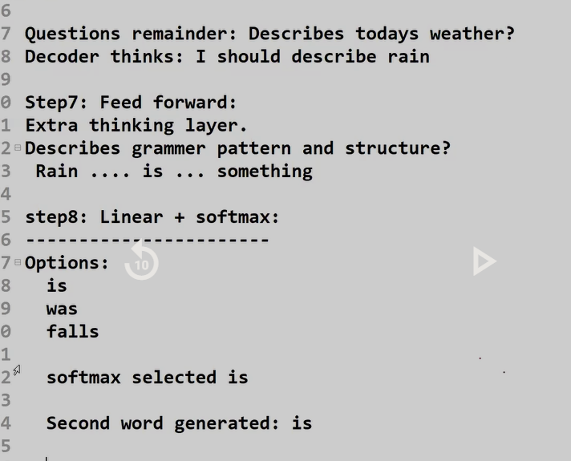

> Extra thinking layer.
> Describes **grammar pattern and structure**.
> **Rain …. is … something**

- FFN ki training nundi telusu — English lo **noun (Rain) tarvata sadharanam ga verb** vastundi.
- Pattern: **`Rain` + `is/was/falls` + description** → *"Rain …. is … something"*.

**Step 8 — Linear + Softmax**

> Options: **is, was, falls**
> Softmax selected **is**.
> **Second word generated: is**

| Option | Probability (ardham kosam) | Enduku |
|---|---|---|
| **is** | **0.58** | Question lo **"todays"** — present tense → `is` best fit |
| falls | 0.22 | Grammar correct, kaani "describe" ki `is` better |
| was | 0.12 | **Past tense** — "todays" question ki match avvadu |
| … | 0.08 | migatha words |

Ikkada **cross-attention** (`todays` → present) + **FFN** (grammar: noun tarvata verb) rendu kalisi `is` ni gelipinchayi.

```text
Round 1:  [START]       → ... → "Rain"
Round 2:  [START] Rain  → Masked Attn ("sentence complete kaaledu")
                        → Cross-Attn ("weather describe cheyyali, today")
                        → FFN ("noun tarvata verb")
                        → Linear + Softmax → "is" ✅
```

##### Third round — "heavy" ela generate avutundi? (Durga Sir)

`is` generate ayyindi → **red loop** → decoder input ippudu `[START] Rain is`. Malli anni blocks.

**Step 9 — Masked Multi-Head Attention (3rd round)**

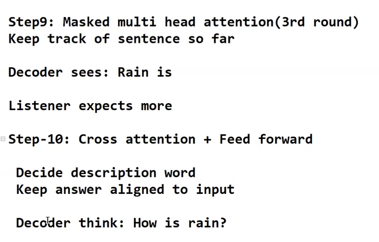

> **Keep track of sentence so far.**
> Decoder sees: **Rain is**
> **Listener expects more.**

- Decoder ippati varaku rasindi gurthu pettukuntundi — `Rain is`.
- *"Rain is…"* ani aapesthe vinevaallu *"is… em?"* ani **inka wait** chestaru — sentence **incomplete**.
- `is` chusi masked attention ki ardham — **is tarvata oka description (adjective)** ravali.

**Step 10 — Cross-Attention + Feed Forward**

> **Decide description word.**
> **Keep answer aligned to input.**
> Decoder thinks: **How is rain?**

| Block | Em chestundi | Weather example lo |
|---|---|---|
| **Cross-Attention** | Answer ni **input ki aligned** ga unchutundi | Question *"todays weather"* — kabatti rain ni **weather laaga** describe cheyyali (rain yokka taste kaadu, speed kaadu) |
| **Feed Forward** | **Description word** decide cheyyadaniki alochistundi | *"How is rain?"* — rain ki training lo common descriptions: heavy, light, continuous … |

**Step 11 — Linear + Softmax**

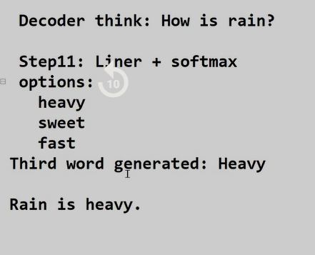

> Options: **heavy, sweet, fast**
> **Third word generated: Heavy**
> **Rain is heavy.**

| Option | Probability (ardham kosam) | Enduku |
|---|---|---|
| **heavy** | **0.74** | Training lo **"heavy rain"** chala common — weather description ki perfect fit |
| fast | 0.06 | Grammar correct, kaani rain ni ala describe cheyyaru — weather meaning ki match avvadu |
| sweet | 0.01 | Rain **taste** gurinchi kaadu question — off topic, cross-attention + FFN ee option ni taggistayi |
| … (light, continuous …) | 0.19 | migatha words |

**Step 12 — 4th round: `[END]` (slide lo ledu, kaani ilaage aagutundi)**

```text
Decoder input: [START] Rain is heavy
Masked Attn:   "Rain is heavy" — subject + verb + description, sentence complete
Cross-Attn:    question ki answer ayipoyindi
Linear+Softmax: [END] ki highest probability → STOP ✋
```

##### Weather example — motham journey (3 rounds + END)

| Round | Decoder input | Masked Attn | Cross-Attn | FFN | Pick |
|---|---|---|---|---|---|
| 1 | `[START]` | Inka emi ledu | *"weather gurinchi cheppali"* | weather → rain/sun/wind | **Rain** |
| 2 | `[START] Rain` | *"sentence complete kaaledu"* | *"rain ni describe cheyyali, today"* | noun tarvata verb | **is** |
| 3 | `[START] Rain is` | *"listener expects more"* | *"answer input ki aligned"* | *"how is rain?"* → description | **heavy** |
| 4 | `[START] Rain is heavy` | Sentence complete | Answer ayipoyindi | — | **[END]** ✋ |

```text
"What is todays weather?"  →  [ENCODER] (oka saari)
                                   │
[START] ──→ Rain ──→ is ──→ heavy ──→ [END]
   🔴 red loop — prathi round lo kotha word input ki add, malli decoder run
```

> **Oka line lo:** Prathi round lo decoder — **ippati varaku em cheppano (masked attn)**, **question em adigaro (cross-attn)**,
> **grammar/meaning prakaram next em ravali (FFN)** chusi, **anni words ki score (linear)** ichhi **best okati (softmax)** pick chestundi.
> Ala `Rain` → `is` → `heavy` → `[END]` — **"Rain is heavy."**

##### Decoder lo Positional Encoding ela pani chestundi?

Encoder lo laage decoder lo kuda prathi token ki **position add** chestaru (diagram lo decoder kinda **Output Embedding ⊕ Positional Encoding**).
Kaani decoder lo konni **special points** unnayi.

**1. Prathi kotha token ki next position**

```text
Round 1:  [START]@0
Round 2:  [START]@0   Rain@1
Round 3:  [START]@0   Rain@1   is@2
Round 4:  [START]@0   Rain@1   is@2   heavy@3
                                       ↑ kotha token → next position number
```

- Prathi round lo **kotha token** ki **next position** (0, 1, 2, 3 …) vastundi.
- **Paata tokens positions maaravu** — `Rain` eppudu position 1 ne, enni rounds ayina.
- Final input = **Output Embedding (word meaning) + Position vector** — encoder lo chusina ⊕ ne.

**2. Encoder positions, Decoder positions — veru veru counters**

```text
Encoder:  What@0   is@1   todays@2   weather@3        ← encoder counter
Decoder:  [START]@0   Rain@1   is@2   heavy@3         ← decoder counter (malli 0 nundi)
```

- Encoder and decoder ki **separate positions** — rendu **0 nundi** start.
- Encoder lo `is@1`, decoder lo `Rain@1` — same number, kaani **veru sequences**, confusion ledu.
- Rendu kalisedi **cross-attention** lo matrame — akkada decoder ki *"input lo ye word"* ani content (meaning) tho match avutundi.

**3. Enduku decoder lo position kavali?**

Position lekapothe decoder ki **"nenu ye order lo rasanu"** teliyadu:

```text
Position THO:     Rain@1  is@2  heavy@3   → "Rain is heavy" ✅ → next: [END]
Position LEKUNDA: { Rain, is, heavy }     → "heavy is Rain"? "is Rain heavy?" — anni same ❌
```

- **Grammar** kosam (Step 7 lo *"Rain … is … something"*) — `Rain` **mundu**, `is` **tarvata** ani telisthe ne next word (description) correct ga vastundi.
- **Next word ye position lo?** — Model ki *"nenu ippudu 3rd word rastunna"* ani telisthe, *"sentence chivariki vachindi, [END] ivvali"* ani kuda decide cheyyagaladu.
- **Masked attention** "venaka words" ane concept kuda **position order** meeda ne depend — edi mundu, edi tarvata telisthe ne future block cheyyagalam.

**4. Training lo vs Usage lo**

| | Training | Usage (generation) |
|---|---|---|
| Positions | Full target `[START] Rain is heavy` ki **anni positions oke saari** (0, 1, 2, 3) | Okko round lo **kotha token ki okka kotha position** |
| KV cache tho | — | Paata tokens (position tho) **cache lo** already unnayi — kotha token position matrame calculate |

**5. GPT (decoder-only) lo**

Encoder ledu kabatti **prompt + answer rendu oke counter**:

```text
<|im_start|>@0  user@1  What@2  is@3  todays@4  weather@5  ...  assistant@9   Rain@10  is@11  heavy@12
└────────────────────── prompt ──────────────────────────────────────────────┘ └──── answer ─────────┘
```

Answer **0 nundi start avvadu** — prompt ayina chote nundi continue. Andhuke **context window** (Section 7.2) limit — prompt + answer motham positions limit lo undali.
(Modern models lo — Llama lantivi — **RoPE** vaadutaru: position ni vector ki add cheyyakunda, Query/Key ni position batti **rotate** chestaru. Idea same — order cheppadam.)

> **Oka line lo:** Decoder lo prathi kotha token ki **next position number** vastundi, paata tokens positions maaravu,
> encoder–decoder ki **separate counters**. Position valle decoder ki *"nenu em order lo rasanu, next ekkada"* telusthundi —
> lekapothe "Rain is heavy" and "heavy is Rain" okkate.

##### Decoder lo prathi block — oka step ni full ga follow cheddam

**Step 3** theesukundam — decoder ki ippati varaku `[START] Nenu India` undi, next token `ni` ravali.

**① Outputs (Output Tokens from Previous Step)**

```text
Input:  [START]  Nenu  India
```

- Diagram kinda unna **"Outputs (Output tokens from previous step)"** ide — **red loop nundi vachina tokens**.
- Modati step lo emi undadu kabatti special **`[START]`** token tho start chestaru.
- Answer ki oka step **venaka** unna tokens istharu — deenni **"shifted right"** antaru (original paper lo diagram lo "Outputs (shifted right)" ani untundi).

**② Output Embedding ⊕ Positional Encoding**

```text
[START] → vector,  Nenu → vector,  India → vector
   + position 1       + position 2     + position 3
```

Encoder lo laage — token → meaning vector, plus **position** info (Section "Positional Encoding" chudandi).

**③ Masked Multi-Head Attention** — *"nenu ippati varaku em rasanu?"*

```text
"India" chustundi →  [START] ✅   Nenu ✅   India ✅  (tanu)   ni ❌ (future — block)
```

- Output tokens **okadaanini okati** chustayi — kaani **future block** (mask).
- `India` → `Nenu` ni chusi *"subject Nenu, object India — ippudu object tarvata 'ni' ravali"* ane pattern pattukuntundi.
- **Multi-head** — encoder lo laage chala heads (grammar, order, meaning…) parallel ga.

**④ Add & Norm** — original info + attention info kalipi, balance (encoder lo chusina Add & Norm ne).

**⑤ Multi-Head Attention (Cross-Attention)** — *"input sentence lo ippudu ye word chudali?"*

Diagram lo **encoder box nundi decoder ki vachina arrow** ikkade kalustundi.

```text
Query (Q)        ← decoder nundi   ("nenu ippudu 'India' tarvata em rayali?")
Key (K), Value (V) ← ENCODER output nundi  ("I", "love", "India" meanings)
```

`India` tarvata next word kosam cross-attention weights (ardham kosam):

| Encoder word | Attention weight | Enduku |
|---|---|---|
| I | 0.10 | Subject already "Nenu" ga rasesam |
| **love** | **0.25** | Verb inka raayaledu — konchem focus |
| **India** | **0.65** | Ippude "India" rasam — Telugu lo object tarvata **"ni"** case marker vastundi |

Ikkade **translation magic** jarugutundi — decoder English sentence ni chusi Telugu lo em rayalo decide chestundi.
Next step lo (`premistanu` kosam) **`love`** ki highest weight vastundi.

**⑥ Add & Norm** — malli shortcut + balance.

**⑦ Feed Forward** — prathi token ni vidiga **polish** (encoder lo chusina Feed Forward ne — *"Attention = connecting, FFN = polishing"*).

**⑧ Add & Norm** — malli shortcut + balance.

**⑨ Nx times repeat** — ③ nundi ⑧ varaku unna decoder layer ni **Nx saarlu** (original lo 6) stack chestaru.
**Prathi decoder layer lo cross-attention undi** — prathi layer encoder output ni chustundi.

**⑩ Linear** — *"vocabulary lo prathi word ki score"*

Chivari token (`India`) yokka final vector (512 numbers) ni → **vocabulary size** scores (logits) ga marchutundi.

```text
512 numbers  →  [Linear]  →  37,000 scores (original paper vocabulary size)
                              (prathi possible token ki okka score)
```

> **Gamaninchandi:** Chivari position (`India`) vector matrame next token predict cheyyadaniki vaadutaru —
> endukante masked attention valla adi **venaka unna anni tokens** info ni already collect chesindi.

**⑪ Softmax** — scores → probabilities (motham = 1.0)

| Token | Score (logit) | Probability |
|---|---|---|
| **ni** | 6.1 | **0.82** |
| ki | 3.9 | 0.09 |
| lo | 3.2 | 0.05 |
| premistanu | 2.5 | 0.02 |
| … (migatha vela tokens) | … | 0.02 |

**⑫ Output Probabilities → token select → RED LOOP 🔴**

- Highest probability **`ni`** select (greedy) — leda temperature tho sampling (Section 7.4).
- `ni` ni decoder input chivara ki add → `[START] Nenu India ni` → **malli ① nundi** (red arrow!).
- **`[END]`** token vachinappudu leda max length reach ayinappudu **aagipotundi**.

(Paina weights, scores — ardham kosam ichhina numbers matrame.)

##### Decoder full flow — oka chupu lo

```text
                    ┌─────────────────────────────────────────────┐
                    │                                             │
Outputs so far ─────┤  [Output Embedding ⊕ Position]              │
([START] Nenu India)│           ↓                                 │
                    │  ┌──── Decoder layer (Nx) ────────────────┐ │
                    │  │ [Masked Multi-Head Attention]          │ │  "nenu em rasanu?"
                    │  │ [Add & Norm]                           │ │
                    │  │ [Multi-Head Attention] ← ENCODER output│ │  "input lo em chudali?"
                    │  │ [Add & Norm]                           │ │
                    │  │ [Feed Forward]                         │ │  "prathi token polish"
                    │  │ [Add & Norm]                           │ │
                    │  └────────────────────────────────────────┘ │
                    │           ↓                                 │
                    │  [Linear]  → vocabulary scores              │
                    │  [Softmax] → probabilities                  │
                    │           ↓                                 │
                    │  Next token: "ni"  ─────── RED LOOP 🔴 ─────┘
                    │                    (input ki add chesi malli run)
```

##### Encoder vs Decoder — side by side

| Block | Encoder | Decoder |
|---|---|---|
| Input | Source sentence | Previous output tokens (red loop) |
| Self-attention | **Normal** — anni words rendu vaipula | **Masked** — future block |
| Cross-attention | ❌ Ledu | ✅ Undi — encoder output ni chustundi |
| Add & Norm | 2 saarlu | **3 saarlu** |
| Feed Forward | ✅ | ✅ |
| Linear + Softmax | ❌ Ledu | ✅ Chivarlo — next token probabilities |
| Run count | Oka saari | Prathi token ki oka saari (loop) |
| Pani | **Ardham chesukovadam** | **Rayadam** |

##### GPT lo decoder ela untundi?

GPT = **decoder-only** — paina decoder lo nundi **cross-attention (⑤, ⑥) teesestaru** (encoder ledu kabatti).
Migathadi anni same — **red loop kuda same**:

```text
Prompt + rasina tokens → [Embedding ⊕ Position] → [Masked MHA → Add & Norm → FFN → Add & Norm] × N
                       → [Linear] → [Softmax] → next token → RED LOOP 🔴 → malli input ki
```

ChatGPT lo answer **token-by-token** type ayyedi — ee red loop valle!

> **Oka line lo:** Decoder = **rase part**. Prathi step lo — ippati varaku rasinavi chustundi (masked attention),
> input sentence chustundi (cross-attention), polish chestundi (feed forward), vocabulary lo prathi token ki probability istundi
> (linear + softmax), best token ni select chesi **red loop** tho malli input ki pamputhundi — `[END]` vachevaraku.

#### Prathi block — oka line lo

| Block | Oka line meaning |
|---|---|
| Input / Output Embedding | Token → meaning vector |
| Positional Encoding | Word order cheppadam |
| Multi-Head Attention | Anni words ni chala angles lo chusi context theeskovadam |
| Masked Multi-Head Attention | Same, kaani future words ni chudakunda |
| Cross-Attention (decoder lo middle MHA) | Output rasetappudu input sentence ni chudadam |
| Add & Norm | Shortcut + balance — training stable |
| Feed Forward | Prathi word ni vidiga deep ga process |
| Nx | Ee layers ni chala saarlu stack chestaru |
| Linear | Vector → vocabulary scores |
| Softmax | Scores → probabilities |

#### Ee diagram ki GPT ki sambandham enti?

GPT **decoder-only** model (Section 4.4 lo table chusam). Ante ee diagram lo:

```text
❌ Encoder (left box) motham teesestaru
❌ Cross-attention (decoder lo middle Multi-Head Attention) kuda teesestaru
✅ Migiledi: Embedding ⊕ Position → [Masked Multi-Head Attention → Add & Norm
             → Feed Forward → Add & Norm] × N → Linear → Softmax
```

Ade **Section 4.3** lo chusina GPT pipeline. Prompt + generate chesina tokens anni **oke sequence** ga
decoder lopaliki velthayi — andhuke separate encoder avasaram ledu.

| Model | Ee diagram lo ye part? |
|---|---|
| **Original Transformer, T5** | Rendu — Encoder + Decoder |
| **BERT** | Left side (Encoder) matrame |
| **GPT, Claude, Llama** | Right side (Decoder) matrame, cross-attention lekunda |

#### Gurthu pettukovalsina points

1. Diagram ni **kinda nundi paiki** chadavali.
2. **Encoder = ardham chesukune part**, **Decoder = rase part**.
3. **Positional Encoding** lekapothe model ki word order teliyadu.
4. **Masked** attention = future chudakudadu; **Cross**-attention = decoder, encoder ni chudadam.
5. **Add & Norm** prathi sub-layer tarvata undi — deep network stable ga train avvadaniki.
6. Chivarlo **Linear + Softmax** = next token probabilities — mana **next token prediction** ide!
7. GPT = ee diagram lo **right side matrame** (decoder-only).

---

## 5. Working Flow — complete run, start to end

User "Hi" ani type chesaru anukondi. Em jarugutundo full trace:

```text
[1] User types: "Hi"
         |
[2] Tokenizer: ["Hi"] -> [1234]
         |
[3] Embedding: [1234] -> [0.2, -1.1, 0.8, ... 4096 numbers]
         |
[4] Positional encoding add: "idi position 0 lo undi"
         |
[5] Transformer blocks (96 saarlu loop):
       - self-attention: ee token ki context enti?
       - feed forward: aa context ni process chey
         |
[6] Output layer: 50,000 tokens ki scores
         |
[7] Softmax: scores -> probabilities
         |
[8] Select: "How" (0.45 probability)
         |
[9] Screen meeda "How" print chey  <-- user ki ikkada kanipistundi
         |
[10] "How" ni input chivara add chey -> ["Hi", "How"]
         |
         +-----> malli [3] nundi start

... idi repeat avutundi varaku:
     - <END> token vachina, LEDA
     - max token limit reach ayina
```

**Ee loop valle** ChatGPT lo answer okesaari raakunda, **token by token** type ayinattu
kanipistundi. Adi animation kaadu — nijam ga **aa speed lo ne** generate avutundi.
Gurthunchukondi: prathi loop lo vachedi **oka token**, oka full word kaadu.

---

## 6. Example — chinna code tho chusi ardham chesukondi

Idi nijam ga ela untundo, oka simple Python example:

```python
# ---------------- Architecture Diagram ----------------
# [Prompt text]
#    ↓
# [Tokenizer]  → text ni token IDs ga marchutundi
#    ↓
# [Model forward pass]  → prathi token ki next-token scores
#    ↓
# [Softmax + pick]  → highest probability token select
#    ↓
# [Loop]  → select ayina token ni prompt ki add chesi malli run
#    ↓
# [Final text]
#
# ---------------- Deep Architecture Notes ----------------
# Step 1: Tokenizer text ni numbers ga marchutundi, endukante model ki maths matrame telusu
# Step 2: Model oka forward pass lo "next token enti" ane prediction istundi
# Step 3: Aa prediction ni text ki add chesi, malli model ki pampistham — idi loop
# Step 4: <END> token vachina, leda max length reach ayina — aagipotundi

from transformers import AutoTokenizer, AutoModelForCausalLM   # HuggingFace nundi tokenizer and model load cheyyadaniki
import torch                                                   # tensor maths and softmax kosam

model_name = "gpt2"                                            # chinna open model, laptop lo kuda run avutundi
tokenizer = AutoTokenizer.from_pretrained(model_name)          # text <-> token IDs convert chese tool
model = AutoModelForCausalLM.from_pretrained(model_name)       # asalu transformer — next token predict chestundi

prompt_text = "Hi How can I"                                   # board meeda unna same example
input_ids = tokenizer.encode(prompt_text, return_tensors="pt") # text ni token IDs tensor ga marchutundi

with torch.no_grad():                                          # training kaadu, kevalam prediction — gradients avasaram ledu
    outputs = model(input_ids)                                 # oka forward pass — transformer box lopaliki vellinattu

next_token_logits = outputs.logits[0, -1, :]                   # chivari token ki vachina raw scores (vocabulary motham)
probabilities = torch.softmax(next_token_logits, dim=-1)       # raw scores ni probabilities ga marchutundi, motham = 1.0

top5 = torch.topk(probabilities, 5)                            # top 5 most likely next tokens theeskovatam

for score, token_id in zip(top5.values, top5.indices):         # prathi okkati print chesi chuddam
    word = tokenizer.decode(token_id)                          # token ID ni malli chaduvagalige text ga marchutundi
    print(repr(word), "->", round(score.item(), 4))            # word and daani probability print
```

Output roughly ila untundi:

```text
' help'      -> 0.4821
' assist'    -> 0.1033
' do'        -> 0.0914
' make'      -> 0.0288
' get'       -> 0.0201
```

Chusara? Model `" help"` ki highest probability ichindi — board meeda Durga Sir
raasina `Help` exactly ade. **Model answer ni "telusukoledu" — statistically
guess chesindi.**

---

## 7. Gurthu Pettukovalsina Points (gotchas)

### 7.1 Model ki "memory" ledu

Prathi run lo **motham conversation** malli pampali. Model ki mundu em
matladamo gurtu undadu. ChatGPT lo memory unnattu anipistundi — kaani
background lo prathi saari **full chat history** malli pamputhunnaru.

```text
Meeru:  "Naa peru Sai"
Model:  "Hello Sai!"
Meeru:  "Naa peru enti?"
        |
        v  nijam ga pampedi idi:
   ["Naa peru Sai", "Hello Sai!", "Naa peru enti?"]
   (motham antha malli — lekapothe model ki teliyadu)
```

### 7.2 Context window — limit undi

Model okesaari enni tokens chudagalado aa limit ki **context window** ani peru.
Daanini daatithe, mundu unna matalu **marchipotundi** (truncate avutayi).

| Model | Context window (approx) |
|---|---|
| GPT-2 | 1,024 tokens |
| GPT-4o | 128,000 tokens |
| Claude | 200,000+ tokens |

#### Class notes — Token Limit (Durga Sir)

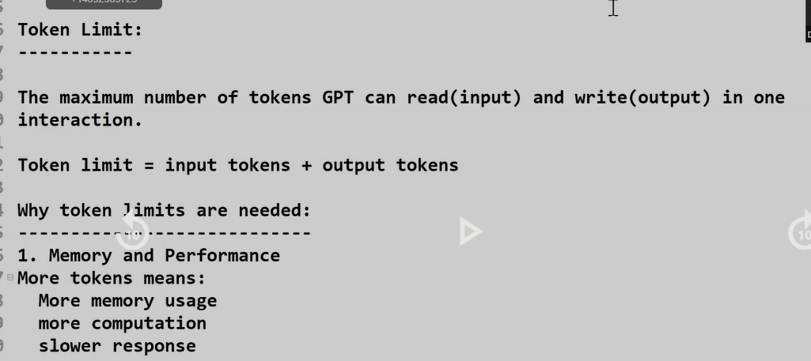

> **Token Limit:** The maximum number of tokens GPT can **read (input)** and **write (output)** in **one interaction**.
>
> **Token limit = input tokens + output tokens**

Simple ga — okka request lo GPT **chadive tokens** (mee prompt + chat history) + **rase tokens** (answer) — rendu kalipi oka **maximum** undi.

```text
Token limit (example: 8,000 tokens)
┌─────────────────────────────────────────┬──────────────────────┐
│  Input: prompt + chat history  (6,500)  │  Output: answer (1,500) │
└─────────────────────────────────────────┴──────────────────────┘
  Input ekkuva aithe → answer ki takkuva space migiluthundi
```

> **Chinna note:** Chat lo prathi message ki **full chat history malli** pamputharu (Section 7.1) — kabatti chat podavu ayye koddi
> **input tokens perugutu** untayi. Konni APIs lo **output ki separate max limit** kuda untundi (ex: answer max 4K–16K tokens).

#### Why token limits are needed?

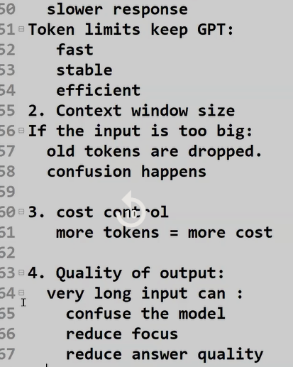

**1. Memory and Performance**

> More tokens means: more memory usage, more computation, slower response.
> Token limits keep GPT: **fast, stable, efficient**.

- Attention lo prathi token **migatha anni tokens** tho score calculate chestundi (Section 4.1.1) — 1,000 tokens → ~10 lakh scores, 10,000 tokens → ~10 **crore** scores!
  Tokens **double** aithe attention pani dadapu **4 times** perugutundi.
- KV cache (Section 4.4) kuda prathi token ki **GPU memory** theeskuntundi (Section 4.5).
- Limit lekapothe — okka user 10 lakh tokens pampi **GPU motham** aakraminchukovachu → andariki slow.

**2. Context Window size**

> If the input is too big: **old tokens are dropped**, **confusion happens**.

- Limit daatithe **paata messages** cut avutayi — model ki ika kanipinchavu (Section 7.6 — whiteboard example).
- Ex: chat modatlo *"naa peru Sai, Telugu lo cheppu"* annaru — 500 messages tarvata adi drop ayyi, model English lo matladochu, peru marchipovachu → **confusion**.

**3. Cost control**

> **More tokens = more cost.**

- API lo **per token** charge chestaru — **input tokens** ki oka rate, **output tokens** ki inko rate (sadharanam ga output **ekkuva costly**).
- Peddha PDF motham prathi saari pampithe → prathi request ki **bill perugutundi**.

**4. Quality of output**

> Very long input can: **confuse the model**, **reduce focus**, **reduce answer quality**.

- Chala peddha input lo important point **madhyalo daagipothe** model miss avvochu (researchers deenni **"lost in the middle"** antaru).
- Attention **anni tokens madhya divide** avutundi — unnecessary text ekkuva unte important words ki **focus taggutundi**.

| # | Reason | Oka line lo |
|---|---|---|
| 1 | Memory & Performance | Ekkuva tokens = ekkuva GPU memory + compute + slow |
| 2 | Context window size | Limit daatithe paata tokens drop → confusion |
| 3 | Cost control | Ekkuva tokens = ekkuva bill |
| 4 | Quality of output | Chala long input → focus taggi answer quality taggutundi |

#### How to use GPTs smartly with Token Limits

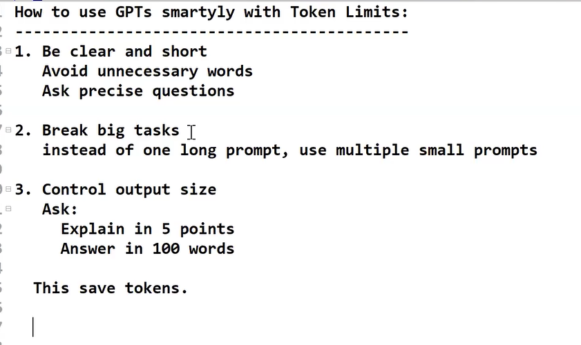

**1. Be clear and short**

> Avoid unnecessary words. Ask precise questions.

| ❌ Long | ✅ Short & clear |
|---|---|
| *"Hi, how are you? I hope you are doing well. I have a small doubt, actually I was reading about Python and I wanted to know, if it's not a problem, can you please tell me what is a list?"* | *"Python list ante enti? oka example tho cheppu"* |
| ~50 tokens | ~12 tokens |

(Token counts approximate.)

**2. Break big tasks**

> Instead of one long prompt, use **multiple small prompts**.

```text
❌ Okka huge prompt:  "Full e-commerce website code rayi — login, cart, payment, admin panel anni"
                      → answer madhyalo cut avvochu, quality takkuva

✅ Small prompts:     1. "Login page code rayi"
                      2. "Ippudu cart feature add chey"
                      3. "Payment integration explain chey"
                      → prathi answer focused, complete
```

**3. Control output size**

> Ask: **"Explain in 5 points"**, **"Answer in 100 words"**.
> **This saves tokens.**

- Output length cheppakapothe GPT **podavu** answer rayochu — output tokens ekkuva = ekkuva cost + time.
- *"5 points lo"*, *"100 words lo"*, *"oka table lo"* ani cheppithe — **short, focused** answer + **tokens save**.

**Inka konni smart tips (slide ki extra):**

| Tip | Enduku |
|---|---|
| **Topic maarithe kotha chat** | Paata chat history prathi message tho malli velthundi — kotha topic ki kotha chat → input tokens takkuva, confusion takkuva |
| **Peddha document lo avasaram unna part matrame** | Motham PDF kaakunda relevant section matrame paste cheyyandi (ide **RAG** idea — relevant chunks matrame pampadam) |
| **Long chat ki summary** | *"Ippati varaku matladindi 5 points lo summarize chey"* → aa summary tho kotha chat start |

> **Oka line lo:** **Token limit = input + output tokens** okka interaction lo maximum. Enduku ante — **memory/speed, context window,
> cost, quality**. Smart ga vaadali ante — **clear & short** ga adugu, **peddha tasks break** chey, **output size control** chey.

#### Why tokens cost money? (Durga Sir)

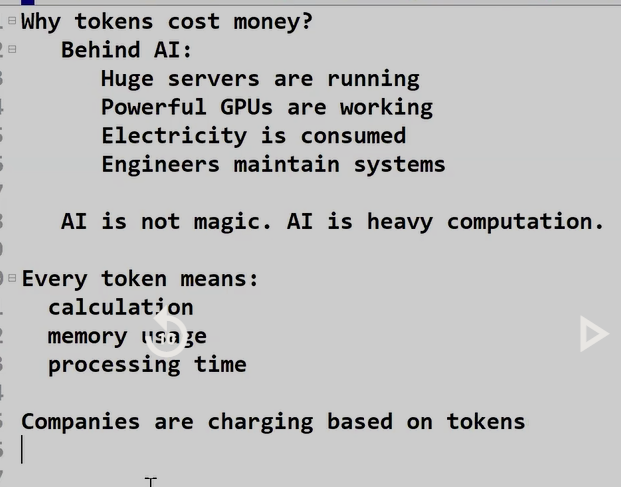

> **Behind AI:**
> - Huge servers are running
> - Powerful GPUs are working
> - Electricity is consumed
> - Engineers maintain systems
>
> **AI is not magic. AI is heavy computation.**

Manam ChatGPT lo type chesi answer chustam — chala simple ga anipistundi. Kaani **venaka** jarigedi:

| Behind AI | Tenglish meaning |
|---|---|
| **Huge servers** | Pedda pedda **data centers** — velalla computers 24×7 run avutu untayi |
| **Powerful GPUs** | Prathi answer ki GPUs (Section 4.5) billions of calculations chestayi — okka high-end AI GPU dhara **lakshallo** untundi |
| **Electricity** | GPUs + cooling (AC) ki **chala current** — konni data centers oka chinna town antha power vaadutayi |
| **Engineers** | Systems ni build, update, fix chese teams — vaallaki salaries |

> **AI is not magic** — prathi answer venaka **real hardware + real current + real manushulu** unnaru. Andhuke free kaadu.

**Every token means:**

> - Calculation
> - Memory usage
> - Processing time
>
> **Companies are charging based on tokens.**

| Every token = | Ela | Ee file lo ekkada chusam |
|---|---|---|
| **Calculation** | Prathi token ki embedding, attention, feed forward, linear, softmax — **anni layers** run avvali | Section 4.3 (GPT pipeline), 4.6 |
| **Memory usage** | Prathi token ki **KV cache** lo GPU memory | Section 4.4, 4.5 |
| **Processing time** | Output prathi token ki decoder **malli run** (red loop) — 500 token answer = 500 runs | Section 4.6 (red loop) |

Andhuke companies **per token** charge chestaru — ekkuva tokens = ekkuva GPU pani = ekkuva kharchu.

**Ela charge chestaru? (API pricing idea)**

```text
Bill = (input tokens × input rate) + (output tokens × output rate)

Example (ardham kosam — nijam rates model batti, time batti maarutayi):
  Input rate  = ₹X per 1 million tokens
  Output rate = sadharanam ga input kanna 3–5 times ekkuva
```

**Output tokens enduku ekkuva costly?**

```text
Input (prompt)  → anni tokens OKE SAARI parallel ga process (prefill — Section 4.4) → GPU efficient ✅
Output (answer) → OKKO token, OKKO run (red loop)                                    → GPU ekkuva time ⏳
```

Input 1,000 tokens — okka forward pass lo ayipotundi. Output 1,000 tokens — **1,000 forward passes**. Andhuke output ki rate ekkuva.

**ChatGPT free version kuda undi kada?** — Free plan lo company kharchu **bharistundi** (limits tho — konni messages, chinna model).
Paid plans / API lo **meeru** token prakaram pay chestaru. Andhuke paina chusina **token-saving tips** (clear & short, output control) money kuda save chestayi.

> **Oka line lo:** AI **magic kaadu — heavy computation**. Prathi token ki **calculation + memory + time** kharchu avutundi
> (servers, GPUs, current, engineers). Andhuke companies **tokens batti** charge chestaru — output tokens inka ekkuva costly.

### 7.3 Hallucination — enduku jarugutundi

Model **facts lookup cheyyadu**. Adi *statistically likely* word ni select
chestundi. Andhuke adi **chala confident ga tappu** cheppagaladu.

```text
Meeru: "2019 lo XYZ case verdict enti?"
Model: "XYZ vs State lo court ila judgment ichindi..."  <-- idi fully kalpitham kaavachu
```

Enduku? Endukante model ki aa case teliyakapoyina, *"aa type question ki
answer ila untundi"* ani adi nerchukundi. Aa shape lo text generate chestundi.

#### Class notes — Hallucination in AI (Durga Sir)

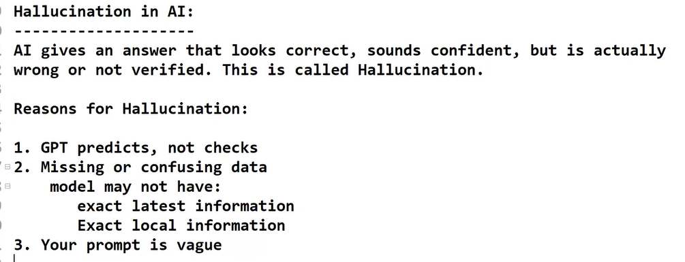

> **Hallucination in AI:** AI gives an answer that **looks correct, sounds confident**, but is actually **wrong or not verified**.
> This is called Hallucination.

Simple ga — AI answer **chudataniki correct ga**, **confident ga** untundi, kaani nijam ga **tappu** leda **check cheyyani** info.
Manishi *"naaku teliyadu"* anakunda **confident ga kalpinchi** cheppinattu.

**Real life example:** Exam lo answer teliyani student — blank vadalakunda, **confident ga, neat ga, points tho** edo rastadu.
Chudataniki correct answer laage untundi — kaani content tappu. AI kuda ade.

#### Reasons for Hallucination

| # | Reason | Tenglish meaning | Example |
|---|---|---|---|
| 1 | **GPT predicts, not checks** | Model **next token predict** chestundi — facts ni **database lo check cheyyadu**. "Correct aa?" ani verify chese step ledu | *"Telangana lo 2025 best hospital?"* → oka peru confident ga cheppestundi |
| 2 | **Missing or confusing data** | Model daggara info **ledu** leda **gandaragolam** ga undi | (kinda chudandi) |
| 3 | **Your prompt is vague** | Question **clear ga lekapothe** model **guess** chestundi | *"Tell about java"* — ye topic? ye level? |

**Reason 2 — model ki em undakapovachu:**

| Missing | Enduku | Example |
|---|---|---|
| **Exact latest information** | Model **training cutoff** varake chadivindi — tarvata jarigindi teliyadu (Section 7.6 — training knowledge) | *"Ivvala gold rate entha?"* → paata number leda kalpitham |
| **Exact local information** | Mee **ooru, mee company, mee college** gurinchi training data lo takkuva / ledu | *"Maa village lo bus timings?"* → edo timings cheppestundi |

Reason 1 ki connection — **model eppudu edo oka next token istundi** (softmax lo anni words ki probability untundi).
"Naaku teliyadu" ani cheppadam **nerchukokapothe**, teliyani chota kuda **likely-sounding** words ne generate chestundi.
Weather example lo chusam — model ki ivvala weather teliyakapoyina `Rain` ani cheppindi.

#### How to reduce Hallucination

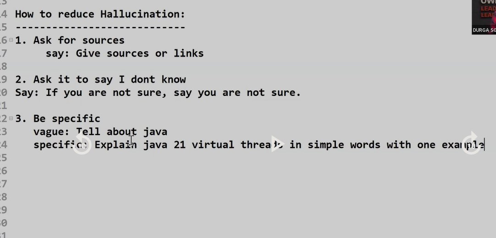

**1. Ask for sources**

> Say: **"Give sources or links."**

- Sources adigithe — model ki **evidence tho** cheppali ani signal; meeru kuda **links open chesi verify** cheyyochu.
- ⚠️ **Jagratha:** Model **fake links / fake references** kuda create cheyyagaladu (adi kuda hallucination!).
  Andhuke links **open chesi check** cheyyandi. Web search unna tools (ChatGPT search, Perplexity) ayithe real sources vastayi.

**2. Ask it to say "I don't know"**

> Say: **"If you are not sure, say you are not sure."**

- Default ga model **edo answer ivvalani** try chestundi. Ee line add chesthe *"teliyakapothe teliyadu ani cheppu"* ani **permission** isthunnam.
- Model **guess** cheyyakunda **honest** ga cheppe chance perugutundi.

**3. Be specific**

> Vague: **"Tell about java"**
> Specific: **"Explain java 21 virtual threads in simple words with one example"**

| | Vague prompt | Specific prompt |
|---|---|---|
| Prompt | Tell about java | Explain java 21 virtual threads in simple words with one example |
| Topic | ❓ Java history? syntax? island? coffee? | ✅ Java 21 → virtual threads |
| Level | ❓ | ✅ Simple words |
| Format | ❓ | ✅ One example |
| Result | Model **guess** chesi edo general ga rastundi | Clear target — **correct, useful** answer |

Specific ga adigithe model ki **guess cheyyalsina space** taggutundi → hallucination taggutundi.

**Inka konni ways (slide ki extra):**

| Way | Ela help chestundi |
|---|---|
| **Context / documents ivvandi** | *"Ee PDF base chesukoni answer ivvu"* — model **mee data** nundi cheptundi, guess kaadu. Ide **RAG** (RAG folder lo chusam) |
| **Web search / tools** | Latest info (gold rate, weather, news) ki search tool unna AI vaadandi — **live data** theeskuntundi |
| **Low temperature** | Facts kavali ante temperature takkuva (Section 7.4) — random words takkuva |
| **Cross-check** | Important vishayalu (medical, legal, money) — **eppudu verify** cheyyandi, AI answer final kaadu |

> **Oka line lo:** Hallucination = **confident ga cheppina tappu answer**. Enduku ante GPT **predict chestundi, check cheyyadu**,
> latest / local info ledu, leda question vague. Taggiinchadaniki — **sources adugu**, **"teliyakapothe teliyadu cheppu"** ani cheppu,
> **specific ga adugu** — and important answers **eppudu verify** chey.

### 7.4 Temperature — same prompt, different answers

Highest probability token **eppudu** select cheyyakunda, kondaru saarlu 2nd/3rd
option select cheyyadaniki **temperature** setting undi.

| Temperature | Em jarugutundi | Eppudu vaadali |
|---|---|---|
| `0` | Eppudu highest probability ne — same prompt ki same answer | Code, facts, extraction |
| `0.7` | Konchem variety — natural ga untundi | Chat, general use |
| `1.5` | Chala random — creative kaani tappulu ekkuva | Story, brainstorming |

#### Class example — Probability tho word select cheyyadam (`random.choices`)

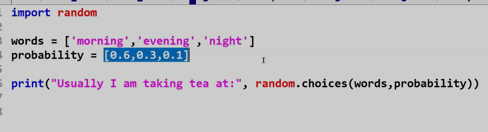

Model next word ni **probability prakaram** ela select chestundo — Durga Sir chinna Python example tho chupincharu:

```python
# ---------------- Architecture Diagram ----------------
# [words list]  +  [probability list]
#    ↓
# [random.choices()]  → probability batti okka word random ga pick
#    ↓
# [Selected word]  → "morning" ekkuva saarlu, "night" chala takkuva saarlu
#
# ---------------- Deep Architecture Notes ----------------
# Step 1: options (words) ready chestam — model vocabulary laaga
# Step 2: prathi word ki probability istham — softmax output laaga
# Step 3: random.choices() aa probabilities prakaram okka word ni pick chestundi
# Step 4: prathi saari run chesthe answer maaravachu — highest eppudu raadu, kaani ekkuva saarlu vastundi

import random                                        # Python built-in random module — random selection kosam

words = ['morning', 'evening', 'night']              # options — model vocabulary lo konni words laaga
probability = [0.6, 0.3, 0.1]                        # prathi word ki chance — morning 60%, evening 30%, night 10%

print("Usually I am taking tea at:", random.choices(words, probability))   # probability batti okka word pick chesi print
```

**Output (prathi run lo maaravachu):**

```text
Usually I am taking tea at: ['morning']     ← ekkuva saarlu idi (60%)
Usually I am taking tea at: ['evening']     ← appudappudu (30%)
Usually I am taking tea at: ['night']       ← chala arudu ga (10%)
```

##### Line by line

| Line | Em chestundi |
|---|---|
| `import random` | Python lo random selection kosam built-in module |
| `words = [...]` | Select cheyyalsina **options** — model lo **vocabulary** laaga |
| `probability = [0.6, 0.3, 0.1]` | Prathi option ki **chance** — model lo **softmax output** laaga (motham = 1.0) |
| `random.choices(words, probability)` | Probabilities prakaram **okka word random ga pick** chestundi — 2nd argument **weights** |

##### Ardham — 10 saarlu run chesthe?

```text
Run:     1        2        3        4        5        6        7        8        9        10
Pick:  morning  morning  evening  morning  night   morning  evening  morning  morning  evening
```

Sumaru **6 saarlu morning, 3 saarlu evening, 1 saari night** — probability ki daggaraga (prathi saari exact ga 6-3-1 raadu, random kabatti).

- **Morning** highest probability — **ekkuva saarlu** vastundi, kaani **eppudu kaadu**.
- **Night** probability takkuva — kaani **0 kaadu**, kabatti appudappudu vastundi.

##### Idi LLM ki ela connect avutundi?

Ide exactly ChatGPT next word select chese vidhanam:

```text
Prompt: "Usually I am taking tea at"
   ↓
Transformer → Linear → Softmax
   ↓
Probabilities:   morning: 0.6    evening: 0.3    night: 0.1     ← mana `probability` list
   ↓
Sampling (random.choices laaga)  → "morning" (ekkuva saarlu), kondari saarlu "evening"
```

| Selection type | Ela | Mana example lo |
|---|---|---|
| **Greedy** (temperature = 0) | Eppudu **highest** probability | Eppudu `morning` — same answer prathi saari |
| **Sampling** (`random.choices` laaga) | Probability **batti random** ga | Ekkuva saarlu `morning`, appudappudu `evening`, `night` |

Andhuke **same prompt ki ChatGPT veru veru answers** istundi — sampling valla.

**Temperature** ee probabilities ni maarchutundi (sampling cheyyadaniki mundu):

```text
Low temperature (0.2):   morning: 0.97   evening: 0.03   night: 0.00   → dadapu eppudu morning (safe)
Normal (1.0):            morning: 0.6    evening: 0.3    night: 0.1    → mana example
High temperature (2.0):  morning: 0.47   evening: 0.33   night: 0.20   → anni daggaraga — chala random
```

(Temperature T tho: prathi probability ni `p^(1/T)` chesi malli total 1.0 ki normalize chestaru — numbers rounded.)

##### Chinna Python notes

- `random.choices()` **list** return chestundi (`['morning']`) — andhuke output lo brackets. Word matrame kavali ante `random.choices(words, probability)[0]`.
- 2nd argument **weights** — clear ga rayali ante `random.choices(words, weights=probability)`.
- Weights sum **1.0 avvakkarledu** — `[6, 3, 1]` ichhina same result (ratio matrame important).
- Okkasari ekkuva picks kavali ante `k` — `random.choices(words, probability, k=10)` → 10 words list.

> **Oka line lo:** `random.choices(words, probability)` = **LLM sampling chinna version** — highest probability word ekkuva saarlu vastundi,
> kaani takkuva probability words kuda appudappudu vastayi. Andhuke ChatGPT same prompt ki veru veru answers istundi.

### 7.5 Oke pani, kaani anni panulu

Translation, summary, code — ivi anni **separate features kaavu**.
Anni **next token prediction** ne. Meeru prompt ela istharo, aa prakaram
likely continuation marutundi.

```text
"Translate to Telugu: Hello"  --> next likely tokens: "Namaskaram"
"Summarize: <long text>"      --> next likely tokens: short summary
"def add(a, b):"              --> next likely tokens: "    return a + b"
```

### 7.6 How GPT remembers things — 2 types of memory (Durga Sir class)

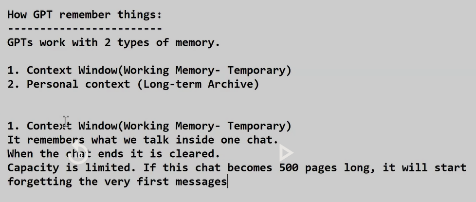

> **GPTs work with 2 types of memory.**
> 1. **Context Window** (Working Memory — Temporary)
> 2. **Personal Context** (Long-term Archive)

Section 7.1 lo chusam — **model ki sontha memory ledu**. Mari ChatGPT mana peru, mana matalu ela gurthu pettukuntundi?
Ee **2 types of memory** valla.

#### Mundu konni technical words — simple meanings

| Word | Simple meaning |
|---|---|
| **Context window** | Model **okkasari** chudagalige tokens limit — current chat antha ikkade |
| **Working memory** | Ippudu pani chestunnappudu matrame gurthu unde memory (mana brain lo short-term laaga) |
| **Temporary** | Konchem sepu matrame — tarvata pothundi |
| **Personal context / Memory** | User gurinchi important details ni **chats bayata save** chese feature |
| **Long-term archive** | Chala kaalam unde storage — kotha chat lo kuda dorukutundi |
| **Truncate** | Limit daatithe **paata messages ni kattirinchadam** (cut) |

#### 1. Context Window (Working Memory — Temporary)

> It remembers what we talk **inside one chat**.
> When the chat ends **it is cleared**.
> **Capacity is limited.** If this chat becomes 500 pages long, it will start **forgetting the very first messages**.

| Slide line | Tenglish meaning |
|---|---|
| Remembers what we talk inside one chat | **Ee chat** lo matladindi matrame gurthu — Section 7.1 lo chusinattu, prathi message ki **full chat history** malli pamputharu |
| When the chat ends it is cleared | **Kotha chat** open chesthe — paata chat lo matalu model ki **kanipinchavu** (paata chat history app lo save untundi, kaani kotha chat context lo ki raadu) |
| Capacity is limited | Context window ki **token limit** undi (Section 7.2 — GPT-4o ~128K, Claude ~200K tokens) |
| 500 pages aithe first messages marchipotundi | Limit daatithe **modati messages** context nundi bayataki — model ki ika kanipinchavu |

**Real life example — Whiteboard 🧑‍🏫:**

```text
Class lo board meeda rastu potharu  →  board nindipothe  →  paina rasinadi cheripesi kotha daaniki space
Class ayipogane                     →  board motham clean
```

Context window ade — **board size limited**, nindithe **paatadi cheripotundi**, chat ayipothe **clean**.

```text
Context window (limit anukondi 10 messages):

Msg 1  "Naa peru Sai"           ← ❌ limit daatindi — bayataki (marchipoyindi)
Msg 2  ...                      ← ❌
Msg 3  ...                      ┐
...                             │  ✅ ivi matrame model ki kanipistayi
Msg 12 "Naa peru enti?"         ┘
         → Model: "Sorry, mee peru naaku teliyadu" 😅
```

> **Note:** 500 pages ane number ardham kosam. Nijam limit **tokens** lo — 128K tokens ≈ sumaru **300 pages** text.
> Limit daatinappudu apps sadharanam ga **paata messages cut** chestayi, leda vaatini **chinna summary** ga marchi pedatayi.

#### 2. Personal Context (Long-term Archive)

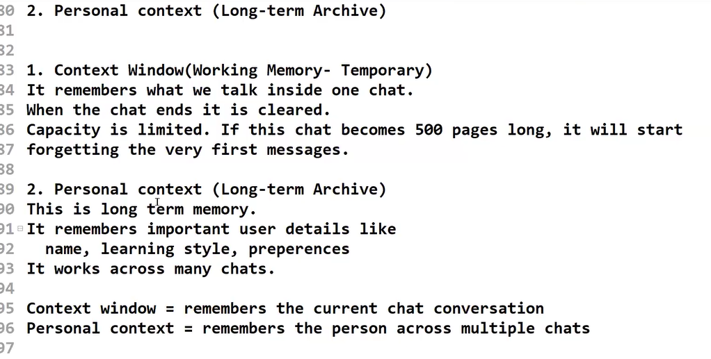

> This is **long term memory**.
> It remembers important user details like **name, learning style, preferences**.
> It works **across many chats**.

| Slide line | Tenglish meaning |
|---|---|
| Long term memory | Chat ayipoyina **pothundi kaadu** — save ayyi untundi |
| Name, learning style, preferences | Ex: *"Naa peru Sai"*, *"Telugu-English mix lo explain chey"*, *"examples tho cheppu"*, *"nenu Python developer"* |
| Works across many chats | **Kotha chat** open chesina — ee details gurthu untayi |

**Real life example — Diary 📔:**

```text
Whiteboard (context window) = class lo rasedi, class ayyaka cheripotharu
Diary (personal context)    = important vishayalu diary lo rasi pettukuntam — eppudaina open chesi chudochu
```

#### Lopala ela pani chestundi? — Model weights maaravu!

Chala important point — **personal context model lopala save avvadu**. Model weights (training lo nerchukunnadi) **maaravu**.
App (ChatGPT) user details ni **separate ga database lo** save chesi, prathi kotha chat lo **context window lo pedutundi**:

```text
1. Old chat:  Meeru: "Naa peru Sai, nenu Telugu-English lo ardham chesukuntanu"
                 ↓  app important details gurthinchi save chestundi
              [Memory database]:  name = Sai,  style = Tenglish

2. New chat (rendu rojula tarvata):
   App background lo prompt ki mundu add chestundi:
   ┌──────────────────────────────────────────────────────┐
   │ [Memory] User name: Sai. Prefers Telugu-English mix.  │  ← personal context
   │ User: "Transformer ante enti?"                         │  ← current chat
   └──────────────────────────────────────────────────────┘
                 ↓  idanta CONTEXT WINDOW lo ki velthundi
   Model: "Sai, Transformer ante..." (Tenglish lo) ✅
```

Ante — **personal context kuda chivariki context window lo ne** model ki velthundi. Model ki "gurthu" ledu —
app **gurthu chesi** prathi saari **pampistundi**. (Idi RAG idea laantide — bayata nundi info theeskochi prompt lo pettadam.)

#### Context Window vs Personal Context — side by side

| | **Context Window** | **Personal Context** |
|---|---|---|
| Type | Working memory — **temporary** | Long-term **archive** |
| Em gurthu pettukuntundi | **Current chat** conversation motham | User gurinchi **important details** (name, style, preferences) |
| Entha kaalam | **Ee chat** varake — chat ayithe clear | **Chala chats** — delete chese varaku |
| Size | Limited (tokens) — nindithe paatadi pothundi | Chinna — konni important points matrame |
| Ekkada untundi | Prathi request lo model ki pampe text | App database lo — kotha chat lo context window ki add |
| Real life | Whiteboard 🧑‍🏫 | Diary 📔 |

> **Class note:**
> **Context window = remembers the current chat conversation.**
> **Personal context = remembers the person across multiple chats.**

#### Bonus — 3rd type: Training knowledge (model weights)

Slide lo 2 types — kaani ardham avvadaniki inkokati telusukovali:

| Memory | Em untundi | Maarutunda? |
|---|---|---|
| **Training knowledge** (weights) | Training lo chadivina general knowledge — *"Hyderabad Telangana capital"*, grammar, facts | ❌ Chat lo maaradu — **kotha training** tho matrame |
| **Context window** | Ee chat | ✅ Prathi message tho |
| **Personal context** | Mee details | ✅ App save/update chestundi |

Andhuke model ki **training cutoff** tarvata jarigina vishayalu teliyavu (weights lo levu), kaani **mee peru** gurthu untundi (personal context lo undi).

> **Oka line lo:** GPT ki 2 memories — **context window** (ee chat, temporary, limited — whiteboard laaga) and
> **personal context** (mee details, chats bayata kuda — diary laaga). Rendu chivariki **context window lo ne** model ki velthayi —
> model weights maaravu.

### 7.7 GPT Strengths — GPT edi baga chestundi? (Durga Sir class)

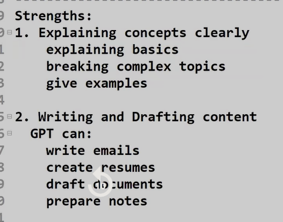

Section 7.3 lo GPT **weakness** (hallucination) chusam. Ippudu GPT **strengths** — ye panulaki GPT ni confident ga vaadochu.

#### 1. Explaining concepts clearly

> - Explaining basics
> - Breaking complex topics
> - Give examples

| Strength | Tenglish meaning | Example prompt |
|---|---|---|
| **Explaining basics** | Kotha topic ni **zero nundi** simple ga cheppadam | *"Transformer ante enti? beginner ki cheppu"* |
| **Breaking complex topics** | Kashtamaina topic ni **chinna chinna steps** ga vidagottadam | *"Attention ni step by step explain chey"* |
| **Give examples** | Concept ki **real life / code examples** ivvadam | *"Positional encoding ki oka daily life example ivvu"* |

**Enduku idi baga vastundi?** — Training lo GPT **koti koti explanations** chadivindi — textbooks, tutorials, blogs, Q&A sites.
Kabatti *"ee concept ni ela explain cheyyali"* ane **pattern** baga nerchukundi. Ee notes file lo chala explanations kuda ilaage tayaru ayyayi!

> **Tip:** *"Explain like I'm a beginner"*, *"Telugu-English mix lo"*, *"oka example tho"* ani adigithe inka better.
> Kaani **facts / numbers** unte (dates, prices, versions) — verify cheyyandi (Section 7.3).

#### 2. Writing and Drafting content

> GPT can:
> - Write emails
> - Create resumes
> - Draft documents
> - Prepare notes

| Pani | Example prompt | Meeru em check cheyyali |
|---|---|---|
| **Write emails** | *"Manager ki 2 days leave kosam polite email rayi"* | Dates, names correct aa? tone okay aa? |
| **Create resumes** | *"3 years Python experience ki resume points rayi"* | **Mee nijam experience** matrame undali — GPT kalpinchina skills teeseyandi |
| **Draft documents** | *"Project proposal ki outline + first draft ivvu"* | Company specific details meere add cheyyali |
| **Prepare notes** | *"Ee class transcript nundi short notes chey"* | Important points miss ayyayemo chudandi |

**Enduku idi baga vastundi?** — GPT **next token prediction** lo expert — **fluent, grammar correct, structured** text rayadam daani asalu pani.
Blank page nundi start cheyyakunda **first draft** fast ga vastundi — meeru **edit + improve** chesthe chalu.

> **Golden rule:** GPT = **first draft writer**, meeru = **final editor**.
> Draft fast ga vastundi, kaani **facts, names, numbers, personal details** meere check chesi send cheyyali.

#### Strengths vs Weaknesses — quick view

| ✅ GPT baga chestundi (strengths) | ⚠️ Jagratha (weaknesses — Section 7.3) |
|---|---|
| Concepts explain cheyyadam | Latest info (training cutoff tarvata) |
| Complex topics break cheyyadam | Local / company specific info |
| Examples ivvadam | Exact facts, numbers, links (verify!) |
| Emails, resumes, documents, notes draft | Confident ga tappu cheppadam (hallucination) |

> **Oka line lo:** GPT **explain cheyyadam** (basics, complex topics, examples) lo and **rayadam** (emails, resumes, documents, notes) lo strong —
> endukante training lo koti koti explanations, documents chadivindi. Kaani **first draft** ga vaadandi — facts meere verify cheyyandi.

### 7.8 GPT Limitations — GPT ki em raadu? (Durga Sir class)

Strengths chusam (7.7). Ippudu **limitations** — ivi telisthe GPT ni **safe ga, correct ga** vaadagalam.

#### 1. No real understanding or emotions

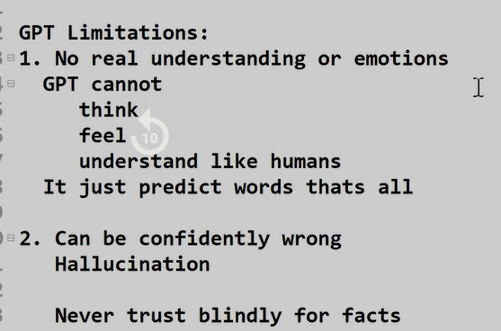

> GPT cannot **think**, **feel**, **understand like humans**.
> **It just predicts words — that's all.**

| GPT cannot | Tenglish meaning | Example |
|---|---|---|
| **Think** | Manishi laaga sontha ga alochinchi, nammakalu, goals pettukoledu | *"Nuvvu em anukuntunnav?"* ki answer kuda **next token prediction** ne |
| **Feel** | Santosham, badha, kopam — **emotions levu** | *"I'm sorry to hear that"* ani rasina — adi **feel avvadu**, training lo nerchukunna polite pattern |
| **Understand like humans** | Manam **anubhavam (experience)** tho ardham chesukuntam — GPT ki body, life experience ledu | "Tea taste" gurinchi rayagaladu, kaani **eppudu taagaledu** |

**It just predicts words** — ee motham file lo chusindi ide: tokens → transformer → softmax → **next token**. Antey.
Answer chala intelligent ga anipinchina — lopala jarigedi **probability tho next word guess**.

> **Chinna note:** GPT reasoning laaga kanipinche panulu (maths steps, code logic) chestundi — patterns valla.
> Adi "nijam understanding" aa kaada ani researchers lo ippatiki debate undi. Kaani **emotions levu, manishi laaga experience ledu** — idi clear.
> Andhuke GPT ni **friend / doctor / therapist** laaga full ga nammakandi.

#### 2. Can be confidently wrong — Hallucination

> **Hallucination.**
> **Never trust blindly for facts.**

- Section 7.3 lo detailed ga chusam — **confident ga, correct laaga, kaani tappu**.
- **Facts** (dates, numbers, names, laws, medicines) — **eppudu verify** cheyyandi.
- Confident tone ≠ correct answer. GPT tappu cheppetappudu kuda **same confidence** tho cheptundi.

#### 3. No real-time awareness

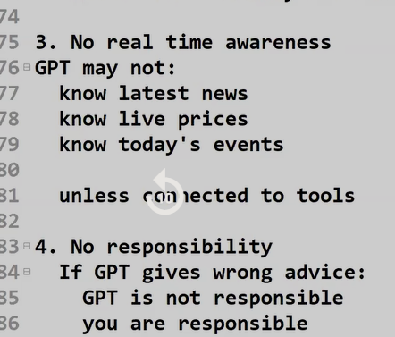

> GPT may not:
> - know **latest news**
> - know **live prices**
> - know **today's events**
>
> **…unless connected to tools.**

| Teliyakapovachu | Enduku | Example |
|---|---|---|
| **Latest news** | Model **training cutoff** varake chadivindi — tarvata vishayalu weights lo levu (Section 7.6) | *"Ninna match lo evaru gelicharu?"* |
| **Live prices** | Prices prathi nimisham maarutayi — model lo **fixed** numbers matrame | *"Ippudu gold / Bitcoin / stock rate?"* |
| **Today's events** | Model ki **ivvala date** kuda teliyakapovachu (app cheppakapothe) | *"Ivvala Hyderabad lo traffic ela undi?"* |

**"Unless connected to tools"** ante?

```text
Tools LEKUNDA:   "Gold rate?"  → model weights nundi paata / kalpitha number ❌
Tools THO:       "Gold rate?"  → app web search / price API call → live number theeskochi
                                → context window lo pedutundi → model answer ✅
```

ChatGPT search, Perplexity, weather / stock APIs — ivi **tools**. Model ki live data **bayata nundi** theeskochi istayi
(Section 7.6 lo personal context laage — anni chivariki **context window** lo ne).
Weather example lo (`Rain is heavy`) — tools lekapothe model ki nijam weather teliyadu ani chusam.

#### 4. No responsibility

> If GPT gives wrong advice:
> - **GPT is not responsible**
> - **You are responsible**

- GPT tappu salaha isthe — daani **consequences meeve**. GPT ki **accountability ledu** (adi oka tool, manishi kaadu).
- Ex: GPT cheppina medicine dose, legal advice, investment tip, code ni production lo test cheyyakunda pettadam — problem vasthe **meere** responsible.

| Area | GPT ni ela vaadali |
|---|---|
| **Medical** 🏥 | Information kosam okay — **decision doctor tho** |
| **Legal** ⚖️ | Basics ardham kosam — final ga **lawyer** |
| **Money / Investment** 💰 | Concepts nerchukovadaniki — real decisions **mee research + expert** |
| **Code** 💻 | Draft ga — **test chesi, review chesi** use cheyyandi |
| **Office emails / documents** 📧 | Draft ga — **chadivi, correct chesi** send cheyyandi |

> **Golden rule (malli):** GPT = **assistant**, meeru = **decision maker**. Final call, final responsibility — **meede**.

#### Limitations — quick view

| # | Limitation | Gurthu pettukovalsindi |
|---|---|---|
| 1 | No real understanding or emotions | Words predict chestundi — think / feel cheyyadu |
| 2 | Confidently wrong (hallucination) | Facts ni **blindly nammakandi** |
| 3 | No real-time awareness | Latest news / prices / events — **tools** unte matrame |
| 4 | No responsibility | Tappu salaha ki **meere** responsible |

> **Oka line lo:** GPT **words predict chese tool** — emotions levu, confident ga tappu cheppagaladu, live info teliyadu (tools lekapothe),
> and daani salaha ki **responsibility meede**. Strengths (7.7) kosam vaadandi, limitations (7.8) gurthu pettukoni verify cheyyandi.

---

## 8. Summary

Oke line lo: **Transformer ante — ippati varaku unna tokens chusi, next token
enti ani probability tho guess chese machine.** Antey, inkem ledu.

Gurthu pettukondi:

1. **Text -> tokens -> numbers.** Model ki letters teliyavu, numbers matrame.
   Generate ayyedi kuda **token**, word kaadu — `unbelievable` = 3 separate steps.
2. **Self-attention** valla prathi word, migatha anni words ni oke saari chustundi — andhuke context ardham chesukuntundi.
3. **Softmax** vocabulary motham ki probabilities istundi, highest unna token select avutundi.
4. **Loop:** output ni input ki add chesi malli run — idi **autoregressive** generation. Andhuke ChatGPT **token-by-token** type chestundi (word-by-word **kaadu**).
5. **`<END>` token** vachinappudu aagipotundi.
6. Model ki **memory ledu**, **facts lookup cheyyadu** — andhuke hallucinate chestundi.

Board meeda unna aa chinna picture — left lo peruguthunna input list, madhyalo box,
right lo oka word — **ade motham LLM technology.** Migatha antha ee oke idea
meeda build ayina layers matrame.
